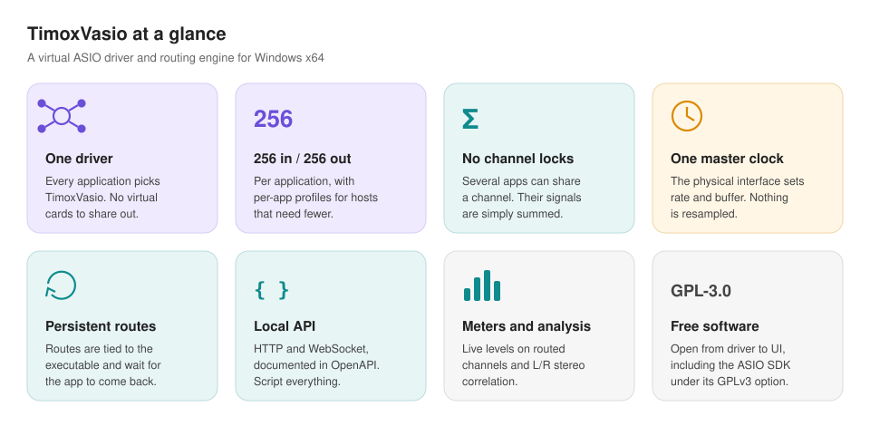
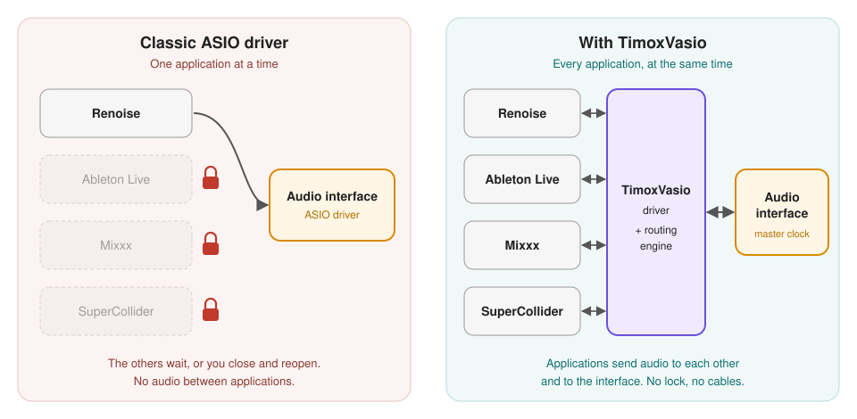
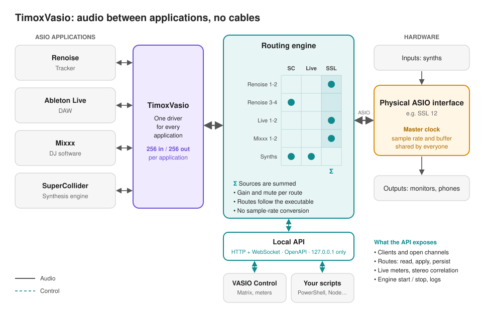

# TimoxVasio

[Français](README.md) | **English**

Virtual ASIO driver and audio routing engine for Windows x64.

TimoxVasio moves audio between several ASIO applications, and to a physical audio interface, without cables or a mixing desk. Routes are set up from a graphical interface or through a local API.

Current release: **[1.2.1](https://github.com/timox/TimoxVasio/releases/tag/v1.2.1)**. See the [release notes](docs/RELEASE_NOTES_v1.2.1.en.md) and [Windows downloads guide](docs/RELEASE_WINDOWS_1.2.1.en.md).

<picture>
  <source media="(prefers-color-scheme: dark)" srcset="docs/images/timoxvasio-features-en-dark.svg">
  
</picture>

## Why

A classic ASIO driver serves one application at a time, and applications cannot send audio to each other. TimoxVasio sits between the applications and the interface: they all open it at the same time, and the engine connects them to each other and to the interface.

<picture>
  <source media="(prefers-color-scheme: dark)" srcset="docs/images/timoxvasio-before-after-en-dark.svg">
  
</picture>

## What it does

- **One driver for every application.** No set of virtual cards to share out: each application selects TimoxVasio and opens the channels it needs.
- **Up to 256 inputs and 256 outputs** per application.
- **No channel locks.** Several applications can open the driver at the same time, even on the same channels. Their signals are then summed.
- **Channel-by-channel routing** between applications, or between an application and the inputs/outputs of a physical ASIO interface, with gain and mute per route.
- **Routes that survive restarts.** A route saved for `renoise.exe` waits for Renoise to reconnect.
- **A local API**, HTTP and WebSocket, documented in OpenAPI, to script everything.

Tested with Renoise, Ableton Live and Mixxx.

## How it works

<picture>
  <source media="(prefers-color-scheme: dark)" srcset="docs/images/timoxvasio-flow-en-dark.svg">
  
</picture>

| Component | Role |
|---|---|
| `TimoxVasio.dll` | The virtual ASIO driver loaded by audio applications. |
| `TimoxVirtualAsioEngine.exe` | The engine that carries the audio and applies the routes. |
| Local API | HTTP and WebSocket on `127.0.0.1`, documented in OpenAPI. The only way to configure the engine. |
| Timox VASIO Control | The Electron interface: physical interface selection, routing matrix and patchbay, meters, stereo correlation, API console, logs. |

The selected physical interface is the master clock: every application uses its sample rate and buffer size. No sample-rate conversion is performed.

## What about alternatives?

Other tools route ASIO audio on Windows, many of them for longer. TimoxVasio mainly stands apart in three ways: it is free software and maintained, it can be fully driven through a documented API, and its routes are tied to applications rather than channel numbers.

| | License | Several ASIO apps | Windows audio (WDM) | External control |
|---|---|---|---|---|
| **TimoxVasio** | GPL-3.0, maintained | Yes, 256 channels per app | No | HTTP/WebSocket API, OpenAPI |
| [VB-Audio Matrix](https://vb-audio.com/Matrix/) | Proprietary, donationware | Yes, 4 virtual drivers (8 to 128 channels) | Yes | MIDI, VBAN |
| [ASIO Link Pro](https://give.academy/downloads/2018/03/) | Free, no longer developed | Yes, multi-client mode | Yes | Graphical interface |
| [Synchronous Audio Router](https://github.com/eiz/SynchronousAudioRouter) | Free software, last release in 2018 | No, a single ASIO host | Yes, that is its purpose | Graphical interface |
| [ReaRoute](https://www.reaper.fm) | Bundled with Reaper | To and from Reaper only | No | Through Reaper |

On the other hand, TimoxVasio does not handle audio from regular Windows applications (browser, video calls, games), carries nothing over the network, and uses a single clock: the physical interface's. VB-Audio Matrix is more complete on those points. These limits are deliberate: one clock and one driver keep routing conversion-free and setup simple.

On Linux, [PipeWire](https://pipewire.org) and [JACK](https://jackaudio.org) have covered this need for a long time.

## Installation

Requirements: Windows 10 or 11 x64, 64-bit ASIO applications, administrator rights and, to output sound, a physical ASIO driver.

1. Download the files from the [latest release](https://github.com/timox/TimoxVasio/releases/latest).
2. **Driver**: extract `TimoxVasio.Driver.<version>.zip` and run `Installer TimoxVasio.bat` as administrator.
3. **Interface and engine**: install `Timox.VASIO.Control.Setup.<version>.exe`, or run the portable version.
4. Start Timox VASIO Control **before** opening TimoxVasio in an audio application, then select the physical interface.

Details and uninstallation: [INSTALL.en.md](INSTALL.en.md).

## Quick start

1. In **Configuration**, choose the physical ASIO driver, the sample rate and the buffer size.
2. In each audio application, select **TimoxVasio** as the ASIO device.
3. In **Channels**, connect application outputs to other applications' inputs or to physical outputs.

Read the state from PowerShell (the port is the one chosen by the engine at startup):

```powershell
Invoke-RestMethod 'http://127.0.0.1:<port>/api/v1/state'
```

The [API quick start](docs/API_QUICKSTART.en.md) has PowerShell and Node.js examples. The full contract is in [API.en.md](API.en.md) and [openapi-v1.json](openapi-v1.json).

## Known limitations

- Windows x64 only; 32-bit, ARM and Windows 7/8 are not validated.
- An application that requires a sample rate or buffer size different from the physical interface's is rejected.
- Signals summed on the same channel can clip the physical output: set route gains accordingly.
- Some hosts cannot represent 256 channels (Mixxx 2.6 is one). A per-application profile lets a given executable see fewer channels. See [the Mixxx compatibility note](docs/mixxx-256-channel-compatibility.en.md).
- ASIO4ALL can be used as the physical driver, but has not been validated.

## Documentation

- [ARCHITECTURE.en.md](ARCHITECTURE.en.md): technical overview
- [BUILD_DRIVERS.en.md](BUILD_DRIVERS.en.md): build and test the components
- [ASIO_CONFORMITE.en.md](ASIO_CONFORMITE.en.md): ASIO SDK conformance
- [docs/ROADMAP.md](docs/ROADMAP.md): planned work

## License

Original code under [GPL-3.0-only](LICENSE). Steinberg's ASIO SDK 2.3.4 is used under its GPLv3 option. Other third-party dependencies keep their own licenses: see [LICENSING.en.md](LICENSING.en.md).

The project can be supported through [GitHub Sponsors](https://github.com/sponsors/timox).
