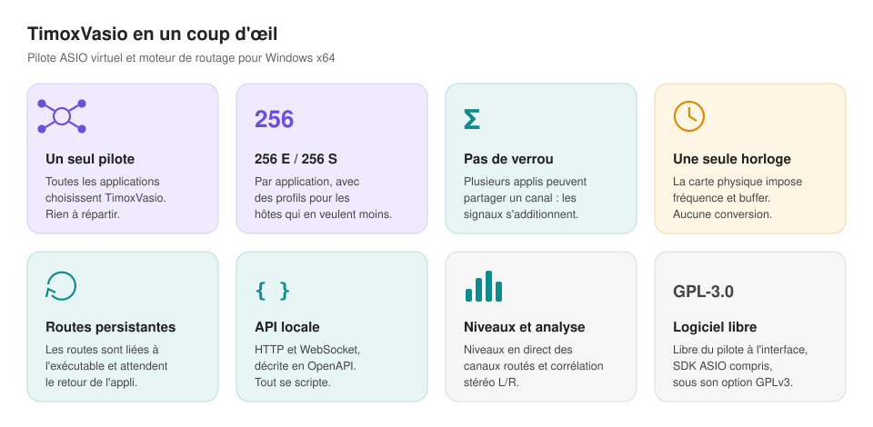
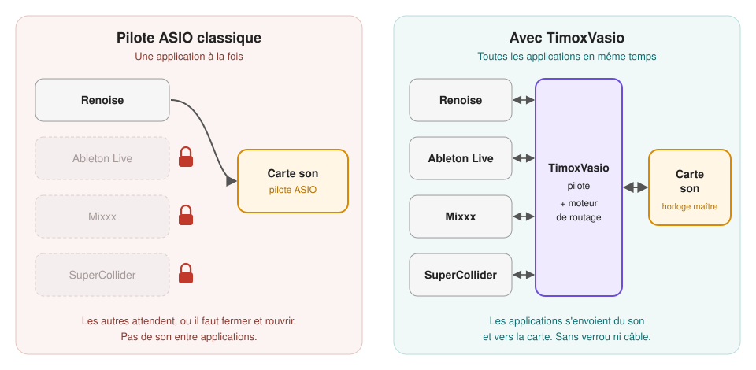
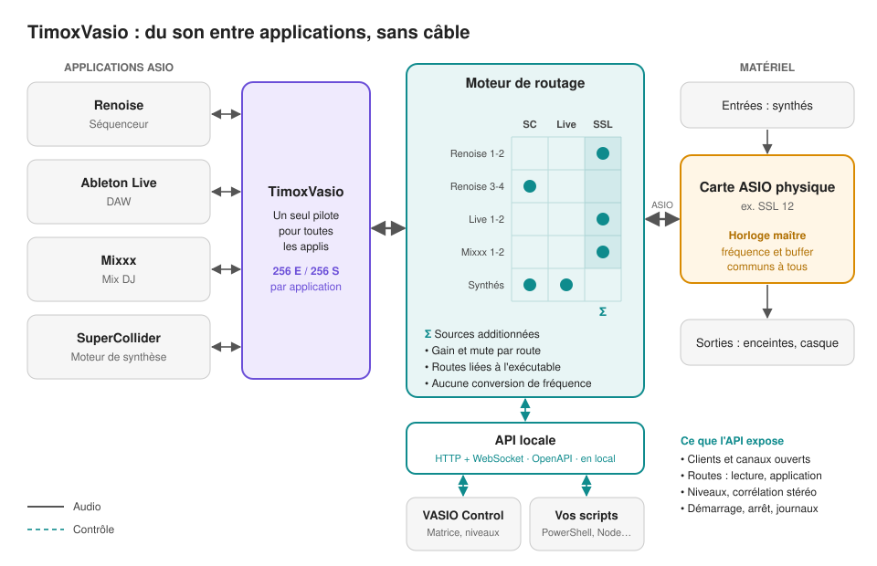

# TimoxVasio

**Français** | [English](README.en.md)

Pilote ASIO virtuel et moteur de routage audio pour Windows x64.

TimoxVasio permet de faire circuler l'audio entre plusieurs applications ASIO, et vers une carte son physique, sans câble ni table de mixage. Les routes se configurent depuis une interface graphique ou par une API locale.

Version actuelle : **[1.2.2](https://github.com/timox/TimoxVasio/releases/tag/v1.2.2)**. Voir les [notes de version](docs/RELEASE_NOTES_v1.2.2.md) et le [guide des téléchargements Windows](docs/RELEASE_WINDOWS_1.2.2.md).



## Pourquoi

Un pilote ASIO classique ne sert qu'une application à la fois, et les applications ne peuvent pas s'envoyer de son. TimoxVasio se place entre les applications et la carte : toutes l'ouvrent en même temps, et le moteur les relie entre elles et à la carte.



## Ce que ça fait

- **Un seul pilote pour toutes les applications.** Pas de cartes virtuelles multiples à répartir : chaque application sélectionne TimoxVasio et ouvre les canaux dont elle a besoin.
- **Jusqu'à 256 entrées et 256 sorties** par application.
- **Pas de verrou sur les canaux.** Plusieurs applications peuvent ouvrir le pilote simultanément, y compris sur les mêmes canaux. Les signaux sont alors additionnés.
- **Un routage canal par canal** entre applications, ou entre une application et les entrées/sorties d'une carte ASIO physique, avec gain et mute par route.
- **Des routes qui survivent aux redémarrages.** Une route enregistrée pour `renoise.exe` attend que Renoise se reconnecte.
- **Une API locale** HTTP et WebSocket, décrite en OpenAPI, pour tout piloter par script.

Testé avec Renoise, Ableton Live et Mixxx.

## Comment ça marche



| Composant | Rôle |
|---|---|
| `TimoxVasio.dll` | Le pilote ASIO virtuel chargé par les applications audio. |
| `TimoxVirtualAsioEngine.exe` | Le moteur qui transporte l'audio et applique les routes. |
| API locale | HTTP et WebSocket sur `127.0.0.1`, décrite en OpenAPI. C'est le seul point d'entrée pour configurer le moteur. |
| Timox VASIO Control | L'interface Electron : choix de la carte physique, matrice et patchbay de routage, niveaux, corrélation stéréo, console API, journaux. |

La carte physique choisie sert d'horloge maître : toutes les applications utilisent sa fréquence d'échantillonnage et sa taille de buffer. Aucune conversion de fréquence n'est faite.

## Et les alternatives ?

D'autres outils font du routage ASIO sous Windows, souvent depuis plus longtemps. TimoxVasio se distingue surtout par trois choses : il est libre et maintenu, il se pilote entièrement par une API documentée, et ses routes sont rattachées aux applications plutôt qu'à des numéros de canaux.

| | Licence | Plusieurs applis ASIO | Audio Windows (WDM) | Pilotage externe |
|---|---|---|---|---|
| **TimoxVasio** | GPL-3.0, maintenu | Oui, 256 canaux par appli | Non | API HTTP/WebSocket, OpenAPI |
| [VB-Audio Matrix](https://vb-audio.com/Matrix/) | Propriétaire, donationware | Oui, 4 pilotes virtuels (8 à 128 canaux) | Oui | MIDI, VBAN |
| [ASIO Link Pro](https://give.academy/downloads/2018/03/) | Gratuit, plus développé | Oui, mode multi-client | Oui | Interface graphique |
| [Synchronous Audio Router](https://github.com/eiz/SynchronousAudioRouter) | Libre, dernière version en 2018 | Non, un seul hôte ASIO | Oui, c'est son rôle | Interface graphique |
| [ReaRoute](https://www.reaper.fm) | Fourni avec Reaper | Vers et depuis Reaper seulement | Non | Via Reaper |

En contrepartie, TimoxVasio ne gère pas l'audio des applications Windows classiques (navigateur, visio, jeux), ne transporte rien sur le réseau, et impose une seule horloge : celle de la carte physique. VB-Audio Matrix reste plus complet sur ces points. Ces limites sont des choix : une seule horloge et un seul pilote, pour garder un routage sans conversion et une configuration simple.

Sous Linux, [PipeWire](https://pipewire.org) et [JACK](https://jackaudio.org) couvrent ce besoin depuis longtemps.

## Installation

Prérequis : Windows 10 ou 11 x64, des applications ASIO 64 bits, les droits administrateur et, pour sortir du son, un pilote ASIO physique.

1. Télécharger les fichiers de la [dernière release](https://github.com/timox/TimoxVasio/releases/latest).
2. **Pilote** : extraire `TimoxVasio.Driver.<version>.zip` et lancer `Installer TimoxVasio.bat` en administrateur.
3. **Interface et moteur** : installer `Timox.VASIO.Control.Setup.<version>.exe`, ou lancer la version portable.
4. Démarrer Timox VASIO Control **avant** d'ouvrir TimoxVasio dans une application audio, puis choisir la carte physique.

Détails et désinstallation : [INSTALL.md](docs/INSTALL.md).

## Utilisation rapide

1. Dans **Configuration**, choisir le pilote ASIO physique, la fréquence et la taille de buffer.
2. Dans chaque application audio, sélectionner **TimoxVasio** comme périphérique ASIO.
3. Dans **Channels**, relier les sorties des applications aux entrées d'autres applications ou aux sorties physiques.

Lire l'état depuis PowerShell (le port est celui choisi par le moteur à son démarrage) :

```powershell
Invoke-RestMethod 'http://127.0.0.1:<port>/api/v1/state'
```

Le [quick start API](docs/API_QUICKSTART.md) donne des exemples PowerShell et Node.js. Le contrat complet est dans [API.md](docs/API.md) et [openapi-v1.json](api/openapi-v1.json).

Pour voir les échanges HTTP et WebSocket dans une petite interface hors ligne,
ouvrir l'[exemple web de l'API](examples/api-web/README.md). L'[exemple
SuperCollider](examples/supercollider/README.md) montre comment un client ASIO
utilise le pilote pour traiter le son.

## Limites connues

- Windows x64 uniquement ; 32 bits, ARM et Windows 7/8 ne sont pas validés.
- Une application qui exige une fréquence ou une taille de buffer différente de celles de la carte physique est refusée.
- Les signaux additionnés sur un même canal peuvent saturer la sortie physique : régler les gains des routes en conséquence.
- Certains hôtes ne savent pas représenter 256 canaux (c'est le cas de Mixxx 2.6). Un profil par application permet d'annoncer moins de canaux à un exécutable donné. Voir [la note de compatibilité Mixxx](docs/mixxx-256-channel-compatibility.md).
- ASIO4ALL peut servir de pilote physique, mais n'a pas été validé.

## Documentation

- [ARCHITECTURE.md](docs/ARCHITECTURE.md) : vue d'ensemble technique
- [BUILD_DRIVERS.md](docs/BUILD_DRIVERS.md) : compiler et tester les composants
- [ASIO_CONFORMITE.md](docs/ASIO_CONFORMITE.md) : conformité au SDK ASIO
- [docs/ROADMAP.md](docs/ROADMAP.md) : travaux prévus

## Licence

Code original sous [GPL-3.0-only](LICENSE). Le SDK ASIO 2.3.4 de Steinberg est utilisé selon son option GPLv3. Les autres dépendances tierces gardent leurs propres licences : voir [LICENSING.md](docs/LICENSING.md).

Le projet peut être soutenu via [GitHub Sponsors](https://github.com/sponsors/timox).
