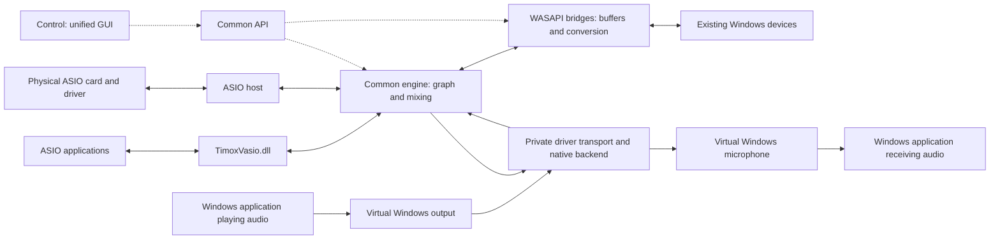
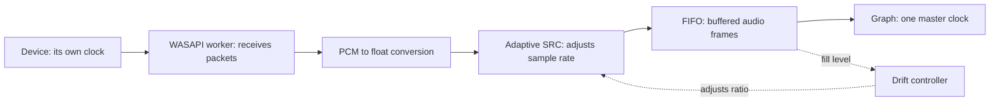

# Understanding the ASIO/WASAPI project

[Français](ASIO_WASAPI_GUIDE.md) | **English**

Status as of October 22, 2026. This document explains the intended architecture and its constraints; the diagrams do not mean that every component has already shipped.

## The overall idea

Build a common audio routing engine for Windows: connect applications and devices, select channels, adjust connections, and control everything through **one unified GUI and API**. This is the ambition behind “a PipeWire equivalent,” not a promise to match all of its features.

Three components have different responsibilities:

| Component | Role | What an application sees |
|---|---|---|
| **TimoxVasio.dll** | The existing virtual ASIO driver; carries buffers from ASIO applications to the engine and back. | An ASIO driver with its channels. |
| **Common engine and bridges** | Routing, mixing, graph scheduling, format conversion and connections between clock domains. | A control API; Control is its graphical interface. |
| **Virtual Windows audio driver** | Exposes our playback and recording devices to Windows applications. | A selectable audio output and microphone. |

The third component is sometimes called a “virtual WASAPI driver.” More precisely, **WASAPI is the API used to access Windows audio devices**. The driver creates the devices; the bridge opens their streams. [Microsoft reference](https://learn.microsoft.com/windows/win32/coreaudio/wasapi).

TimoxVasio remains separate from the Windows driver and WASAPI backends. “Independent” here means that it retains its identity and role as a virtual ASIO driver; it still uses the engine for routing and scheduling.

## Intended architecture

Solid arrows carry audio. Dotted arrows represent control. The virtual device names below are illustrative.

The intended virtual branch uses our `TimoxWindowsAudio.sys` driver and a private transport to the engine. The backend receives Windows render data and supplies Windows capture data to the driver. It does not attempt to write to a microphone through WASAPI. This transport is separate from WASAPI bridges to existing devices.

The per-process audio-copy bridge (*process loopback*) creates a new source from an application's shared Windows audio. Sending graph audio to a microphone selectable by another Windows application requires Timox to provide its own virtual recording endpoint. The native driver prototype and private transport compile, but loading and real transfers still require qualification on a test target; the engine backend is in development. Installation, signing and distribution remain separate work packages. See the [native driver design](superpowers/specs/2026-10-22-native-windows-audio-driver.md).

### Where do FlexASIO and ASIO2WASAPI fit?

These projects make existing Windows devices accessible to an ASIO application. FlexASIO follows `ASIO application ↔ FlexASIO ↔ PortAudio ↔ WASAPI ↔ existing device`. They are useful references or candidate backends to evaluate; they do not supply our native Windows endpoints or common graph. [FlexASIO](https://github.com/dechamps/FlexASIO), [ASIO2WASAPI](https://github.com/levmin/ASIO2WASAPI/tree/master/Source/Driver).

FlexASIO documents two relevant limits: its ASIO buffers do not represent total latency, and it does not compensate independent clock drift with adaptive SRC. Our synchronization and measurements remain necessary. [Buffers](https://github.com/dechamps/FlexASIO/blob/master/CONFIGURATION.md#option-buffersizesamples), [clocks](https://github.com/dechamps/FlexASIO/blob/master/FAQ.md#why-am-i-getting-glitches-cracks-pops-in-the-audio).

## Why input and output names can seem reversed

They depend on the point of view:

| Selection in the Windows application | Audio direction | Role in our graph |
|---|---|---|
| “Virtual audio output” | The application **writes** its audio to this output. | A **source** entering the graph. |
| “Virtual microphone” | The application **reads** audio from this microphone. | A **destination** fed by the graph. |

**Loopback** copies shared audio playing on a Windows output into a new graph source. It creates neither an output nor a virtual microphone. Endpoint loopback can contain several applications mixed together; process loopback creates a separate source for the selected process tree. [Microsoft loopback documentation](https://learn.microsoft.com/en-gb/windows/win32/coreaudio/loopback-recording).

## Three practical uses

**Copy browser audio into a Timox ASIO application:** Firefox keeps playing through its normal Windows output; Timox creates an independent graph source from a copy of its shared-mode audio → graph → TimoxVasio → ASIO application. No Windows output change is needed. The copy covers the process and its children. Routing it back to the original output may play the sound twice. ASIO and WASAPI-exclusive output are not included.

**Send a Timox ASIO application's sound to Windows:** ASIO application → TimoxVasio → engine → WASAPI render to a physical Windows output. Feeding that audio into another Windows application's microphone requires a Windows virtual recording endpoint, which is not shipped yet.

**Connect two ASIO applications without a physical ASIO card:** application A → TimoxVasio → engine driven by the software clock → TimoxVasio → application B. This path needs no WASAPI bridge.

The planned Windows virtual driver is needed to create software playback and recording endpoints for workflows that require them.

## What a bridge actually needs to solve

A bridge does more than copy samples. The two sides can run at slightly different speeds, request different block sizes and use different formats.

This diagram shows capture. For render: **graph → FIFO → adaptive SRC → PCM conversion → device**. Conversion and WASAPI calls run in a separate worker. The graph callback does not wait for the device.

### Clocks and drift

Two devices reporting “48 kHz” do not necessarily produce exactly 48,000 frames per second at the same time. They can use independent oscillators.

For example, **100 ppm of relative clock difference** at 48 kHz represents **4.8 frames per second**. Without correction, 256 frames of buffering would be consumed or accumulated in approximately **53 seconds**. Increasing the buffer delays the problem; it does not synchronize the clocks.

The SRC (*sample rate converter*) adjusts the rate slightly to keep the FIFO near its target level. It also handles conversions between 44.1 and 48 kHz. The currently planned drift correction is limited to ±0.2% around the nominal ratio. This does not guarantee recovery from any possible interruption.

**Only one master schedules the graph**: the ASIO clock in hardware mode, or the software clock without a card. Each connected WASAPI stream follows this cadence through its bridge; it does not set the graph clock.

### Latency: a cost to measure for each path

Latency depends on application buffers, transport, the bridge FIFO, the SRC filter and device buffers/periods. A round trip adds the capture and render paths. The graph block size is therefore not the total latency.

Reference values at 48 kHz:

| Element | Corresponding duration |
|---|---:|
| 128 frames | 2.67 ms |
| 256 frames | 5.33 ms |
| FIFO holding 512 frames | 10.67 ms of queued audio |
| Current SRC delay, 127.5 frames at its input | 2.66 ms when that input is at 48 kHz |

**Illustrative example**, not a product measurement: 256 frames waiting in a FIFO plus the SRC delay already amount to approximately 8 ms at 48 kHz, before other delays. Do not blindly add all maximum capacities: some describe a reserve, others actual waiting time or overlapping stages.

A smaller buffer provides less margin for Windows scheduling delays. End-to-end latency must be measured using a known signal, separately from buffer estimates.

### Quality, channels and CPU cost

- Adaptive resampling changes numerical sample values: **the path is not bit-perfect**. This does not imply audible degradation; noise, distortion and alias rejection must be measured.
- Cost increases with the number of streams, channels, their sample rates and the filter. The current SRC implementation uses 256 taps and approximately 4 MiB of coefficients per instance; its measured test quality does not establish its performance under load.
- A stereo device does not become multichannel because TimoxVasio has more channels. Channel assignment, mixing or downmixing must be explicit.
- Two parallel paths can have different delays. Summing them without alignment can cause comb filtering; automatic compensation for every path is not yet assured.
- The GUI and API must expose effective format, state, drift, FIFO level and losses. A count of lost frames does not have the same unit as a count of incidents.

### Windows constraints and recovery

| Constraint | Consequence for our solution |
|---|---|
| Shared mode | Several applications coexist; the bridge must negotiate the format and period that are actually available. |
| Exclusive mode | Reserves the endpoint and can interrupt other uses. It remains a later work package, not a free shortcut to a better solution. |
| Device unplugged or format changed | Prepare new buffers and a new generation; preserve routes, report unavailability, then resume. |
| Capture denied | Display the error; administrator elevation does not guarantee that capture will be allowed. |
| Empty or full FIFO | Produce silence or apply a bounded, accounted rejection policy; do not block the graph. |
| Routing feedback loop | Reject loopback → render on the same endpoint; loops through other applications or an acoustic microphone remain possible. |

Formats are negotiated according to the mode and device, and exclusivity changes sharing capabilities. [Microsoft device formats](https://learn.microsoft.com/en-us/windows/win32/coreaudio/device-formats), [Microsoft exclusive mode](https://learn.microsoft.com/en-us/windows/desktop/coreaudio/exclusive-mode-streams).

If capture is denied, check Windows microphone access for the device and desktop apps. Allowing an application is insufficient when overall access is disabled. Output loopback and microphone capture are separate uses; success with the former does not validate the latter. [Microsoft microphone privacy](https://support.microsoft.com/en-us/windows/privacy/windows-camera-microphone-and-privacy).

## Where does the project stand?

| Element | Status in this working branch |
|---|---|
| TimoxVasio virtual ASIO | Existing; this work leaves the DLL unchanged. |
| Software clock + GUI/API selection | Implemented; first real transfer between two ASIO hosts passed without a physical card at 48 kHz/2048 frames. Other formats and extended stability remain to qualify. |
| Rings, SRC, PCM conversion, inventory and shared backend | Implemented; unit tests and real render/loopback streaming are available. |
| WASAPI ports in the runtime | Transfer tests, including virtual transport, have passed. |
| Adaptive worker and bridge persistence | Implemented; hardware qualification is ongoing, particularly priming and drift control. |
| Control/API activation and reconnection | Implemented; GUI visually checked with simulation. A first real ASIO→WASAPI→loopback→ASIO path detects the expected signal. Extended measurements and the complete Electron workflow remain to qualify. |
| Our virtual Windows driver | Design and initial packet validation are available; no endpoint or kernel driver has shipped yet. |
| App audio copy (process loopback) from shared Windows playback | Implemented in this branch; it creates an independent graph source from a copy of the target process tree's shared audio. Runtime qualification remains. It does not include ASIO or WASAPI-exclusive streams, and the process list does not identify which API an application selected. |
| Exclusive mode, WASAPI hardware master | Later work, not delivered in this increment. |

The requirement remains a GUI, an API and performance at least on par with TimoxVasio. **That parity has not yet been demonstrated.** The ASIO path without bridges must be compared separately: it must not incur SRC processing for unused bridges.

See the [plan](superpowers/plans/2026-10-21-wasapi-bridge.md) and [verification log](superpowers/plans/2026-10-21-wasapi-bridge-progress.md) for detailed evidence and remaining steps.
