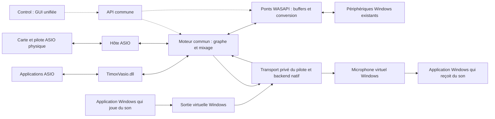
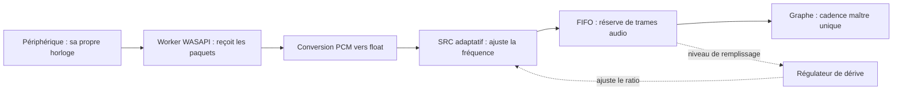

# Comprendre le projet ASIO/WASAPI

**Français** | [English](ASIO_WASAPI_GUIDE.en.md)

État au 22 octobre 2026. Ce document explique la cible et les contraintes ; les schémas ne signifient pas que tous les composants sont déjà livrés.

## L'idée générale

Construire un moteur de routage audio commun sous Windows : connecter applications et périphériques, choisir les canaux, régler les connexions, puis piloter l'ensemble depuis **une GUI et une API unifiées**. C'est l'ambition « équivalent PipeWire », pas une promesse de compatibilité avec toutes ses fonctions.

Trois composants ont des responsabilités différentes :

| Composant | Rôle | Ce qu'une application voit |
|---|---|---|
| **TimoxVasio.dll** | Pilote ASIO virtuel existant ; transporte les buffers des applications ASIO vers le moteur et inversement. | Un pilote ASIO avec ses canaux. |
| **Moteur commun et ponts** | Routage, mixage, cadence du graphe, conversion des formats et raccordement des horloges. | Une API de contrôle ; Control est son interface graphique. |
| **Pilote audio virtuel Windows** | Expose nos périphériques de lecture et d'enregistrement aux applications Windows. | Une sortie audio et un microphone sélectionnables. |

Le troisième composant est parfois appelé « pilote WASAPI virtuel ». Plus précisément, **WASAPI est l'API permettant d'utiliser les périphériques audio Windows**. Le pilote crée les périphériques ; le pont ouvre leurs flux. [Référence Microsoft](https://learn.microsoft.com/windows/win32/coreaudio/wasapi).

TimoxVasio reste distinct du pilote Windows et des backends WASAPI. « Autonome » signifie ici qu'il conserve son identité et son rôle de pilote ASIO virtuel ; il utilise toujours le moteur pour le routage et la cadence.

## Schéma de l'architecture visée

Les flèches pleines transportent du son. Les pointillés représentent le contrôle. Les noms de périphériques virtuels ci-dessous sont illustratifs.

La branche virtuelle cible utilise notre pilote `TimoxWindowsAudio.sys` et un transport privé vers le moteur. Le backend reçoit les données du rendu Windows et fournit au pilote celles de la capture Windows. Il ne tente pas d'écrire dans un microphone via WASAPI. Ce transport est distinct des ponts WASAPI vers les périphériques existants.

**Des câbles virtuels tiers permettent déjà de tester le graphe.** Dans ce cas, le pont lit la capture d'un câble pour recevoir le son d'une application, et écrit le rendu d'un autre câble pour alimenter un microphone virtuel. Notre pilote natif supprime ce détour. Son prototype et son transport privé se compilent, mais leur chargement et leurs échanges réels restent à qualifier sur une cible de test ; le backend moteur est en développement. Installation, signature et distribution restent des lots distincts. Voir la [conception du pilote natif](superpowers/specs/2026-10-22-native-windows-audio-driver.md).

Le moteur n'a pas besoin de ce nouveau pilote pour utiliser un microphone USB, des haut-parleurs ou un câble virtuel déjà présents. Il en a besoin pour proposer **ses propres** périphériques Windows aux autres applications.

### Où se placent FlexASIO et ASIO2WASAPI ?

Ces projets rendent des périphériques Windows existants accessibles à une application ASIO. FlexASIO suit le trajet `application ASIO ↔ FlexASIO ↔ PortAudio ↔ WASAPI ↔ périphérique existant`. Ils peuvent servir de références ou de backends à évaluer ; ils ne fournissent pas les endpoints Windows natifs ni notre graphe commun. [FlexASIO](https://github.com/dechamps/FlexASIO), [ASIO2WASAPI](https://github.com/levmin/ASIO2WASAPI/tree/master/Source/Driver).

FlexASIO documente deux limites utiles à notre conception : ses buffers ASIO ne représentent pas toute la latence, et il ne compense pas la dérive entre horloges indépendantes par SRC adaptatif. Notre synchronisation et nos mesures restent donc nécessaires. [Buffers](https://github.com/dechamps/FlexASIO/blob/master/CONFIGURATION.md#option-buffersizesamples), [horloges](https://github.com/dechamps/FlexASIO/blob/master/FAQ.md#why-am-i-getting-glitches-cracks-pops-in-the-audio).

## Pourquoi les noms entrée/sortie semblent inversés

Ils dépendent du point de vue :

| Choix dans l'application Windows | Sens du son | Rôle dans notre graphe |
|---|---|---|
| « Sortie audio virtuelle » | L'application **écrit** son son vers cette sortie. | Une **source** qui entre dans le graphe. |
| « Microphone virtuel » | L'application **lit** le son de ce microphone. | Une **destination** alimentée par le graphe. |

Le **loopback** est encore autre chose : il permet de capturer le son joué sur une sortie Windows. Il ne crée ni sortie ni microphone virtuel. Le loopback d'un endpoint partagé peut contenir plusieurs applications mélangées ; une capture par processus est une fonction distincte. [Loopback Microsoft](https://learn.microsoft.com/en-gb/windows/win32/coreaudio/loopback-recording).

## Trois usages concrets

**Envoyer un navigateur vers un logiciel ASIO :** navigateur → sortie d'un câble virtuel → capture WASAPI du câble → moteur → TimoxVasio → logiciel ASIO. Autre possibilité : capturer par loopback une sortie Windows, avec le risque de récupérer aussi les autres sons de cette sortie.

**Envoyer un logiciel ASIO vers une application de visioconférence :** logiciel ASIO → TimoxVasio → moteur → rendu WASAPI vers le câble virtuel → microphone du câble choisi dans l'application de visioconférence.

**Relier deux logiciels ASIO sans carte ASIO physique :** application A → TimoxVasio → moteur cadencé par l'horloge logicielle → TimoxVasio → application B. Aucun pont WASAPI n'est nécessaire sur ce trajet.

Avec notre futur pilote Windows, ses périphériques remplaceront ceux du câble tiers dans les deux premiers exemples.

## Ce qu'un pont doit réellement résoudre

Un pont ne se limite pas à copier des échantillons. Les deux côtés peuvent avancer à des vitesses légèrement différentes, demander des blocs différents et utiliser des formats différents.

Ce schéma montre la capture. Pour le rendu : **graphe → FIFO → SRC adaptatif → conversion PCM → périphérique**. Les conversions et les appels WASAPI s'exécutent dans un worker séparé. Le callback du graphe n'attend pas le périphérique.

### Horloges et dérive

Deux périphériques affichant « 48 kHz » ne produisent pas nécessairement exactement 48 000 trames par seconde au même instant. Ils peuvent utiliser des oscillateurs indépendants.

Exemple : **100 ppm d'écart relatif** à 48 kHz représentent **4,8 trames par seconde**. Sans correction, une réserve de 256 trames serait consommée ou accumulée en environ **53 secondes**. Agrandir le buffer retarde le problème ; cela ne synchronise pas les horloges.

Le SRC (*sample rate converter*, rééchantillonneur) ajuste très légèrement le débit pour maintenir le FIFO près de son niveau cible. Il sert aussi aux conversions 44,1↔48 kHz. La correction de dérive actuellement prévue est bornée à ±0,2 % autour du ratio nominal. Ce n'est pas une garantie de récupération de n'importe quel décrochage.

**Un seul maître cadence le graphe** : horloge ASIO dans le mode matériel, ou horloge logicielle sans carte. Chaque flux WASAPI raccordé suit cette cadence via son pont ; il ne recadence pas le graphe.

### Latence : un coût à mesurer par trajet

La latence dépend des buffers des applications, du transport, du FIFO du pont, du filtre SRC et des buffers/périodes du périphérique. Un aller-retour ajoute les trajets de capture et de rendu. La taille du bloc du graphe n'est donc pas la latence totale.

Repères à 48 kHz :

| Élément | Durée correspondante |
|---|---:|
| 128 trames | 2,67 ms |
| 256 trames | 5,33 ms |
| FIFO contenant 512 trames | 10,67 ms d'audio en attente |
| Retard du SRC actuel, 127,5 trames à son entrée | 2,66 ms si cette entrée est à 48 kHz |

**Exemple illustratif**, pas mesure du produit : 256 trames en attente dans un FIFO + le retard du SRC représentent déjà environ 8 ms à 48 kHz, avant les autres délais. Il ne faut pas additionner aveuglément toutes les capacités maximales : certaines décrivent une réserve, d'autres une attente effective ou des étapes qui se recouvrent.

Un buffer plus petit réduit la réserve de sécurité face aux retards d'ordonnancement Windows. La latence de bout en bout devra être mesurée par un signal connu, séparément des estimations de buffers.

### Qualité, canaux et coût CPU

- Le rééchantillonnage adaptatif modifie les valeurs numériques : **le trajet n'est pas bit-perfect**. Cela ne signifie pas une dégradation audible ; il faut mesurer bruit, distorsion et rejet d'alias.
- Le coût augmente avec le nombre de flux, de canaux, leur fréquence et le filtre. L'implémentation SRC actuelle utilise 256 taps et environ 4 Mio de coefficients par instance ; sa qualité de test ne prouve pas sa performance sous charge.
- Un périphérique stéréo ne devient pas multicanal parce que TimoxVasio possède davantage de canaux. Affectation, mixage ou réduction de canaux doivent être explicites.
- Deux chemins parallèles peuvent avoir des délais différents. Les sommer sans alignement peut provoquer un filtrage en peigne ; la compensation automatique de tous les trajets n'est pas acquise.
- La GUI et l'API doivent rendre visibles format effectif, état, dérive, niveau du FIFO et pertes. Un compteur de trames perdues n'a pas la même unité qu'un nombre d'incidents.

### Contraintes Windows et récupération

| Contrainte | Conséquence pour notre solution |
|---|---|
| Mode partagé | Plusieurs applications coexistent ; le pont doit négocier le format et la période réellement disponibles. |
| Mode exclusif | Réserve l'endpoint ; peut interrompre les autres usages. Il reste un lot ultérieur, pas un raccourci gratuit vers une meilleure solution. |
| Périphérique débranché ou format modifié | Préparer de nouveaux buffers et une nouvelle génération ; conserver les routes, signaler l'indisponibilité, puis reprendre. |
| Capture refusée | Afficher l'erreur ; une élévation administrateur ne garantit pas que la capture sera autorisée. |
| FIFO vide ou plein | Produire du silence ou appliquer une politique de rejet bornée et comptabilisée ; ne pas bloquer le graphe. |
| Boucle de routage | Refuser loopback → rendu sur le même endpoint ; les boucles via d'autres applications ou un microphone acoustique restent possibles. |

Les formats sont négociés selon le mode et le périphérique, et l'exclusivité change les possibilités de partage. [Formats Microsoft](https://learn.microsoft.com/en-us/windows/win32/coreaudio/device-formats), [mode exclusif Microsoft](https://learn.microsoft.com/en-us/windows/desktop/coreaudio/exclusive-mode-streams).

En cas de capture refusée, vérifier dans Windows l'accès au microphone pour l'appareil et pour les applications de bureau. Un accès permis à l'application ne suffit pas si l'accès général est désactivé. Le loopback d'une sortie et la capture d'un microphone sont deux usages distincts ; réussir le premier ne valide pas le second. [Confidentialité microphone Microsoft](https://support.microsoft.com/en-us/windows/privacy/windows-camera-microphone-and-privacy).

## Où en est le projet ?

| Élément | État de cette branche de travail |
|---|---|
| TimoxVasio ASIO virtuel | Existant, DLL inchangée par ce travail. |
| Horloge logicielle + choix GUI/API | Implémentés ; premier trajet réel entre deux hôtes ASIO réussi sans carte physique à 48 kHz/2048 trames. Autres formats et stabilité longue à qualifier. |
| Anneaux, SRC, conversion PCM, inventaire et backend partagé | Implémentés ; tests unitaires et streaming réel rendu/loopback disponibles. |
| Ports WASAPI dans le runtime | Tests de transfert, y compris avec le transport virtuel, réussis. |
| Worker adaptatif et persistance des ponts | Implémentés ; qualification matérielle en cours, notamment du préremplissage et de la dérive. |
| Activation Control/API et reconnexion | Implémentées ; GUI vérifiée visuellement avec simulation. Un premier trajet réel ASIO→WASAPI→loopback→ASIO détecte le signal attendu. Mesures prolongées et parcours complet Electron à terminer. |
| Notre pilote virtuel Windows | Conception et validation du protocole initial disponibles ; aucun endpoint ou pilote noyau encore livré. Câble tiers pour les premiers usages. |
| Exclusif, maître WASAPI matériel, loopback par processus | Travaux ultérieurs non livrés dans cette tranche. |

L'exigence reste une GUI, une API et des performances au moins au niveau de TimoxVasio. **Cette parité n'est pas encore démontrée.** Le chemin ASIO sans pont doit être comparé séparément : il ne doit pas payer le traitement SRC des ponts inutilisés.

Voir le [plan](superpowers/plans/2026-10-21-wasapi-bridge.md) et le [journal de vérification](superpowers/plans/2026-10-21-wasapi-bridge-progress.md) pour les preuves détaillées et les étapes restantes.
