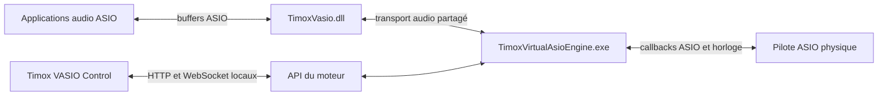
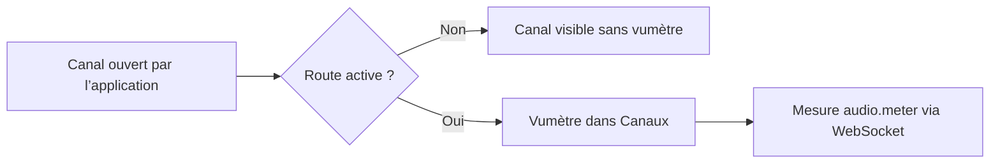
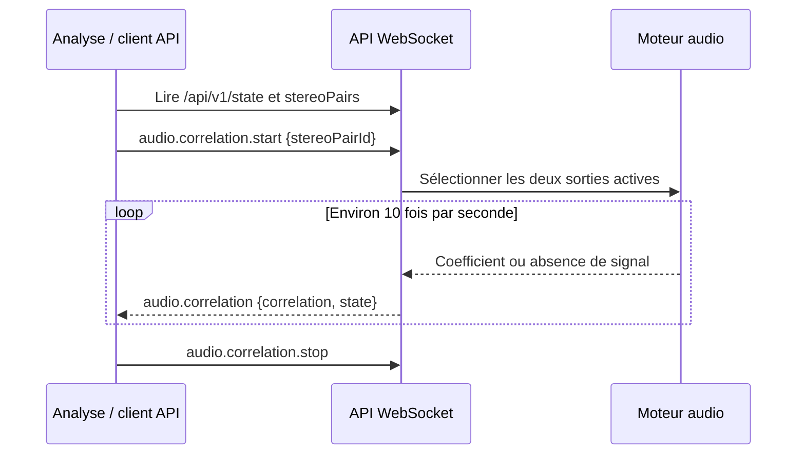
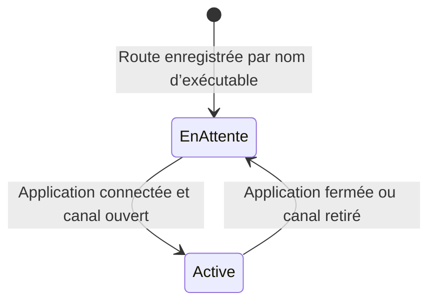

# Utiliser Timox VASIO Control

**Français** | [English](FONCTIONS.en.md)

Cette page décrit les fonctions de [TimoxVasio 1.2.6](https://github.com/timox/TimoxVasio/releases/tag/v1.2.6). L’interface est en anglais ; elle réunit six vues :

| Vue | Usage principal |
| --- | --- |
| **Configuration** | Choisir le pilote ASIO physique, sa fréquence et son tampon; consulter les profils de canaux attribués aux applications. |
| **Routing** | Voir les connexions dans le patchbay, attribuer un profil à un processus présent, retirer sa configuration, puis ouvrir la matrice d'une connexion précise. |
| **Analysis** | Explorer l'historique des métriques Performance, les incidents du transport et la corrélation stéréo ; exporter les données. |
| **Performance** | Vérifier que le callback du pilote physique tient dans le temps d’un bloc et mesurer la durée de chaque étape du trajet audio. |
| **API and Swagger** | Lire le contrat embarqué et envoyer des requêtes HTTP ou commandes WebSocket depuis la console intégrée. |
| **Logs** | Consulter les événements du moteur et choisir le niveau de diagnostic. |

## Trois composants et deux chemins distincts



Les échantillons suivent le chemin du haut. L’interface, Swagger et la console utilisent l’API locale pour lire l’état et envoyer des commandes; ils ne transportent pas les échantillons. Le moteur doit fonctionner avant qu’une application ASIO puisse ouvrir ses buffers TimoxVasio. Le guide [Installation](INSTALL.md) décrit l’ordre de lancement.

## Canaux ouverts, routes et vumètres

**Routing** s'ouvre sur le patchbay et montre les connexions sauvegardées. Le sélecteur **Connection pair** isole un couple source/destination ; **Show all ports** révèle les ports disponibles. **Add a connection** ouvre l'ajout mono/stéréo. Un bloc de processus réunit ses entrées à gauche et ses sorties à droite, y compris les ports issus de son profil enregistré. Les commandes −, + et **Fit** règlent le zoom; on peut faire glisser le fond pour parcourir la carte. La poignée ✥ déplace un bloc et ✎ lui donne un nom d'affichage ; ces choix sont conservés localement dans Control et ne changent aucun nom ASIO.

Le bouton ⚙ d'un processus présent dans Routing permet de lui attribuer un profil de capacité en entrées et sorties ASIO, avec 2/2 proposés au départ. Le profil s'applique à l'exécutable au prochain démarrage ASIO; 256 est une limite interne et non un ensemble de ports affichés par défaut. Dans ce même panneau, **Remove this configuration** retire les connexions de ce processus et son profil après confirmation, sans fermer le processus Windows. Seuls les canaux ouverts par l'application deviennent des extrémités actives. Un canal ouvert n'est pas automatiquement connecté. Le détail des processus et des vumètres reste replié sous le graphe.

Dans le graphe, les blocs distinguent matériel physique, processus actif et profil sauvegardé. Les ports physiques et virtuels ont des couleurs et des formes distinctes. Un câble continu est sauvegardé, un câble en tirets attend l'application de la configuration et un câble pointillé est muet ; ▲ indique un gain positif. L'inspecteur d'un câble montre son état, son gain, sa sourdine et ouvre une matrice limitée aux canaux reliés entre les deux blocs. Une connexion appliquée ne devient active que lorsque ses deux canaux ASIO sont ouverts. Les modifications audio restent en brouillon jusqu'à **Apply configuration**. Les libellés et couleurs personnalisés sont locaux à Control et ne modifient pas le traitement audio.



L’événement `audio.meter` associe un niveau de crête en dBFS à un `endpointId` et fournit les compteurs cumulés `underruns` et `overruns` du transport client :

```json
{
  "event": "audio.meter",
  "payload": {
    "endpointId": "virtual:TimoxVasio:1234:output:1",
    "peakDbfs": -9.0,
    "underruns": 0,
    "overruns": 0
  }
}
```

L’API publie les mesures environ deux fois par seconde. Elle représente le silence par `-120` dBFS. La barre de l’interface couvre `-60` à `0` dBFS, tandis que le nombre affiché conserve la valeur reçue. Les compteurs concernent les anneaux du transport virtuel; ils ne mesurent pas à eux seuls les échéances manquées du callback physique.

## Corrélation stéréo L/R

La vue **Analysis** propose les paires de sorties adjacentes d’une même application dont les deux canaux sont ouverts et routés. Choisissez une paire, puis lancez l’analyse. Le graphique montre l’évolution du coefficient entre `−1` et `+1` :

| Valeur | Lecture |
| --- | --- |
| Proche de `+1` | Les deux signaux évoluent ensemble. |
| Proche de `0` | Faible corrélation sur la fenêtre mesurée. |
| Proche de `−1` | Les signaux évoluent en opposition. |
| `null`, état `no_signal` | Un canal est silencieux ou trop faible pour une mesure fiable. |

Le moteur calcule une corrélation normalisée à décalage nul sur des fenêtres d’environ 100 ms. Sous `−90` dBFS RMS sur l’un des deux canaux, il publie `no_signal`. Le coefficient indique une relation entre les signaux L/R; il ne mesure pas un angle de phase en degrés et `0` ne signifie pas « silence ».



## Routes persistantes quand une application se reconnecte

`GET /api/v1/state` contient deux listes : `configuredRoutes` regroupe toutes les routes enregistrées; `routes` ne contient que celles qui peuvent être activées avec les canaux actuellement ouverts. Une route virtuelle enregistrée sous le nom de l’exécutable, par exemple `virtual:TimoxVasio:app:renoise.exe:output:1`, attend la reconnexion de l’application. Une fois le canal ouvert, l’API publie la route active avec le PID courant dans son `endpointId`.



Un exemple d’état sans application connectée est `configuredRoutes: 8`, `routes: 0`. Le moteur conserve les huit routes; il ne lance aucun flux physique tant qu’aucune route n’est active. Pour créer une nouvelle route en attente, l’application doit disposer d’un profil dans `GET /api/v1/application-profiles`, et le numéro de canal doit rester dans les limites de ce profil. Lors d’un `configuration.apply`, envoyez **toutes** les routes à conserver : la commande remplace la liste complète et peut interrompre brièvement le flux.

## Performance : budget du callback et durées par étape

La vue **Performance** montre le schéma échantillon → tampons ASIO → bloc et répond à deux questions : le callback du pilote physique tient-il dans le temps d'un bloc, et où passe le temps entre l'application et la carte. La durée d'un bloc est `bufferFrames / sampleRate`. La zone **Routed application load** affiche aussi le CPU du processus Windows (moyenne sur tous les processeurs logiques) et, quand les mesures par étape sont activées, le pire callback de l'application en pourcentage du bloc. Un dépassement de 100 % signale une échéance audio manquée dans l'échantillon mesuré ; ces chiffres ne désignent pas un VST précis.

**Budget du callback physique.** Sur chaque fenêtre de cinq secondes, le moteur publie `bufferHealth` dans `GET /api/v1/state` : le callback le plus lent (*Slowest callback*), le temps disponible pour un bloc (*Time available*, soit `bufferFrames / sampleRate`), la marge restante ou le dépassement (*Time left* / *Over time*), le nombre de démarrages retardés (*Delayed starts*), de dépassements de traitement (*Processing overruns*) et de callbacks observés. L'état vaut `healthy`, `warning` ou `insufficient` quand la fenêtre n'a pas assez de callbacks. Un démarrage retardé est une observation d'ordonnancement, pas la preuve d'une coupure audible. Rien n'est ajusté automatiquement : augmenter la taille de buffer reste une décision de l'utilisateur.

**Durées par étape.** La case *Enable stage measurements* envoie la commande WebSocket `performance.measurements.set`. La collecte est désactivée au démarrage du moteur ; une fois activée, elle échantillonne au plus un callback sur seize et publie, pour la dernière fenêtre complète de cinq secondes, la moyenne, le maximum et le nombre d'échantillons de chaque étape :

| Étape | Ce qui est mesuré |
| --- | --- |
| *Host callback* | L'appel `bufferSwitch` de l'application ASIO, c'est-à-dire tout le travail qu'elle fait pendant cet appel. |
| *Virtual ring write* | La copie des sorties de l'application dans l'anneau partagé. |
| *Ring wait* | L'attente entre la publication d'un bloc complet et sa lecture par le moteur. |
| *Client read* | La lecture des anneaux des clients par le callback physique. |
| *Routing* | L'application des routes, gains et mutes. |
| *Physical output copy* | La copie vers le tampon du pilote physique. |

Une étape sans observation reste vide. La copie physique s'arrête à la remise au pilote : ces durées ne mesurent ni la latence du matériel ni le moment où le son est entendu, et les maxima de plusieurs étapes ne s'additionnent pas en une latence totale.

```json
{ "id": "mesures-1", "command": "performance.measurements.set", "payload": { "enabled": true } }
```

La commande est idempotente ; `false` arrête la collecte et efface la fenêtre. `GET /api/v1/state` expose `performanceMeasurements` avec `enabled`, `sampleEveryCallbacks` (16) et `window` (`null` tant qu'aucune fenêtre n'est complète). En PowerShell :

```powershell
$state = Invoke-RestMethod 'http://127.0.0.1:52525/api/v1/state'
$state.bufferHealth | Format-List state, callbackCount, delayedStartCount, processingOverrunCount
$state.performanceMeasurements.window.physical | Format-List
```

## Analyse : historique des mesures

L'onglet **Analysis** trace les mesures récoltées dans Performance : durée du callback physique rapportée au bloc, CPU du processus routé et pire callback de l'application rapporté au bloc. Il échantillonne l'état toutes les cinq secondes ; l'historique n'est pas calculé sur le fil audio. Les incidents d'anneau (*underrun* et *overrun*) sont tracés par application et par sens, sous forme de différences entre compteurs cumulés. Le premier point est une référence, pas un nouvel incident. Les compteurs sont communs aux canaux d'un même transport et ne permettent pas de localiser l'incident sur un canal individuel.

La section canaux distingue les routes **configurées**, les canaux **ouverts** par l'application et ceux **routés maintenant**. « Routé » ne prouve pas la présence de son. L'historique est conservé en mémoire pendant l'ouverture de Control (jusqu'à 1 800 instantanés de performance et 7 200 instantanés de transport) ; **Export CSV** permet une analyse après la session. La distribution du son par fréquence n'est pas disponible dans l'API actuelle : elle demanderait de copier ponctuellement un bloc du canal choisi et de calculer son spectre hors du callback audio.

## Console API intégrée et exemples de programmation

Ouvrez **API and Swagger**. Swagger décrit les routes HTTP, les commandes WebSocket et leurs schémas. La **Console API** offre des modèles de requêtes, un éditeur JSON et une zone de réponse. Les commandes `configuration.apply` et `engine.stop` demandent une confirmation dans l’interface.

Pour lire l’état sans modifier le moteur, sélectionnez **Requête HTTP** et utilisez :

```json
{ "method": "GET", "path": "/api/v1/state" }
```

La même lecture en PowerShell (`52525` est le port par défaut ; si le moteur en a choisi un autre, Control l’affiche) :

```powershell
$state = Invoke-RestMethod 'http://127.0.0.1:52525/api/v1/state'
$state.engine | Format-List
$state.configuredRoutes | Format-Table id, sourceEndpointId, destinationEndpointId
$state.stereoPairs | Format-Table id, label
```

Pour démarrer une corrélation depuis la console WebSocket, remplacez l’identifiant par un `id` réellement renvoyé dans `stereoPairs` :

```json
{
  "id": "analyse-1",
  "command": "audio.correlation.start",
  "payload": { "stereoPairId": "stereo:TimoxVasio:1234:output:1-2" }
}
```

Un programme Node.js peut écouter les mesures en utilisant le sous-protocole documenté `vasio.api.v1` et le paquet `ws` (`npm install ws`) :

```javascript
const WebSocket = require('ws');
const socket = new WebSocket('ws://127.0.0.1:52525/api/v1/ws', 'vasio.api.v1');

socket.on('message', raw => {
  const message = JSON.parse(raw.toString());
  if (message.event === 'audio.meter') {
    const { endpointId, peakDbfs } = message.payload;
    console.log(endpointId, `${peakDbfs.toFixed(1)} dBFS`);
  }
  if (message.event === 'audio.correlation') {
    const { correlation, state } = message.payload;
    console.log(state, correlation);
  }
});

socket.on('error', error => console.error(error.message));
```

Pour activer la corrélation dans ce programme, commencez par lire `GET /api/v1/state`, choisissez une paire dans `stereoPairs`, puis envoyez la commande `audio.correlation.start` ci-dessus. Une requête sur une paire absente ou non routée est refusée. La [référence API](API.md) et le [quick start](API_QUICKSTART.md) donnent le contrat complet de configuration et de diagnostics.
