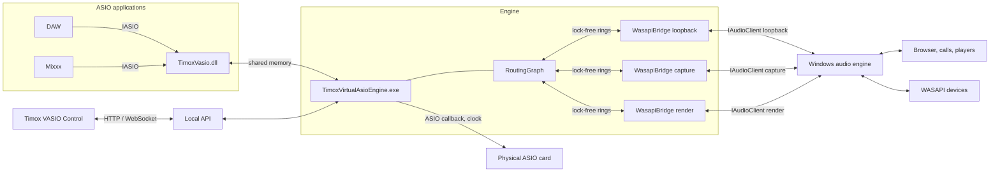
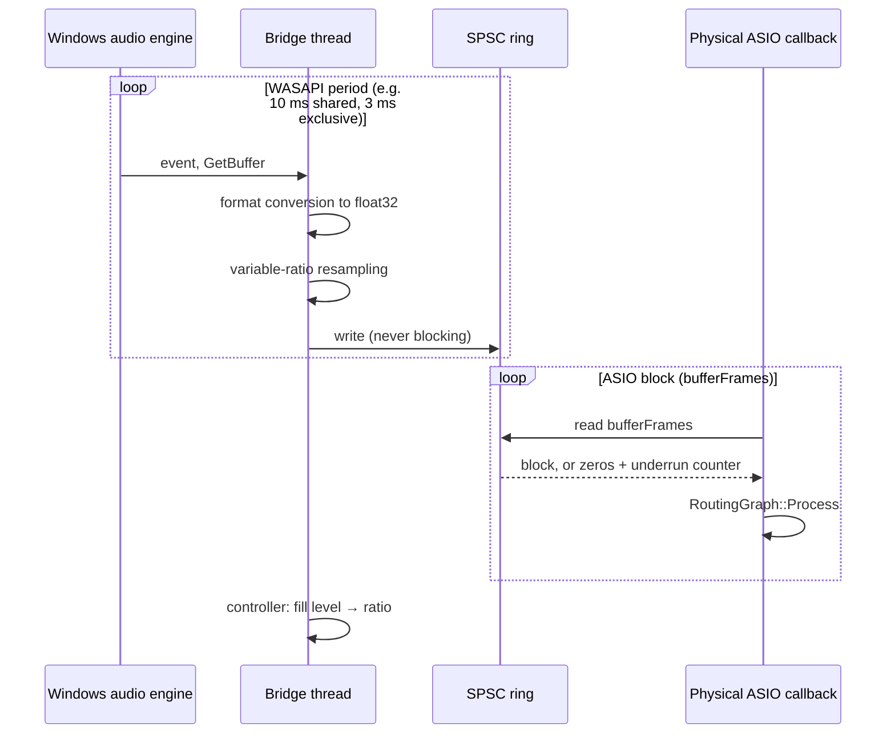
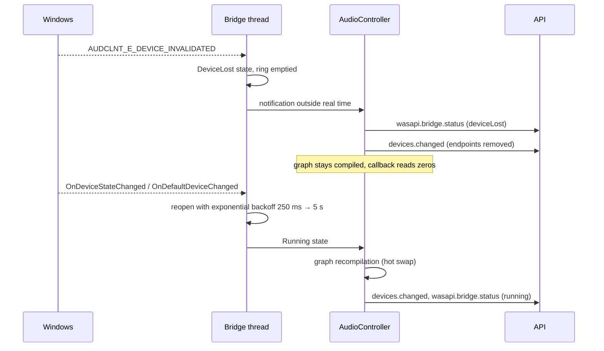

# Specification: Windows Audio (WASAPI) bridge for TimoxVasio

[Français](WASAPI_BRIDGE_SPEC.md) | **English**

Status: design proposal, not implemented. Target version: 1.3.
Date: 21 October 2026.

This document specifies the interface that lets ASIO applications connected
to TimoxVasio exchange audio with the Windows audio stack (WASAPI), in both
directions, without giving up the principles of the current engine: a single
clock in the ASIO path, no implicit conversion in that path, a routing graph
that is immutable during the callback, and a local API as the only
configuration entry point.

## 1. Goal and use cases

TimoxVasio currently links ASIO applications to each other and to a physical
ASIO card. It ignores the audio of ordinary Windows applications (browser,
video calls, players, games), which goes through WASAPI. The WASAPI bridge
closes that gap.

| Case | Source | Destination |
|---|---|---|
| Record or process a browser's sound in a DAW | Loopback capture of a Windows render device, or of a single process | TimoxVasio virtual inputs of an ASIO application |
| Hear a video call on the ASIO card's monitors | Loopback capture | Physical ASIO card outputs |
| Send a DAW mix into a video call | TimoxVasio virtual outputs | WASAPI render device (third-party virtual cable or, in phase 3, the TimoxVasio virtual endpoint) |
| Use a USB headset microphone that has no ASIO driver | WASAPI capture device | TimoxVasio virtual inputs |
| Run TimoxVasio on a PC without an ASIO card | WASAPI device in exclusive mode as master clock | The whole graph |

## 2. Scope and phases

Delivery happens in three independent phases. Each phase is usable alone.

| Phase | Content | Clock | Kernel component |
|---|---|---|---|
| 1 | Slave WASAPI bridges: capture, loopback (device or process), render. The physical ASIO card remains the clock. | ASIO | None |
| 2 | Exclusive WASAPI bridge as master clock. TimoxVasio runs without a physical ASIO driver. | Exclusive WASAPI | None |
| 3 | TimoxVasio virtual audio endpoint visible to Windows as a playback and a recording device. | Unchanged | Signed KS/PortCls driver |

This document fully specifies phases 1 and 2. Phase 3 is outlined in
section 12 because it requires a kernel-mode driver signed by Microsoft,
which is a separate project. Meanwhile a third-party virtual audio cable
(VB-Cable, Virtual Audio Cable) seen as an ordinary WASAPI device covers the
"ASIO to Windows application" need.

Out of scope: network transport, MIDI, Windows spatial audio, per-application
volume control in the Windows mixer, compressed formats.

## 3. Preserved invariants

The bridge fits into the existing architecture without changing it on these
points:

1. **The audio callback never blocks.** `AudioRoutingRuntime::Process` does
   no allocation, locking or waiting. The bridge only adds reads and writes
   on lock-free rings.
2. **No sample-rate conversion in the ASIO path.** TimoxVasio clients and the
   physical card run at the same rate and block size. The conversion needed
   on the Windows side happens in the bridge thread, never in the callback.
3. **The graph is immutable while processing.** A bridge adds endpoints to
   the graph compiled by `RoutingGraph::Create`; adding or removing a bridge
   is a reconfiguration, like changing the card. Routes to an existing bridge
   hot-swap like the others (see
   [ENGINE_ROUTE_HOT_SWAP.en.md](ENGINE_ROUTE_HOT_SWAP.en.md)).
4. **The API is the only configuration entry point.** Control and scripts
   configure bridges through `configuration.apply`. The Electron renderer
   touches neither WASAPI nor shared memory.
5. **Routes survive the absence of their endpoint.** A route to an unplugged
   WASAPI device stays in `configuredRoutes` and reactivates when it comes
   back, like a route to a closed application.

## 4. Overview



Each bridge owns its real-time thread, its `IAudioClient` and one ring per
direction towards the graph. The physical ASIO card callback remains the
graph's only cadence in phase 1.

## 5. Concepts

### 5.1 Bridge

A bridge is the configuration object that connects a WASAPI device to the
graph. It has a stable caller-chosen identifier, a kind, a device selector
and synchronisation parameters.

| Field | Type | Values | Role |
|---|---|---|---|
| `id` | string | `[A-Za-z0-9_-]{1,64}` | Stable identifier, reused in endpoint identifiers |
| `kind` | enum | `capture`, `loopback`, `render` | Direction on the Windows side |
| `device` | selector | see 5.2 | Target device |
| `shareMode` | enum | `shared` (default), `exclusive` | WASAPI open mode |
| `channels` | integer or `null` | 1 to 64 | Exposed channels; `null` takes the device format |
| `targetLatencyMs` | number or `null` | 1 to 500 | Target latency in the ring; `null` applies the default (6.3) |
| `processFilter` | object or `null` | see 5.3 | Loopback limited to one process |
| `clockRole` | enum | `slave` (default), `master` | Phase 2: `master` makes the bridge the engine clock |
| `enabled` | boolean | | A disabled bridge keeps its configuration and routes but opens nothing |

A `capture` or `loopback` bridge exposes endpoints with direction `input`
(it feeds signal into the graph). A `render` bridge exposes endpoints with
direction `output`.

### 5.2 Device selector

MMDevice identifiers are stable but opaque. The selector also allows
following the Windows default device, which is the dominant use case for
loopback.

```json
{ "kind": "id", "id": "{0.0.0.00000000}.{a1b2c3d4-...}" }
{ "kind": "default", "flow": "render", "role": "console" }
{ "kind": "default", "flow": "capture", "role": "communications" }
```

`role` follows the Windows roles `console`, `multimedia`, `communications`.
A `loopback` bridge always selects a `flow: "render"` device. A `default`
selector follows default-device changes
(`IMMNotificationClient::OnDefaultDeviceChanged`): the bridge reopens on the
new device without intervention, and routes remain valid because their
identifiers carry the bridge `id`, not the device's.

### 5.3 Per-process loopback

Windows 10 2004 and later can capture the output of a single process tree
(`AUDIOCLIENT_ACTIVATION_TYPE_PROCESS_LOOPBACK`). The filter mirrors
TimoxVasio's per-executable profile logic:

```json
{ "processName": "chrome.exe", "mode": "include" }
{ "processId": 4321, "mode": "exclude" }
```

With `processName`, the bridge resolves the process at start and on every
change of the process list, as `VasioClientManager` does for ASIO clients.
If several instances share the name, the bridge captures the oldest one's
tree and reports the ambiguity in its status. On an older Windows the engine
rejects the configuration with `WASAPI_PROCESS_LOOPBACK_UNSUPPORTED`.

### 5.4 Endpoint families and link rules

The graph gains two endpoint types.

```cpp
enum class RoutingEndpointType {
    PhysicalInput, PhysicalOutput,
    VirtualInput, VirtualOutput,
    WasapiInput,   // capture or loopback bridge
    WasapiOutput,  // render bridge
};
```

Endpoint identifiers, continuing the existing format:

```text
wasapi:<bridgeId>:input:<channel>
wasapi:<bridgeId>:output:<channel>
```

Channels are numbered from 1. An endpoint's `name` is
`<device name> <L|R|n>` according to the format's channel mask.

Links accepted by `RoutingGraph::SupportsLink`:

| Source → Destination | Virtual input | Physical output | WASAPI output |
|---|---|---|---|
| Virtual output | yes (existing) | yes (existing) | **yes** |
| Physical input | yes (existing) | no | **yes** |
| WASAPI input | **yes** | **yes** | no |

WASAPI-to-WASAPI links are refused in phase 1: a loopback routed to the
device it captures feeds back on itself. Physical-to-physical links remain
refused. Any other combination returns `INVALID_ROUTE_DIRECTION`.

## 6. Clock and synchronisation

This is the central point. The Windows audio engine and the ASIO card have
independent clocks; even at the same nominal rate they drift by a few tens
of ppm. Two roles are defined.

### 6.1 `slave` role (phase 1)

The physical ASIO card remains the clock. The bridge absorbs the difference.



The `render` direction is symmetric: the callback writes into the ring, the
bridge thread reads, resamples, converts and hands the data to WASAPI.

**Nominal conversion.** In shared mode the bridge first requests the engine
format (graph sample rate, float32) with
`AUDCLNT_STREAMFLAGS_AUTOCONVERTPCM | AUDCLNT_STREAMFLAGS_SRC_DEFAULT_QUALITY`.
Windows then performs the nominal conversion (44.1 kHz versus 48 kHz, for
instance) and the bridge only corrects drift. If the format is refused
(`AUDCLNT_E_UNSUPPORTED_FORMAT`, common for loopback on some versions), the
bridge opens the device mix format and performs the full conversion itself.
In exclusive mode the bridge opens the engine rate if `IsFormatSupported`
accepts it, otherwise the closest advertised format, and converts.

**Drift correction.** A proportional-integral controller reads the ring fill
level on every WASAPI period and adjusts the resampling ratio within ±0.2 %
of the nominal ratio. The setpoint is `targetLatencyMs`. The resampler is a
polyphase windowed-sinc with a per-block variable ratio and linear
interpolation between phases. It is implemented in the repository; if the
quality measurement (section 11) proves insufficient, `libsamplerate`
(BSD-2, GPL-3.0 compatible) is the chosen alternative.

**Resynchronisation.** If the fill level leaves `[0, capacity]` (Windows
stream cut, suspend), the bridge empties the ring, fills it with silence up
to the setpoint and increments `resyncs`. The ASIO callback is never
informed: it reads zeros during recovery.

### 6.2 `master` role (phase 2)

A `clockRole: "master"` bridge replaces the physical ASIO card as cadence
source. Conditions:

- `shareMode` is `exclusive` and `kind` is `render` or `capture`; a loopback
  cannot be master.
- `physicalDriverId` is `null` in the configuration. A physical driver and a
  master bridge at the same time are refused with `INVALID_CONFIGURATION`.
- Only one master bridge. Other bridges remain slaves and synchronise to it
  through the mechanism of 6.1.
- The configuration's `sampleRate` and `bufferFrames` become the exclusive
  rate and period requested from `IAudioClient::Initialize`. The minimum
  period and the alignment are read with `GetDevicePeriod` and, after an
  `AUDCLNT_E_BUFFER_SIZE_NOT_ALIGNED`, recomputed as Microsoft prescribes.
  The effective size is published in `engine.bufferFrames`, as for an ASIO
  driver that imposes its preferred size.

The engine abstracts the cadence source:

```cpp
// include/clock_host.h
class ClockHost {
public:
    virtual ~ClockHost() = default;
    virtual bool start(std::uint32_t bufferFrames,
                       const std::vector<std::uint32_t>& inputChannels,
                       const std::vector<std::uint32_t>& outputChannels,
                       PhysicalAsioProcessCallback callback, void* context,
                       std::string& error) = 0;
    virtual void stop() noexcept = 0;
    virtual PhysicalAsioTimingCounters consumeTimingCounters() noexcept = 0;
};
```

`PhysicalAsioHost` and `WasapiExclusiveHost` implement it. The callback
signature is today's: the graph's "physical" inputs and outputs are then the
master bridge's channels, and `AudioRoutingRuntime` does not change. The
callback runs on the master bridge thread, registered with MMCSS as a
`Pro Audio` task.

### 6.3 Default latency and ring capacity

| Mode | Default `targetLatencyMs` | Ring capacity |
|---|---|---|
| shared, `IAudioClient3` available | max(minimum shared period × 2, 3 × ASIO block) | 4 × setpoint, minimum 2 ASIO blocks |
| shared, `IAudioClient` only | 10 ms + 2 × ASIO block | same |
| exclusive slave | 2 × ASIO block | same |

The bridge requests the smallest shared period that
`IAudioClient3::GetSharedModeEnginePeriod` allows for the negotiated format.
The ring is an SPSC buffer of interleaved float32, sized at creation and
never reallocated.

### 6.4 Loopback and events

In loopback mode WASAPI signals no event without an active render stream on
the same device. A `loopback` bridge therefore opens, in parallel, a silent
render stream on the captured device and paces itself on its events. That
silent stream is excluded from the inventory and creates no endpoint.
Without it, the bridge falls back to a fixed-period timer equal to half the
device period.

## 7. Engine architecture

### 7.1 New components

| File | Role |
|---|---|
| `include/wasapi_bridge.h`, `src/wasapi_bridge.cpp` | One bridge: activation, format negotiation, thread, rings, controller, status |
| `include/wasapi_device_enumerator.h`, `src/wasapi_device_enumerator.cpp` | `IMMDeviceEnumerator` inventory, default-device tracking, arrivals and removals |
| `include/wasapi_exclusive_host.h`, `src/wasapi_exclusive_host.cpp` | Phase 2: `ClockHost` over an exclusive stream |
| `include/clock_host.h` | Shared cadence-source interface (phase 2) |
| `src/drift_resampler.h`, `src/drift_resampler.cpp` | Variable-ratio resampler and controller, no Windows dependency, testable |
| `src/spsc_audio_ring.h` | Lock-free SPSC interleaved float32 ring |
| `src/wasapi_bridge_store.cpp` | Persistence of bridges in `audio-configuration.json` next to routes |

No third-party dependency: `mmdeviceapi.h`, `audioclient.h`,
`audiopolicy.h`, `avrt.lib`. Per-process activation uses
`ActivateAudioInterfaceAsync` (`mmdeviceapi.h`, Windows 10 2004).

### 7.2 C++ interface of a bridge

```cpp
// include/wasapi_bridge.h
struct WasapiDeviceSelector {
    enum class Kind { Id, Default } kind = Kind::Default;
    std::wstring id;                       // Kind::Id
    enum class Flow { Render, Capture } flow = Flow::Render;
    enum class Role { Console, Multimedia, Communications } role = Role::Console;
};

struct WasapiProcessFilter {
    std::optional<std::wstring> processName;
    std::optional<std::uint32_t> processId;
    bool include = true;
};

struct WasapiBridgeConfiguration {
    std::string id;
    enum class Kind { Capture, Loopback, Render } kind = Kind::Loopback;
    WasapiDeviceSelector device;
    bool exclusive = false;
    std::optional<std::uint32_t> channels;
    std::optional<double> targetLatencyMs;
    std::optional<WasapiProcessFilter> processFilter;
    bool clockMaster = false;              // phase 2
    bool enabled = true;
};

struct WasapiBridgeHealth {
    enum class State { Stopped, Starting, Running, DeviceLost, FormatChanged, Error } state;
    std::wstring deviceId;                 // device actually opened
    std::string deviceName;
    std::uint32_t channels = 0;
    std::uint32_t deviceSampleRate = 0;
    std::uint32_t devicePeriodFrames = 0;
    bool windowsConverts = false;          // AUTOCONVERTPCM accepted
    double measuredLatencyMs = 0.0;
    double driftPpm = 0.0;                 // applied ratio − 1, in ppm
    std::uint64_t underruns = 0, overruns = 0, resyncs = 0;
    std::string lastError;
};

class WasapiBridge final {
public:
    static std::unique_ptr<WasapiBridge> Create(const WasapiBridgeConfiguration& configuration,
        WasapiDeviceEnumerator& devices, std::string& error);
    // Control thread.
    bool Start(std::uint32_t graphSampleRate, std::uint32_t graphBufferFrames, std::string& error);
    void Stop() noexcept;
    WasapiBridgeHealth Health() const;
    // ASIO callback thread only. Never blocking.
    std::uint32_t ReadBlock(float* const* planarOutputs, std::uint32_t frames) noexcept;  // kind != Render
    bool WriteBlock(const float* const* planarInputs, std::uint32_t frames) noexcept;     // kind == Render
};
```

`AudioRoutingLayout` receives `std::vector<WasapiBridge*> bridges` and
`AudioRoutingRuntime::Process` calls `ReadBlock` before the graph and
`WriteBlock` after it, in bridge order. Blocks are de-interleaved once in
the bridge thread; the callback performs no conversion.

### 7.3 Configuration cycle

`AudioController::ApplyConfigurationCore` extends the existing sequence:

1. Full validation: bridges (unique identifiers, filters, roles), routes
   (existing endpoints, directions), clock (6.2). No mutation before
   validation completes.
2. If the set of bridges or the clock source changes: stop the stream,
   `engine.status` = `reconfiguring`, close removed bridges, create added
   bridges, open the clock source, `Start` the bridges with the confirmed
   rate and block, compile the graph, start.
3. If only routes change: hot swap, as today.
4. A bridge whose device is absent starts in `DeviceLost` state; the
   configuration is still accepted and the `running` state is reached if at
   least one route has both endpoints available. Its endpoints do not appear
   in the inventory until it is `Running`.

### 7.4 Device loss and return



A device format change (`FormatChanged`) follows the same path. The ASIO
stream is never interrupted by a WASAPI-side event in the `slave` role. In
the `master` role, device loss stops the engine with `engine.error`
`WASAPI_DEVICE_LOST`, like the loss of an ASIO card.

## 8. API contract

The additions are compatible with existing clients: all new fields are
additions, existing commands keep their shape, and a client that omits
`wasapiBridges` keeps its bridges (see 8.3). `apiVersion` becomes `1.1`.

### 8.1 Inventory

`GET /api/v1/drivers` and `GET /api/v1/state` add:

```json
{
  "wasapiDevices": [
    {
      "id": "{0.0.0.00000000}.{a1b2c3d4-...}",
      "name": "Speakers (Realtek)",
      "flow": "render",
      "state": "active",
      "defaultRoles": ["console", "multimedia"],
      "mixFormat": { "sampleRate": 48000, "channels": 2, "bitDepth": 32, "float": true },
      "minSharedPeriodFrames": 128,
      "exclusiveSampleRates": [44100, 48000, 96000]
    }
  ],
  "wasapiBridges": [
    {
      "id": "browser",
      "kind": "loopback",
      "device": { "kind": "default", "flow": "render", "role": "console" },
      "shareMode": "shared",
      "channels": 2,
      "targetLatencyMs": 12,
      "processFilter": { "processName": "chrome.exe", "mode": "include" },
      "clockRole": "slave",
      "enabled": true,
      "status": {
        "state": "running",
        "deviceId": "{0.0.0.00000000}.{a1b2c3d4-...}",
        "deviceName": "Speakers (Realtek)",
        "deviceSampleRate": 48000,
        "devicePeriodFrames": 480,
        "windowsConverts": true,
        "measuredLatencyMs": 12.4,
        "driftPpm": -37.2,
        "underruns": 0, "overruns": 0, "resyncs": 1,
        "lastError": ""
      },
      "inputEndpoints": [
        { "id": "wasapi:browser:input:1", "name": "Speakers (Realtek) L", "direction": "input", "channel": 1 },
        { "id": "wasapi:browser:input:2", "name": "Speakers (Realtek) R", "direction": "input", "channel": 2 }
      ],
      "outputEndpoints": []
    }
  ]
}
```

`exclusiveSampleRates` and `minSharedPeriodFrames` are probed without
opening a stream (`IsFormatSupported`, `GetSharedModeEnginePeriod`); they are
`null` if the device is inactive. `state` mirrors the MMDevice states
`active`, `disabled`, `notPresent`, `unplugged`.

### 8.2 Configuration

`configuration.apply` accepts two additional fields:

```json
{
  "id": "request-7",
  "command": "configuration.apply",
  "payload": {
    "physicalDriverId": "physical-driver-stable-id",
    "sampleRate": 48000,
    "bufferFrames": 256,
    "wasapiBridges": [
      { "id": "browser", "kind": "loopback",
        "device": { "kind": "default", "flow": "render", "role": "console" },
        "shareMode": "shared", "channels": 2, "targetLatencyMs": null,
        "processFilter": null, "clockRole": "slave", "enabled": true },
      { "id": "teams-out", "kind": "render",
        "device": { "kind": "id", "id": "{0.0.0.00000000}.{cable-input-...}" },
        "shareMode": "shared", "channels": 2, "targetLatencyMs": 20,
        "processFilter": null, "clockRole": "slave", "enabled": true }
    ],
    "routes": [
      { "id": "r1", "sourceEndpointId": "wasapi:browser:input:1",
        "destinationEndpointId": "virtual:TimoxVasio:app:renoise.exe:input:1",
        "gainDb": 0.0, "mute": false },
      { "id": "r2", "sourceEndpointId": "virtual:TimoxVasio:app:renoise.exe:output:1",
        "destinationEndpointId": "wasapi:teams-out:output:1",
        "gainDb": -6.0, "mute": false }
    ],
    "expectedConfigurationRevision": 41
  }
}
```

Phase 2, without an ASIO card:

```json
{
  "physicalDriverId": null,
  "sampleRate": 48000,
  "bufferFrames": 192,
  "wasapiBridges": [
    { "id": "usb-headset", "kind": "render",
      "device": { "kind": "id", "id": "{0.0.0.00000000}.{headset-...}" },
      "shareMode": "exclusive", "channels": 2, "targetLatencyMs": null,
      "processFilter": null, "clockRole": "master", "enabled": true }
  ],
  "routes": [ "..." ]
}
```

Validation rules, in order:

| Check | Error |
|---|---|
| Bridge `id` well-formed and unique | `INVALID_BRIDGE` |
| `kind`, `shareMode`, `clockRole`, `device` well-formed | `INVALID_BRIDGE` |
| `kind: "loopback"` with `flow: "capture"`, or `clockRole: "master"` with loopback or `shared` | `INVALID_BRIDGE` |
| Several `master` bridges, or `master` with a non-null `physicalDriverId`, or neither while routes exist | `INVALID_CONFIGURATION` |
| `processFilter` on a Windows older than 10 2004 | `WASAPI_PROCESS_LOOPBACK_UNSUPPORTED` |
| Endpoint `wasapi:<id>:...` whose bridge is not in `wasapiBridges` | `UNKNOWN_BRIDGE` |
| Channel beyond the bridge's `channels` | `UNKNOWN_ENDPOINT` |
| Link outside table 5.4 | `INVALID_ROUTE_DIRECTION` |
| Explicit device not found | accepted, bridge in `deviceLost` |
| Exclusive mode refused by Windows or unsupported format | `WASAPI_EXCLUSIVE_UNAVAILABLE`, `WASAPI_FORMAT_UNSUPPORTED` (only for `master`; for `slave`, the bridge enters `error` without blocking the engine) |

`channels: null` is resolved when the bridge starts; a route to a channel
that turns out to be absent stays in `configuredRoutes` and waits, like a
route to a channel an application has not allocated.

### 8.3 Compatibility and persistence

- A `configuration.apply` without a `wasapiBridges` field keeps the saved
  bridges. An empty array `[]` removes them all. This rule differs from
  `routes`, which is always a full replacement, because existing clients
  (examples, scripts) know nothing about bridges and must not erase them.
- Bridges persist in `audio-configuration.json` under a `wasapiBridges`
  field. An older file without that field loads with no bridge.
- The stable identifiers `wasapi:<bridgeId>:...` do not depend on the
  device: changing a bridge's selector keeps its routes.

### 8.4 Events

| Event | Payload |
|---|---|
| `devices.changed` | Now includes `wasapiDevices` and `wasapiBridges` |
| `wasapi.bridge.status` | `{ "bridgeId", "status": { ... } }` on every state change, and once per second while `running` for `measuredLatencyMs`, `driftPpm` and the counters |
| `audio.meter` | Emitted for routed WASAPI endpoints like the others; `underruns`/`overruns` are the bridge's counters |
| `engine.error` | Codes below |

### 8.5 Added error codes

| Code | Meaning |
|---|---|
| `INVALID_BRIDGE` | Malformed bridge or forbidden field combination |
| `UNKNOWN_BRIDGE` | A route references a bridge absent from the configuration |
| `WASAPI_DEVICE_NOT_FOUND` | Explicit selector with no device (reported in `status`, not as a refusal) |
| `WASAPI_FORMAT_UNSUPPORTED` | No negotiable format with the device |
| `WASAPI_EXCLUSIVE_UNAVAILABLE` | Exclusive mode refused (device busy or forbidden by Windows) |
| `WASAPI_DEVICE_LOST` | Device invalidated during the stream; fatal only for a `master` bridge |
| `WASAPI_PROCESS_LOOPBACK_UNSUPPORTED` | Per-process filter on a Windows version that is too old |
| `WASAPI_ACTIVATION_FAILED` | `ActivateAudioInterfaceAsync` or `Activate` failed; `hresult` attached |

Errors carry, when available, `operation`, `bridgeId`, `deviceId` and
`hresult` (signed integer), on the model of `asioError`.

### 8.6 Schemas

`api/schemas/api-v1.json` adds the definitions `wasapiDevice`,
`wasapiDeviceSelector`, `wasapiProcessFilter`, `wasapiBridge`,
`wasapiBridgeStatus`, `wasapiBridgeStatusEvent`, and extends `state`,
`drivers`, `applyCommand` and `event`. `openapi-v1.json` documents these
objects and the new event under `x-websocket`. `tests/api-contract.ps1`
validates this document's examples against the schemas.

## 9. Timox VASIO Control interface

The interface rule in `AGENTS.md` applies without exception.

- **Left navigation.** The `ASIO setup` section becomes `Audio setup` and
  hosts, below the ASIO card, the table of WASAPI bridges: identifier, kind,
  device, state, measured latency, drift. That table is global state, not a
  contextual detail. No other navigation entry is added.
- **Patchbay.** Each `running` bridge is a graph node, like a process, with
  an icon that distinguishes loopback, capture and render, and the device
  name as subtitle. A `deviceLost` or `error` bridge stays visible, greyed
  out, with its configured routes dashed, like an absent application.
- **Actions.** The background context menu offers `Add Windows Audio
  bridge…`; a bridge node's menu offers `Edit…`, `Disable`, `Remove`. Forms
  open in a modal: kind, device selector (list of `wasapiDevices` plus the
  three "Default device" entries), mode, channels, target latency,
  per-process filter (list of processes with active audio output, read from
  `wasapiDevices[].sessions` when available, otherwise free text), clock
  role (phase 2). Cable actions remain in the cable's context menu.
- **No permanent panel** beside the graph. Selecting a bridge or a cable
  opens nothing.
- **Performance.** The Performance section adds one card per bridge:
  measured latency against setpoint, drift in ppm, underruns, overruns,
  resyncs, and whether Windows or the bridge performs the nominal
  conversion. The buffer diagram shows the bridge as an extra stage between
  Windows and the ASIO block. These measurements come from
  `wasapi.bridge.status`, with no work added to the callback.
- **Pending configuration.** Bridge edits follow the same draft as routes:
  `Changes pending`, `Apply configuration`, `Discard pending edits`.
  `configuration-merge.js` learns to merge `wasapiBridges` with rule 8.3.

## 10. Windows compatibility and prerequisites

| Feature | Prerequisite |
|---|---|
| Shared bridges, device loopback, render, capture | Windows 10 1703 or Windows 11 (`IAudioClient3` for small periods; `IAudioClient` fallback on earlier Windows 10) |
| Per-process loopback | Windows 10 2004 (build 19041) or Windows 11 |
| Exclusive mode | Allowed in the Windows device properties ("Allow applications to take exclusive control") |
| Master bridge (phase 2) | Same as exclusive mode; no physical ASIO driver selected |

The engine must initialise COM as `COINIT_MULTITHREADED` on the bridge
thread; the existing control thread is not modified. Bridge threads register
with MMCSS (`AvSetMmThreadCharacteristics`, `"Pro Audio"`). The engine
process requests no additional privilege.

## 11. Tests and acceptance criteria

Unit tests without Windows audio, integrated in CTest like the existing
tests:

- `DriftResamplerTests`: controller response to a +100 ppm drift step (back
  within ±5 ppm of the setpoint in under 10 simulated seconds), stability at
  the nominal 44 100/48 000 ratio, resampler signal-to-noise ratio above
  90 dB on a 1 kHz and a 10 kHz sine.
- `SpscAudioRingTests`: concurrent read and write, counted underruns and
  overruns, no reallocation.
- `WasapiBridgeConfigurationTests`: validation of 8.2, selectors,
  persistence and reload of a file without `wasapiBridges`.
- `RoutingGraphTests` extended to the link table of 5.4.
- `api-contract.ps1`: this document's examples against the schemas.

Probes and manual checks on a Windows machine:

- `WasapiBridgeProbe` (modelled on `PhysicalAsioProbe`): opens a bridge of
  each kind on the default device, publishes 30 s of health.
- `vasio-doctor`: checks that per-process loopback is available and that
  exclusive mode is allowed on the chosen device.
- End-to-end measurement: a test signal rendered by a Windows application,
  captured by loopback, routed to a TimoxVasio test client; measured latency
  between the setpoint and the setpoint plus one WASAPI period, no underrun
  over 10 minutes, drift corrected without resynchronisation.
- `master` role: engine started without an ASIO card on a USB headset in
  exclusive mode at 48 kHz and 192 frames; Renoise and Mixxx open TimoxVasio
  and route to each other and to the headset.

Phase 1 acceptance criteria: the first four use cases of section 1 work
from Control and from a WebSocket script, the tests above pass, the existing
performance measurements show no callback-time increase beyond the cost of
the ring copies, and `API.md`, `ARCHITECTURE.md` and `FONCTIONS.md` are
updated.

## 12. Phase 3: Windows virtual endpoint

For Windows applications to see "TimoxVasio" in their device list, a
kernel-mode driver (KS/PortCls or AVStream) is required, exposing one
playback and one recording device, signed by Microsoft through the hardware
portal. The driver would do no processing: it exposes cyclic buffers that a
`kind: "virtual"` bridge in the engine reads and writes like any other ring,
with the engine clock as reference, which removes drift for that bridge. The
endpoint identifiers, API and interface of this document apply unchanged;
only the selector gains `{ "kind": "virtual" }`. This phase depends on a
decision about signing cost and the installer, and is not required by
phases 1 and 2.

## 13. Decisions made and open questions

Decisions:

- Sample-rate conversion stays out of the ASIO path; it lives in the bridge
  threads. The README's "one clock, no conversion" principle remains true
  for ASIO applications and the card.
- Bridges are configured through `configuration.apply`, not a dedicated
  command, to keep a single atomically validated transaction and the
  `expectedConfigurationRevision` mechanism.
- WASAPI to WASAPI is refused in phase 1.
- Bridges absent from the request are kept (8.3).

Open questions, to settle before implementation:

1. Should the inventory of Windows audio sessions
   (`IAudioSessionEnumerator`) be exposed to populate the process list of
   the loopback filter, or should the executable name stay free text?
2. Should `targetLatencyMs` be allowed below one WASAPI period, with the
   documented underrun risk, or be bounded to one period?
3. Is a per-bridge gain needed on top of the per-route gain, to compensate
   the Windows mixer volume in loopback?

## 14. WASAPI references

All interfaces used are public and documented by Microsoft. The two
behaviours flagged as poorly documented (possible refusal of
`AUTOCONVERTPCM` in loopback, no loopback events without a render stream)
are covered by the fallbacks in sections 6.1 and 6.4.

| Topic | Reference |
|---|---|
| WASAPI overview, shared and exclusive modes | [About WASAPI](https://learn.microsoft.com/en-us/windows/win32/coreaudio/wasapi) |
| Exclusive-mode streams, period alignment | [Exclusive-Mode Streams](https://learn.microsoft.com/en-us/windows/win32/coreaudio/exclusive-mode-streams) |
| Loopback capture of a render device | [Loopback Recording](https://learn.microsoft.com/en-us/windows/win32/coreaudio/loopback-recording) |
| Per-process loopback capture | [ApplicationLoopbackAudio sample](https://learn.microsoft.com/en-us/samples/microsoft/windows-classic-samples/applicationloopbackaudio-sample/) and [AUDIOCLIENT_ACTIVATION_PARAMS](https://learn.microsoft.com/en-us/windows/win32/api/audioclientactivationparams/ns-audioclientactivationparams-audioclient_activation_params) |
| Small periods in shared mode | [IAudioClient3](https://learn.microsoft.com/en-us/windows/win32/api/audioclient/nn-audioclient-iaudioclient3) and [Low Latency Audio](https://learn.microsoft.com/en-us/windows-hardware/drivers/audio/low-latency-audio) |
| `AUTOCONVERTPCM`, `SRC_DEFAULT_QUALITY`, `EVENTCALLBACK`, `LOOPBACK` flags | [AUDCLNT_STREAMFLAGS_XXX Constants](https://learn.microsoft.com/en-us/windows/win32/coreaudio/audclnt-streamflags-xxx-constants) |
| Enumeration, default device, notifications | [IMMDeviceEnumerator](https://learn.microsoft.com/en-us/windows/win32/api/mmdeviceapi/nn-mmdeviceapi-immdeviceenumerator) and [IMMNotificationClient](https://learn.microsoft.com/en-us/windows/win32/api/mmdeviceapi/nn-mmdeviceapi-immnotificationclient) |
| Invalidation and error codes | [AUDCLNT_E_XXX](https://learn.microsoft.com/en-us/windows/win32/coreaudio/audclnt-err-xxx-constants) |
| Real-time thread priority | [AvSetMmThreadCharacteristics](https://learn.microsoft.com/en-us/windows/win32/api/avrt/nf-avrt-avsetmmthreadcharacteristicsw) |
| Virtual audio driver (phase 3) | [Audio Drivers Design Guide](https://learn.microsoft.com/en-us/windows-hardware/drivers/audio/) and the [SYSVAD](https://github.com/microsoft/Windows-driver-samples/tree/main/audio/sysvad) sample |
