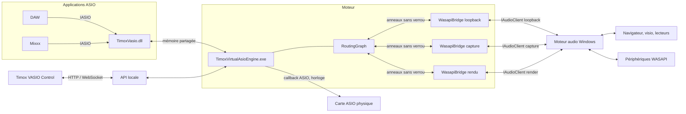
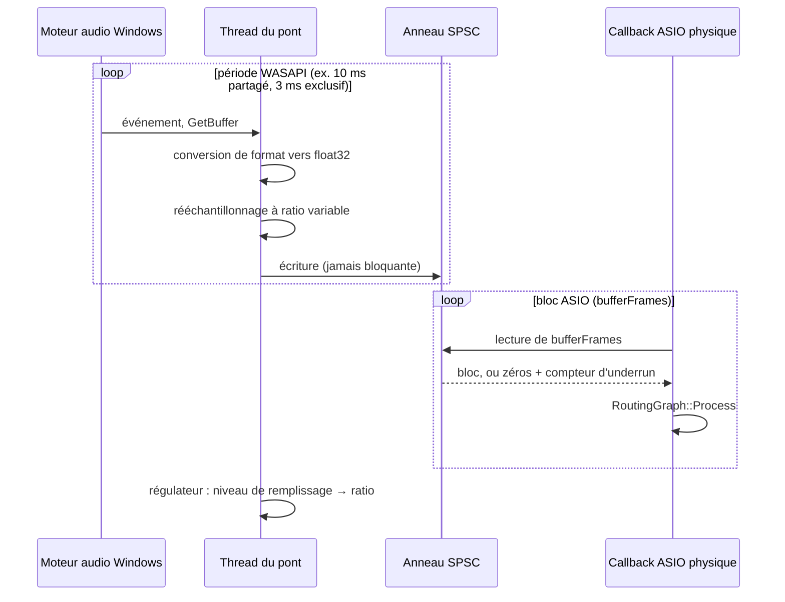
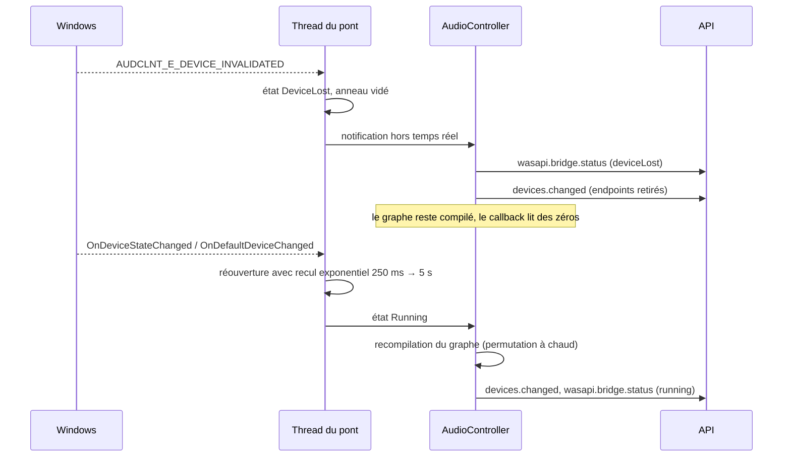

# Spécification : pont Windows Audio (WASAPI) pour TimoxVasio

**Français** | [English](WASAPI_BRIDGE_SPEC.en.md)

Statut au 25 octobre 2026 : les ponts WASAPI partagés (capture, rendu,
loopback de périphérique et copie audio par processus) sont présents dans le
moteur et l'API. La qualification du trajet complet sur une vraie application
et une vraie sortie reste à faire. L'horloge WASAPI exclusive de phase 2 et
l'endpoint virtuel Windows de phase 3 ne sont pas déclarés livrés. Cette
spécification reste la conception cible ; voir le plan d'implémentation et
`docs/API.md` pour l'état et le contrat actuels.
Version cible : 1.3. Date de la conception : 21 octobre 2026.
Plan d'implémentation pour agent codeur : [superpowers/plans/2026-10-21-wasapi-bridge.md](superpowers/plans/2026-10-21-wasapi-bridge.md).

Ce document spécifie l'interface qui permet aux applications ASIO connectées
à TimoxVasio d'échanger de l'audio avec la pile audio Windows (WASAPI), dans
les deux sens, sans abandonner les principes du moteur actuel : une seule
horloge dans le chemin ASIO, aucune conversion implicite dans ce chemin, un
graphe de routage immuable pendant le callback, et une API locale comme seul
point de configuration.

## 1. Objectif et cas d'usage

TimoxVasio relie aujourd'hui des applications ASIO entre elles et à une carte
ASIO physique. Il ignore l'audio des applications Windows classiques
(navigateur, visioconférence, lecteurs, jeux), qui passent par WASAPI. Le pont
WASAPI comble cette séparation.

| Cas | Source | Destination |
|---|---|---|
| Enregistrer ou traiter le son d'un navigateur dans un DAW | Capture loopback d'un périphérique de rendu Windows, ou d'un seul processus | Entrées virtuelles TimoxVasio d'une application ASIO |
| Écouter la visioconférence sur les moniteurs de la carte ASIO | Capture loopback | Sorties de la carte ASIO physique |
| Envoyer le mix d'un DAW vers une visioconférence | Sorties virtuelles TimoxVasio | Endpoint virtuel TimoxVasio (phase 3, lorsqu'il sera qualifié) |
| Utiliser le micro d'un casque USB sans pilote ASIO | Périphérique de capture WASAPI | Entrées virtuelles TimoxVasio |
| Faire tourner TimoxVasio sur un PC sans carte ASIO | Périphérique WASAPI en mode exclusif comme horloge maître | Tout le graphe |

## 2. Périmètre et phases

La livraison se fait en trois phases indépendantes. Chaque phase est
utilisable seule.

| Phase | Contenu | Horloge | Composant kernel |
|---|---|---|---|
| 1 | Ponts WASAPI esclaves : capture, loopback (périphérique ou processus), rendu. La carte ASIO physique reste l'horloge. | ASIO | Aucun |
| 2 | Pont WASAPI exclusif comme horloge maître. TimoxVasio fonctionne sans pilote ASIO physique. | WASAPI exclusif | Aucun |
| 3 | Endpoint audio virtuel TimoxVasio visible par Windows comme périphérique de lecture et d'enregistrement. | Inchangée | Pilote KS/PortCls signé |

Ce document décrit la conception cible des phases 1 et 2. L'implémentation
actuelle de la phase 1 comprend la copie audio par processus, mais sa
qualification réelle reste à faire. La phase 2 et l'endpoint de phase 3 sont
des travaux distincts ; aucun périphérique audio virtuel tiers n'est requis
dans l'architecture TimoxVasio.

Hors périmètre : transport réseau, MIDI, audio spatial Windows, contrôle du
volume par application dans le mélangeur Windows, formats compressés.

## 3. Invariants préservés

Le pont s'insère dans l'architecture existante sans la modifier sur ces
points :

1. **Le callback audio ne bloque jamais.** `AudioRoutingRuntime::Process` ne
   fait ni allocation, ni verrou, ni attente. Le pont y ajoute seulement des
   lectures et écritures sur des anneaux sans verrou.
2. **Aucune conversion de fréquence dans le chemin ASIO.** Les clients
   TimoxVasio et la carte physique tournent à la même fréquence et à la même
   taille de bloc. La conversion nécessaire au côté Windows se fait dans le
   thread du pont, jamais dans le callback.
3. **Le graphe est immuable pendant le traitement.** Un pont ajoute des
   endpoints au graphe compilé par `RoutingGraph::Create`; l'ajout ou le
   retrait d'un pont est une reconfiguration, comme le changement de carte.
   Les routes vers un pont existant se permutent à chaud comme les autres
   (voir [ENGINE_ROUTE_HOT_SWAP.md](ENGINE_ROUTE_HOT_SWAP.md)).
4. **L'API est le seul point de configuration.** Control et les scripts
   configurent les ponts par `configuration.apply`. Le renderer Electron ne
   touche ni WASAPI ni la mémoire partagée.
5. **Les routes survivent à l'absence de leur extrémité.** Une route vers un
   périphérique WASAPI débranché reste dans `configuredRoutes` et se réactive
   à son retour, comme une route vers une application fermée.

## 4. Vue d'ensemble



Chaque pont possède son propre thread temps réel, son propre `IAudioClient`
et un anneau par direction vers le graphe. Le callback de la carte ASIO reste
l'unique cadence du graphe en phase 1.

## 5. Concepts

### Adhésion directe et copies audio

Timox ne route que les flux qui entrent explicitement dans son graphe. Il y a
deux façons différentes d'y faire entrer le son :

| Chemin | Qui ouvre le flux ? | Ce que Timox maîtrise | Ce que cela ne prouve pas |
|---|---|---|---|
| Client ASIO TimoxVasio | L'application ouvre `TimoxVasio.dll` | Le moteur connaît le client, ses ports, ses buffers et les callbacks échangés avec le pilote | Que le client produit un signal audible à chaque bloc |
| Pont WASAPI de périphérique | Le moteur Timox ouvre un périphérique Windows existant | Le flux du pont et sa copie dans le graphe | Que l'application source est un client Timox ou que son audio passe par ce pont |
| Copie audio d'une application | Timox demande à Windows une copie partagée du processus choisi | Cette copie, liée à l'identité du processus sélectionné | Que l'application a choisi WASAPI plutôt que DirectSound, ni son flux ASIO ou exclusif |
| Copie du mix d'un endpoint | Timox lit le mix partagé d'une sortie Windows | Le mix de cet endpoint | L'identité ou la séparation des applications présentes dans le mix |
| Endpoint virtuel Timox (cible) | L'application sélectionne l'endpoint Timox dans Windows | Les flux qui ouvrent explicitement cet endpoint, sous réserve de la qualification d'isolation | Que l'endpoint et son attribution par session sont déjà qualifiés en production |

Le terme **adhésion** désigne une connexion explicite à une interface Timox
que Timox possède ou expose : le client ASIO ouvre le pilote Timox, ou une
application choisit un endpoint virtuel Timox lorsqu'il sera disponible et
qualifié. Une **copie audio** est différente : Timox ouvre lui-même une source
WASAPI et ajoute le signal copié comme nouveau nœud du graphe. Cette copie
ne crée pas de connexion directe au pilote ASIO et ne redirige pas la lecture
d'origine. Le même processus peut aussi ouvrir TimoxVasio.dll et apparaître
comme un client ASIO distinct. Dans l'interface, la source copiée doit donc
rester distinguable de ce client, même s'ils proviennent du même processus
Windows.

### 5.1 Pont (bridge)

Un pont est l'objet de configuration qui relie un périphérique WASAPI au
graphe. Il a un identifiant stable choisi par l'appelant, un type, un
sélecteur de périphérique et des paramètres de synchronisation.

| Champ | Type | Valeurs | Rôle |
|---|---|---|---|
| `id` | chaîne | `[A-Za-z0-9_-]{1,64}` | Identifiant stable, réutilisé dans les identifiants d'endpoints |
| `kind` | énumération | `capture`, `render`, `endpointLoopback`, `processLoopback` | Direction et type de source Windows |
| `endpointId` / `defaultRole` | sélecteur | voir 5.2 | Sélecteur des ponts de périphérique |
| `shareMode` | énumération | `shared` (défaut), `exclusive` | Mode d'ouverture WASAPI |
| `channels` | entier ou `null` | 1 à 64 | Canaux exposés ; `null` prend le format du périphérique |
| `targetLatencyMs` | nombre ou `null` | 1 à 500 | Latence visée dans l'anneau ; `null` applique la valeur par défaut (6.3) |
| `processId`, `processCreationTime`, `processImagePath` | identité | voir 5.3 | Obligatoires pour `processLoopback`, absents des ponts de périphérique |
| `clockRole` | énumération | `slave` (défaut), `master` | Phase 2 : `master` fait du pont l'horloge du moteur |
| `enabled` | booléen | | Un pont désactivé conserve sa configuration et ses routes mais n'ouvre rien |

Les ponts `capture`, `endpointLoopback` et `processLoopback` exposent des
endpoints `input` au graphe. Un pont `render` expose des endpoints `output`.

### 5.2 Sélecteur de périphérique

Les identifiants MMDevice sont stables mais opaques. Le sélecteur permet
aussi de suivre le périphérique par défaut de Windows, ce qui est le cas
d'usage dominant pour le loopback.

```json
{ "kind": "id", "id": "{0.0.0.00000000}.{a1b2c3d4-...}" }
{ "kind": "default", "flow": "render", "role": "console" }
{ "kind": "default", "flow": "capture", "role": "communications" }
```

`role` suit les rôles Windows `console`, `multimedia`, `communications`. Un
pont `loopback` sélectionne toujours un périphérique de `flow: "render"`. Un
sélecteur `default` suit les changements de périphérique par défaut
(`IMMNotificationClient::OnDefaultDeviceChanged`) : le pont se rouvre sur le
nouveau périphérique sans intervention, et les routes restent valides car
leurs identifiants portent l'`id` du pont, pas celui du périphérique.

### 5.3 Loopback par processus

La liste Audio setup présente les processus ayant une session de lecture
Windows active ; elle ne prétend pas savoir si l'application a appelé WASAPI,
DirectSound ou une autre API passant par le mixeur partagé. L'utilisateur
choisit explicitement une entrée et Timox crée une copie indépendante de son
audio partagé, y compris celui de ses processus enfants. La lecture originale
continue. La copie est liée au PID, à l'heure de création du processus et au
chemin de son image. Ces trois valeurs sont vérifiées avant et après
`ActivateAudioInterfaceAsync` ; aucun paquet n'est lu si l'identité change.
La capture est en lecture seule et ne redirige pas le flux d'origine. Les
sorties ASIO et WASAPI exclusives ne sont pas capturées. La fonction demande
Windows 10 build 20348 ou ultérieur.

La configuration courante utilise une identité explicite, sans sélecteur de
périphérique :

```json
{
  "id": "browser-copy",
  "kind": "processLoopback",
  "processId": 4321,
  "processCreationTime": "134000000000000000",
  "processImagePath": "C:\\Program Files\\Browser\\browser.exe",
  "enabled": true
}
```

### 5.4 Familles d'endpoints et règles de liaison

Le graphe gagne deux types d'extrémités.

```cpp
enum class RoutingEndpointType {
    PhysicalInput, PhysicalOutput,
    VirtualInput, VirtualOutput,
    WasapiInput,   // capture, loopback d'endpoint ou copie de processus
    WasapiOutput,  // pont render
};
```

Identifiants d'endpoints, dans la continuité du format existant :

```text
wasapi:<bridgeId>:input:<channel>
wasapi:<bridgeId>:output:<channel>
```

Le canal est numéroté à partir de 1. Le `name` d'un endpoint vaut
`<nom du périphérique> <L|R|n>` d'après le masque de canaux du format.

Liaisons acceptées par `RoutingGraph::SupportsLink` :

| Source → Destination | Entrée virtuelle | Sortie physique | Sortie WASAPI |
|---|---|---|---|
| Sortie virtuelle | oui (existant) | oui (existant) | **oui** |
| Entrée physique | oui (existant) | non | **oui** |
| Entrée WASAPI | **oui** | **oui** | non |

Les liaisons WASAPI vers WASAPI sont refusées en phase 1 : un loopback routé
vers le périphérique qu'il capture boucle sur lui-même. Les liaisons
physique vers physique restent refusées. Toute autre combinaison renvoie
`INVALID_ROUTE_DIRECTION`.

## 6. Horloge et synchronisation

C'est le point central. Le moteur audio Windows et la carte ASIO ont des
horloges indépendantes ; même à fréquence nominale identique, elles dérivent
de quelques dizaines de ppm. Deux rôles sont définis.

### 6.1 Rôle `slave` (phase 1)

La carte ASIO physique reste l'horloge. Le pont absorbe la différence.



Le sens `render` est symétrique : le callback écrit dans l'anneau, le thread
du pont lit, rééchantillonne, convertit et remet à WASAPI.

**Conversion nominale.** En mode partagé, le pont demande d'abord le format
du moteur (fréquence du graphe, float32) avec
`AUDCLNT_STREAMFLAGS_AUTOCONVERTPCM | AUDCLNT_STREAMFLAGS_SRC_DEFAULT_QUALITY`.
Windows assure alors la conversion nominale (44,1 kHz contre 48 kHz par
exemple) et le pont ne corrige que la dérive. Si le format est refusé
(`AUDCLNT_E_UNSUPPORTED_FORMAT`, fréquent en loopback sur certaines
versions), le pont ouvre le format de mixage du périphérique et assure
lui-même la conversion complète. En mode exclusif, le pont ouvre la
fréquence du moteur si `IsFormatSupported` l'accepte, sinon le format le plus
proche parmi ceux annoncés, et convertit.

**Correction de dérive.** Un régulateur proportionnel-intégral lit le niveau
de remplissage de l'anneau à chaque période WASAPI et ajuste le ratio de
rééchantillonnage dans une bande de ±0,2 % autour du ratio nominal. La
consigne est `targetLatencyMs`. Le rééchantillonneur est polyphasé à fenêtre
de sinc, ratio variable par bloc, interpolation linéaire entre phases. Il est
implémenté dans le dépôt ; si la mesure de qualité (section 11) est
insuffisante, `libsamplerate` (BSD-2, compatible GPL-3.0) est l'alternative
retenue.

**Resynchronisation.** Si le remplissage sort de `[0, capacité]` (coupure du
flux Windows, suspension), le pont vide l'anneau, le remplit de silence
jusqu'à la consigne et incrémente `resyncs`. Le callback ASIO n'est jamais
informé : il lit des zéros pendant la reprise.

### 6.2 Rôle `master` (phase 2)

Un pont `clockRole: "master"` remplace la carte ASIO physique comme source de
cadence. Conditions :

- `shareMode` vaut `exclusive` et `kind` vaut `render` ou `capture` ; un
  loopback ne peut pas être maître.
- `physicalDriverId` vaut `null` dans la configuration. Un pilote physique
  et un pont maître simultanés sont refusés avec `INVALID_CONFIGURATION`.
- Un seul pont maître. Les autres ponts restent esclaves et se synchronisent
  sur lui par le mécanisme de 6.1.
- `sampleRate` et `bufferFrames` de la configuration deviennent la fréquence
  et la période exclusives demandées à `IAudioClient::Initialize`. La période
  minimale et l'alignement sont lus avec `GetDevicePeriod` et, après un
  `AUDCLNT_E_BUFFER_SIZE_NOT_ALIGNED`, recalculés comme le prescrit
  Microsoft. La taille effective est publiée dans `engine.bufferFrames`,
  comme pour un pilote ASIO qui impose sa taille préférée.

Le moteur abstrait la source de cadence :

```cpp
// include/clock_host.h
class ClockHost {
public:
    virtual ~ClockHost() = default;
    virtual bool start(std::uint32_t bufferFrames,
                       const std::vector<std::uint32_t>& inputChannels,
                       const std::vector<std::uint32_t>& outputChannels,
                       PhysicalAsioProcessCallback callback, void* context,
                       std::string& error) = 0;
    virtual void stop() noexcept = 0;
    virtual PhysicalAsioTimingCounters consumeTimingCounters() noexcept = 0;
};
```

`PhysicalAsioHost` et `WasapiExclusiveHost` l'implémentent. La signature du
callback est celle d'aujourd'hui : les entrées et sorties « physiques » du
graphe sont alors les canaux du pont maître, et `AudioRoutingRuntime` ne
change pas. Le callback tourne sur le thread du pont maître, enregistré
auprès de MMCSS en tâche `Pro Audio`.

### 6.3 Latence par défaut et capacité des anneaux

| Mode | `targetLatencyMs` par défaut | Capacité de l'anneau |
|---|---|---|
| partagé, `IAudioClient3` disponible | max(période partagée minimale × 2, 3 × bloc ASIO) | 4 × consigne, minimum 2 blocs ASIO |
| partagé, `IAudioClient` seul | 10 ms + 2 × bloc ASIO | idem |
| exclusif esclave | 2 × bloc ASIO | idem |

Le pont demande la plus petite période partagée que `IAudioClient3::
GetSharedModeEnginePeriod` autorise pour le format négocié. L'anneau est un
tampon SPSC de float32 entrelacés, dimensionné à la création, jamais
réalloué.

### 6.4 Loopback et événements

En mode loopback, WASAPI ne signale pas d'événement sans flux de rendu actif
sur le même périphérique. Le pont `loopback` ouvre donc en parallèle un flux
de rendu silencieux sur le périphérique capturé et se cadence sur ses
événements. Ce flux silencieux est exclu de l'inventaire et ne crée aucun
endpoint. Sans lui, le pont se rabat sur une horloge à période fixe égale à
la moitié de la période du périphérique.

## 7. Architecture du moteur

### 7.1 Nouveaux composants

| Fichier | Rôle |
|---|---|
| `include/wasapi_bridge.h`, `src/wasapi_bridge.cpp` | Un pont : activation, négociation de format, thread, anneaux, régulateur, état |
| `include/wasapi_device_enumerator.h`, `src/wasapi_device_enumerator.cpp` | Inventaire `IMMDeviceEnumerator`, suivi des périphériques par défaut et des arrivées/départs |
| `include/wasapi_exclusive_host.h`, `src/wasapi_exclusive_host.cpp` | Phase 2 : `ClockHost` sur un flux exclusif |
| `include/clock_host.h` | Interface commune de source de cadence (phase 2) |
| `src/drift_resampler.h`, `src/drift_resampler.cpp` | Rééchantillonneur à ratio variable et régulateur, sans dépendance Windows, testable |
| `src/spsc_audio_ring.h` | Anneau SPSC float32 entrelacé, sans verrou |
| `src/wasapi_bridge_store.cpp` | Persistance des ponts dans `audio-configuration.json` à côté des routes |

Aucune dépendance tierce : `mmdeviceapi.h`, `audioclient.h`,
`audiopolicy.h`, `avrt.lib`. L'activation par processus utilise
`ActivateAudioInterfaceAsync` (`mmdeviceapi.h`, Windows 10 build 20348 ou ultérieur pour la capture par processus).

### 7.2 Interface C++ d'un pont

```cpp
// include/wasapi_bridge.h
struct WasapiDeviceSelector {
    enum class Kind { Id, Default } kind = Kind::Default;
    std::wstring id;                       // Kind::Id
    enum class Flow { Render, Capture } flow = Flow::Render;
    enum class Role { Console, Multimedia, Communications } role = Role::Console;
};

struct WasapiProcessIdentity {
    std::uint32_t processId;
    std::uint64_t processCreationTime;
    std::wstring processImagePath;
};

struct WasapiBridgeConfiguration {
    std::string id;
    enum class Kind { Capture, Render, EndpointLoopback, ProcessLoopback } kind = Kind::EndpointLoopback;
    std::optional<WasapiDeviceSelector> device;
    bool exclusive = false;
    std::optional<std::uint32_t> channels;
    std::optional<double> targetLatencyMs;
    std::optional<WasapiProcessIdentity> processIdentity;
    bool clockMaster = false;              // phase 2
    bool enabled = true;
};

struct WasapiBridgeHealth {
    enum class State { Stopped, Starting, Running, DeviceLost, FormatChanged, Error } state;
    std::wstring deviceId;                 // périphérique effectivement ouvert
    std::string deviceName;
    std::uint32_t channels = 0;
    std::uint32_t deviceSampleRate = 0;
    std::uint32_t devicePeriodFrames = 0;
    bool windowsConverts = false;          // AUTOCONVERTPCM accepté
    double measuredLatencyMs = 0.0;
    double driftPpm = 0.0;                 // ratio appliqué − 1, en ppm
    std::uint64_t underruns = 0, overruns = 0, resyncs = 0;
    std::string lastError;
};

class WasapiBridge final {
public:
    static std::unique_ptr<WasapiBridge> Create(const WasapiBridgeConfiguration& configuration,
        WasapiDeviceEnumerator& devices, std::string& error);
    // Thread de contrôle.
    bool Start(std::uint32_t graphSampleRate, std::uint32_t graphBufferFrames, std::string& error);
    void Stop() noexcept;
    WasapiBridgeHealth Health() const;
    // Thread du callback ASIO uniquement. Jamais bloquant.
    std::uint32_t ReadBlock(float* const* planarOutputs, std::uint32_t frames) noexcept;  // kind != Render
    bool WriteBlock(const float* const* planarInputs, std::uint32_t frames) noexcept;     // kind == Render
};
```

`AudioRoutingLayout` reçoit `std::vector<WasapiBridge*> bridges` et
`AudioRoutingRuntime::Process` appelle `ReadBlock` avant le graphe et
`WriteBlock` après, dans l'ordre des ponts. Les blocs sont désentrelacés une
fois dans le thread du pont ; le callback ne fait aucune conversion.

### 7.3 Cycle de configuration

`AudioController::ApplyConfigurationCore` étend la séquence existante :

1. Validation complète : ponts (identifiants uniques, filtres, rôles),
   routes (endpoints existants, directions), horloge (6.2). Aucune mutation
   avant la fin de la validation.
2. Si l'ensemble des ponts ou la source d'horloge change : arrêt du flux,
   `engine.status` = `reconfiguring`, fermeture des ponts retirés, création
   des ponts ajoutés, ouverture de la source d'horloge, `Start` des ponts
   avec la fréquence et le bloc confirmés, compilation du graphe, démarrage.
3. Si seules les routes changent : permutation à chaud, comme aujourd'hui.
4. Un pont dont le périphérique est absent démarre en état `DeviceLost` ;
   la configuration reste acceptée et l'état `running` est atteint si au
   moins une route a ses deux extrémités disponibles. Ses endpoints
   n'apparaissent pas dans l'inventaire tant qu'il n'est pas `Running`.

### 7.4 Perte et retour de périphérique



Un changement de format du périphérique (`FormatChanged`) suit le même
chemin. Le flux ASIO n'est jamais interrompu par un événement côté WASAPI en
rôle `slave`. En rôle `master`, la perte du périphérique arrête le moteur
avec `engine.error` `WASAPI_DEVICE_LOST`, comme la perte d'une carte ASIO.

## 8. Contrat API

Les ajouts sont compatibles avec les clients existants : tous les nouveaux
champs sont des ajouts, les commandes existantes gardent leur forme, et un
client qui omet `wasapiBridges` conserve ses ponts (voir 8.3). `apiVersion`
passe à `1.1`.

### 8.1 Inventaire

`GET /api/v1/drivers` et `GET /api/v1/state` ajoutent :

```json
{
  "wasapiDevices": [
    {
      "id": "{0.0.0.00000000}.{a1b2c3d4-...}",
      "name": "Haut-parleurs (Realtek)",
      "flow": "render",
      "state": "active",
      "defaultRoles": ["console", "multimedia"],
      "mixFormat": { "sampleRate": 48000, "channels": 2, "bitDepth": 32, "float": true },
      "minSharedPeriodFrames": 128,
      "exclusiveSampleRates": [44100, 48000, 96000]
    }
  ],
  "wasapiBridges": [
    {
      "id": "browser",
      "kind": "endpointLoopback",
      "device": { "kind": "default", "flow": "render", "role": "console" },
      "shareMode": "shared",
      "channels": 2,
      "targetLatencyMs": 12,
      "clockRole": "slave",
      "enabled": true,
      "status": {
        "state": "running",
        "deviceId": "{0.0.0.00000000}.{a1b2c3d4-...}",
        "deviceName": "Haut-parleurs (Realtek)",
        "deviceSampleRate": 48000,
        "devicePeriodFrames": 480,
        "windowsConverts": true,
        "measuredLatencyMs": 12.4,
        "driftPpm": -37.2,
        "underruns": 0, "overruns": 0, "resyncs": 1,
        "lastError": ""
      },
      "inputEndpoints": [
        { "id": "wasapi:browser:input:1", "name": "Haut-parleurs (Realtek) L", "direction": "input", "channel": 1 },
        { "id": "wasapi:browser:input:2", "name": "Haut-parleurs (Realtek) R", "direction": "input", "channel": 2 }
      ],
      "outputEndpoints": []
    }
  ]
}
```

`exclusiveSampleRates` et `minSharedPeriodFrames` sont sondés sans ouvrir de
flux (`IsFormatSupported`, `GetSharedModeEnginePeriod`) ; ils valent `null`
si le périphérique est inactif. `state` reprend les états MMDevice
`active`, `disabled`, `notPresent`, `unplugged`.

### 8.2 Configuration

`configuration.apply` accepte deux champs supplémentaires :

```json
{
  "id": "request-7",
  "command": "configuration.apply",
  "payload": {
    "physicalDriverId": "physical-driver-stable-id",
    "sampleRate": 48000,
    "bufferFrames": 256,
    "wasapiBridges": [
      { "id": "browser", "kind": "endpointLoopback",
        "device": { "kind": "default", "flow": "render", "role": "console" },
        "shareMode": "shared", "channels": 2, "targetLatencyMs": null,
        "clockRole": "slave", "enabled": true },
      { "id": "teams-out", "kind": "render",
        "device": { "kind": "id", "id": "{0.0.0.00000000}.{cable-input-...}" },
        "shareMode": "shared", "channels": 2, "targetLatencyMs": 20,
        "clockRole": "slave", "enabled": true }
    ],
    "routes": [
      { "id": "r1", "sourceEndpointId": "wasapi:browser:input:1",
        "destinationEndpointId": "virtual:TimoxVasio:app:renoise.exe:input:1",
        "gainDb": 0.0, "mute": false },
      { "id": "r2", "sourceEndpointId": "virtual:TimoxVasio:app:renoise.exe:output:1",
        "destinationEndpointId": "wasapi:teams-out:output:1",
        "gainDb": -6.0, "mute": false }
    ],
    "expectedConfigurationRevision": 41
  }
}
```

Phase 2, sans carte ASIO :

```json
{
  "physicalDriverId": null,
  "sampleRate": 48000,
  "bufferFrames": 192,
  "wasapiBridges": [
    { "id": "usb-headset", "kind": "render",
      "device": { "kind": "id", "id": "{0.0.0.00000000}.{headset-...}" },
      "shareMode": "exclusive", "channels": 2, "targetLatencyMs": null,
      "clockRole": "master", "enabled": true }
  ],
  "routes": [ "..." ]
}
```

Règles de validation, dans l'ordre :

| Vérification | Erreur |
|---|---|
| `id` de pont conforme, unique | `INVALID_BRIDGE` |
| `kind`, `shareMode`, `clockRole`, `device` bien formés | `INVALID_BRIDGE` |
| `kind: "endpointLoopback"` avec un endpoint de capture, ou `clockRole: "master"` avec loopback ou `shared` | `INVALID_BRIDGE` |
| Plusieurs ponts `master`, ou `master` avec `physicalDriverId` non nul, ou ni l'un ni l'autre alors que des routes existent | `INVALID_CONFIGURATION` |
| `processLoopback` sur une version Windows non prise en charge | Le pont reste indisponible avec une erreur visible ; aucune capture ne démarre |
| Endpoint `wasapi:<id>:...` dont le pont n'est pas dans `wasapiBridges` | `UNKNOWN_BRIDGE` |
| Canal au-delà de `channels` du pont | `UNKNOWN_ENDPOINT` |
| Liaison hors du tableau 5.4 | `INVALID_ROUTE_DIRECTION` |
| Périphérique explicite introuvable | accepté, pont en `deviceLost` |
| Mode exclusif refusé par Windows ou format non pris en charge | `WASAPI_EXCLUSIVE_UNAVAILABLE`, `WASAPI_FORMAT_UNSUPPORTED` (uniquement en `master` ; en `slave`, le pont passe en `error` sans bloquer le moteur) |

`channels: null` est résolu au démarrage du pont ; une route vers un canal
qui se révèle absent reste dans `configuredRoutes` et attend, comme une route
vers un canal non alloué par une application.

### 8.3 Compatibilité et persistance

- Un `configuration.apply` sans champ `wasapiBridges` conserve les ponts
  enregistrés. Un tableau vide `[]` les supprime tous. Cette règle diffère de
  `routes`, qui est toujours un remplacement complet, car les clients
  existants (exemples, scripts) ne connaissent pas les ponts et ne doivent
  pas les effacer.
- Les ponts sont persistés dans `audio-configuration.json` avec un champ
  `wasapiBridges`. Un fichier antérieur sans ce champ se charge sans pont.
- Les identifiants stables `wasapi:<bridgeId>:...` ne dépendent pas du
  périphérique : changer le sélecteur d'un pont conserve ses routes.

### 8.4 Événements

| Événement | Payload |
|---|---|
| `devices.changed` | Inclut désormais `wasapiDevices` et `wasapiBridges` |
| `wasapi.bridge.status` | `{ "bridgeId", "status": { ... } }` à chaque changement d'état, et toutes les secondes en `running` pour `measuredLatencyMs`, `driftPpm` et les compteurs |
| `audio.meter` | Émis pour les endpoints WASAPI routés, comme pour les autres ; les compteurs `underruns`/`overruns` sont ceux du pont |
| `engine.error` | Codes ci-dessous |

### 8.5 Codes d'erreur ajoutés

| Code | Signification |
|---|---|
| `INVALID_BRIDGE` | Pont mal formé ou combinaison de champs interdite |
| `UNKNOWN_BRIDGE` | Une route référence un pont absent de la configuration |
| `WASAPI_DEVICE_NOT_FOUND` | Sélecteur explicite sans périphérique (signalé dans `status`, pas en refus) |
| `WASAPI_FORMAT_UNSUPPORTED` | Aucun format négociable avec le périphérique |
| `WASAPI_EXCLUSIVE_UNAVAILABLE` | Mode exclusif refusé (périphérique occupé ou interdit par Windows) |
| `WASAPI_DEVICE_LOST` | Périphérique invalidé pendant le flux ; fatal uniquement pour un pont `master` |
| `WASAPI_PROCESS_LOOPBACK_UNSUPPORTED` | Filtre par processus sur une version de Windows trop ancienne |
| `WASAPI_ACTIVATION_FAILED` | `ActivateAudioInterfaceAsync` ou `Activate` a échoué ; `hresult` est joint |

Les erreurs portent, quand c'est disponible, `operation`, `bridgeId`,
`deviceId` et `hresult` (entier signé), sur le modèle de `asioError`.

### 8.6 Schémas

`api/schemas/api-v1.json` ajoute les définitions `wasapiDevice`,
`wasapiDeviceSelector`, `wasapiProcessFilter`, `wasapiBridge`,
`wasapiBridgeStatus`, `wasapiBridgeStatusEvent`, et étend `state`, `drivers`,
`applyCommand` et `event`. `openapi-v1.json` documente ces objets et le
nouvel événement dans `x-websocket`. `tests/api-contract.ps1` valide les
exemples de ce document contre les schémas.

## 9. Interface Timox VASIO Control

La règle d'interface d'`AGENTS.md` s'applique sans exception.

- **Navigation gauche.** La section `ASIO setup` devient `Audio setup` et
  accueille, sous la carte ASIO, le tableau des ponts WASAPI : identifiant,
  type, périphérique, état, latence mesurée, dérive. Ce tableau est un état
  global, pas un détail contextuel. Aucune autre entrée de navigation n'est
  ajoutée.
- **Patchbay.** Chaque pont `running` est un nœud du graphe, comme un
  processus, avec une icône qui distingue loopback, capture et rendu, et
  le nom du périphérique en sous-titre. Un pont `deviceLost` ou `error`
  reste visible, grisé, avec ses routes configurées en pointillé, comme une
  application absente.
- **Actions.** Le menu contextuel du fond propose `Ajouter un pont Windows
  Audio…` ; celui d'un nœud de pont propose `Modifier…`, `Désactiver`,
  `Supprimer`. Les formulaires s'ouvrent en modal : type, sélecteur de
  périphérique (liste des `wasapiDevices` plus les trois entrées
  « Périphérique par défaut »), mode, canaux, latence cible, filtre par
  processus (liste des processus avec sortie audio active, lue dans
  `wasapiDevices[].sessions` si disponible, sinon saisie libre), rôle
  d'horloge (phase 2). Les actions sur un câble restent dans le menu
  contextuel du câble.
- **Aucun panneau permanent** à côté du graphe. Sélectionner un pont ou un
  câble n'ouvre rien.
- **Performance.** La section Performance ajoute une carte par pont :
  latence mesurée contre consigne, dérive en ppm, underruns, overruns,
  resyncs, et indique si Windows ou le pont assure la conversion nominale.
  Le schéma des buffers montre le pont comme une étape supplémentaire entre
  Windows et le bloc ASIO. Ces mesures viennent de `wasapi.bridge.status`,
  sans travail ajouté dans le callback.
- **Configuration en attente.** Les modifications de ponts suivent le même
  brouillon que les routes : `Changes pending`, `Apply configuration`,
  `Discard pending edits`. `configuration-merge.js` apprend à fusionner
  `wasapiBridges` avec la règle 8.3.

## 10. Compatibilité Windows et prérequis

| Fonction | Prérequis |
|---|---|
| Ponts partagés, loopback de périphérique, rendu, capture | Windows 10 1703 ou Windows 11 (`IAudioClient3` pour les petites périodes ; repli `IAudioClient` sur Windows 10 antérieur) |
| Loopback par processus | Windows 10 build 20348 ou ultérieur |
| Mode exclusif | Autorisé dans les propriétés du périphérique Windows (« Autoriser les applications à prendre le contrôle exclusif ») |
| Pont maître (phase 2) | Même prérequis que le mode exclusif ; aucun pilote ASIO physique sélectionné |

Le moteur doit être initialisé en COM `COINIT_MULTITHREADED` sur le thread
du pont ; le thread de contrôle existant n'est pas modifié. Les threads de
pont s'enregistrent auprès de MMCSS (`AvSetMmThreadCharacteristics`,
`"Pro Audio"`). Le processus moteur ne demande aucun privilège
supplémentaire.

## 11. Tests et critères d'acceptation

Tests unitaires sans Windows audio, intégrés à CTest comme les tests
existants :

- `DriftResamplerTests` : réponse du régulateur à un pas de dérive de
  +100 ppm (retour dans ±5 ppm de la consigne en moins de 10 s simulées),
  stabilité à ratio nominal 44 100/48 000, rapport signal sur bruit du
  rééchantillonneur supérieur à 90 dB sur une sinusoïde à 1 kHz et à 10 kHz.
- `SpscAudioRingTests` : lecture et écriture concurrentes, underrun et
  overrun comptés, absence de réallocation.
- `WasapiBridgeConfigurationTests` : validation de 8.2, sélecteurs,
  persistance et rechargement d'un fichier sans `wasapiBridges`.
- `RoutingGraphTests` étendus au tableau de liaisons 5.4.
- `api-contract.ps1` : exemples de ce document contre les schémas.

Sondes et vérifications manuelles sur machine Windows :

- `WasapiBridgeProbe` (sur le modèle de `PhysicalAsioProbe`) : ouvre un pont
  de chaque type sur le périphérique par défaut, publie 30 s de santé.
- `vasio-doctor` : contrôle que le loopback par processus est disponible et
  que le mode exclusif est autorisé sur le périphérique choisi.
- Mesure de bout en bout : un signal de test rendu par une application
  Windows, capturé par loopback, routé vers un client TimoxVasio de test ;
  latence mesurée entre la consigne et la consigne + une période WASAPI,
  aucun underrun sur 10 minutes, dérive corrigée sans resynchronisation.
- Rôle `master` : moteur démarré sans carte ASIO sur un casque USB en
  exclusif à 48 kHz et 192 frames ; Renoise et Mixxx ouvrent TimoxVasio et
  se routent l'un vers l'autre et vers le casque.

Critères d'acceptation de la phase 1 : les cas d'usage 1, 2 et 4 de la
section 1 fonctionnent depuis Control et depuis un script WebSocket. Le cas 3
attend l'endpoint virtuel TimoxVasio de phase 3 ; aucun câble tiers ne le
remplace dans le périmètre produit. Les
tests ci-dessus passent, les mesures de performance existantes ne montrent
aucune augmentation du temps de callback au-delà du coût des copies
d'anneau, et la documentation `API.md`, `ARCHITECTURE.md` et `FONCTIONS.md`
est mise à jour.

## 12. Phase 3 : endpoint virtuel Windows

Pour que les applications Windows voient « TimoxVasio » dans leur liste de
périphériques, il faut un pilote en mode noyau (KS/PortCls ou AVStream)
exposant un périphérique de lecture et un périphérique d'enregistrement, et
signé par Microsoft via le portail matériel. Le pilote ne ferait aucun
traitement : il expose des tampons cycliques qu'un pont `kind: "virtual"` du
moteur lit et écrit comme n'importe quel anneau, avec l'horloge du moteur
comme référence, ce qui supprime la dérive pour ce pont. Les identifiants
d'endpoints, l'API et l'interface de ce document s'appliquent sans
changement ; seul le sélecteur gagne `{ "kind": "virtual" }`. Cette phase
dépend de l'implémentation, de la qualification et de la voie de signature et
d'installation du pilote ; elle reste nécessaire pour rendre TimoxVasio
directement visible comme périphérique Windows.

## 13. Décisions prises et questions ouvertes

Décisions :

- La conversion de fréquence reste hors du chemin ASIO ; elle vit dans les
  threads de pont. Le principe « une horloge, pas de conversion » du README
  reste vrai pour les applications ASIO et la carte.
- Les ponts sont configurés dans `configuration.apply`, pas par une commande
  dédiée, pour garder une seule transaction validée atomiquement et le
  mécanisme `expectedConfigurationRevision`.
- WASAPI vers WASAPI est refusé en phase 1.
- Les ponts absents de la requête sont conservés (8.3).

Décision prise depuis la rédaction de cette conception :

1. L'inventaire présente les sessions audio Windows actives par processus ;
   la sélection crée explicitement une copie loopback liée au PID, à l'heure
   de création et au chemin du processus. Il ne prétend pas identifier l'API
   utilisée par l'application. Voir
   [le plan process-loopback](superpowers/plans/2026-10-25-wasapi-process-loopback.md).

Questions de conception encore ouvertes :

1. Faut-il autoriser `targetLatencyMs` en dessous d'une période WASAPI, avec
   le risque d'underruns documenté, ou borner à une période ?
2. Faut-il un gain par pont en plus du gain par route, pour compenser le
   volume du mélangeur Windows en loopback ?

## 14. Références WASAPI

Toutes les interfaces utilisées sont publiques et documentées par Microsoft.
Les deux comportements signalés comme peu documentés (refus possible de
`AUTOCONVERTPCM` en loopback, absence d'événements loopback sans flux de
rendu) sont couverts par les replis des sections 6.1 et 6.4.

| Sujet | Référence |
|---|---|
| Vue d'ensemble WASAPI, modes partagé et exclusif | [About WASAPI](https://learn.microsoft.com/en-us/windows/win32/coreaudio/wasapi) |
| Flux en mode exclusif, alignement des périodes | [Exclusive-Mode Streams](https://learn.microsoft.com/en-us/windows/win32/coreaudio/exclusive-mode-streams) |
| Capture loopback d'un périphérique de rendu | [Loopback Recording](https://learn.microsoft.com/en-us/windows/win32/coreaudio/loopback-recording) |
| Capture loopback par processus | [ApplicationLoopbackAudio sample](https://learn.microsoft.com/en-us/samples/microsoft/windows-classic-samples/applicationloopbackaudio-sample/) et [AUDIOCLIENT_ACTIVATION_PARAMS](https://learn.microsoft.com/en-us/windows/win32/api/audioclientactivationparams/ns-audioclientactivationparams-audioclient_activation_params) |
| Petites périodes en mode partagé | [IAudioClient3](https://learn.microsoft.com/en-us/windows/win32/api/audioclient/nn-audioclient-iaudioclient3) et [Low Latency Audio](https://learn.microsoft.com/en-us/windows-hardware/drivers/audio/low-latency-audio) |
| Drapeaux `AUTOCONVERTPCM`, `SRC_DEFAULT_QUALITY`, `EVENTCALLBACK`, `LOOPBACK` | [AUDCLNT_STREAMFLAGS_XXX Constants](https://learn.microsoft.com/en-us/windows/win32/coreaudio/audclnt-streamflags-xxx-constants) |
| Énumération, périphérique par défaut, notifications | [IMMDeviceEnumerator](https://learn.microsoft.com/en-us/windows/win32/api/mmdeviceapi/nn-mmdeviceapi-immdeviceenumerator) et [IMMNotificationClient](https://learn.microsoft.com/en-us/windows/win32/api/mmdeviceapi/nn-mmdeviceapi-immnotificationclient) |
| Invalidation et codes d'erreur | [AUDCLNT_E_XXX](https://learn.microsoft.com/en-us/windows/win32/coreaudio/audclnt-err-xxx-constants) |
| Priorité temps réel des threads | [AvSetMmThreadCharacteristics](https://learn.microsoft.com/en-us/windows/win32/api/avrt/nf-avrt-avsetmmthreadcharacteristicsw) |
| Pilote audio virtuel (phase 3) | [Audio Drivers Design Guide](https://learn.microsoft.com/en-us/windows-hardware/drivers/audio/) et exemple [SYSVAD](https://github.com/microsoft/Windows-driver-samples/tree/main/audio/sysvad) |
