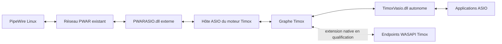

# PWAR et TimoxVasio : intégration envisagée

Revue statique actualisée le 24 octobre 2026, avec la grille `audio-dsp-review`.
Aucun pilote PWAR installé ou exécuté. **L'architecture reste envisageable ;
la révision examinée nécessite des corrections avant intégration.** Les quatre
fichiers examinés ont été téléchargés au commit immuable
`ed5b07c44c7635d006422d646d56368600504b3f`. Ce constat ne détermine pas la
version du binaire éventuellement utilisé par l'utilisateur.

Le [projet PWAR](https://github.com/ripxorip/PWAR) annonce un pont bidirectionnel
Windows ASIO/Linux PipeWire, à buffers variables, sans dérive. Il distribue un
pilote ASIO Windows distinct. Ces annonces ne constituent pas une mesure de
latence, de stabilité ou de dérive avec TimoxVasio.

PWAR devient un pilote externe sélectionné par le moteur. Aucun nouveau protocole
réseau ni fusion des deux DLL n'est nécessaire. Le pilote ASIO Timox reste
autonome ; le travail WASAPI natif conserve son périmètre indépendant.

## Compatibilité et limites observées

Dans [le pilote PWAR](https://github.com/ripxorip/PWAR/blob/ed5b07c44c7635d006422d646d56368600504b3f/windows/asio/pwarASIO.cpp),
le format est `ASIOSTFloat32LSB`, les fréquences acceptées 44,1/48 kHz, et la taille
est contrôlée par minimum, maximum et granularité. Le listener réseau déclenche
les callbacks : l'étiquette d'horloge « Internal » ne prouve pas une cadence locale
indépendante du réseau.

Les constats suivants empêchent de déclarer cette révision directement compatible :

- `createBuffers` alloue seulement les canaux demandés ; le listener lit toujours
  deux sorties. Une ouverture avec zéro ou une sortie risque un accès invalide.
- L'en-tête expose **une entrée et deux sorties** (`pwarASIO.h:30-31`). La boucle
  copie le premier canal réseau dans cette unique entrée. L'ancienne formulation
  « duplication des entrées » était trop générale : cette révision ne propose
  simplement pas deux entrées ASIO, donc pas de capture stéréo Linux → Windows.
- `stop` baisse un drapeau ; `disposeBuffers` libère ensuite les buffers sans
  drainage visible du listener. Une course avec un callback reste à exclure.

Les références exactes et les conséquences sont détaillées ci-dessous. Ces
déductions statiques ne sont pas des reproductions de crash ou des mesures audio.

Côté Timox, [PhysicalAsioHost](../src/physical_asio_host.cpp) accepte le
[float32](../src/asio_sample_conversion.cpp), valide les tailles annoncées et
installe les callbacks. Il alloue uniquement les canaux routés ; sans route, il
peut ouvrir une seule entrée pour l'horloge. Ce comportement explique le conflit
avec les deux sorties imposées ci-dessus. Un seul pilote ASIO physique sert de
maître : PWAR occuperait cette place, pas celle d'un second périphérique agrégé.

L'hôte retourne zéro aux messages ASIO, notamment reset/resynchronisation ;
la notification de changement de fréquence provoque un arrêt avec demande
explicite de réapplication dans [AudioController](../src/audio_controller.cpp).
Une reprise transparente après changement distant n'est donc pas acquise.

## Qualification minimale proposée

1. Identifier version, architecture x64, chemin et SHA-256 du PWAR réellement
   utilisé ; confronter son code aux constats avant chargement.
2. Corriger ou confirmer résolus les problèmes de canaux et d'arrêt. Tester les
   configurations sans route, entrée seule, sortie seule et duplex ; demander
   systématiquement deux sorties ne suffit pas à résoudre le cycle de vie.
3. Après correction de l'exposition des entrées, à 48 kHz et une taille commune
   annoncée par les deux côtés, envoyer deux tons distincts dans chaque sens :
   séparation, ordre, amplitude et continuité. Avec le code examiné inchangé,
   ne revendiquer qu'une entrée et deux sorties ASIO.
4. Mesurer cadence, dérive et sous-alimentations sur durée ; provoquer pertes,
   silence et redémarrage distant, puis stop/reconfiguration sous trafic.

Ces essais réutilisent la solution réseau existante. Aucun résultat de cette
matrice n'est actuellement revendiqué ; le benchmark local Timox et la compilation
du pilote WASAPI ne qualifient pas PWAR.

## Revue de la révision figée

Références : [implémentation ASIO](https://github.com/ripxorip/PWAR/blob/ed5b07c44c7635d006422d646d56368600504b3f/windows/asio/pwarASIO.cpp),
[en-tête ASIO](https://github.com/ripxorip/PWAR/blob/ed5b07c44c7635d006422d646d56368600504b3f/windows/asio/pwarASIO.h),
[contrat routeur](https://github.com/ripxorip/PWAR/blob/ed5b07c44c7635d006422d646d56368600504b3f/protocol/pwar_router.h),
[format paquet](https://github.com/ripxorip/PWAR/blob/ed5b07c44c7635d006422d646d56368600504b3f/protocol/pwar_packet.h).
Les lignes ci-dessous concernent ces fichiers, pas les sources Timox.

| Point | Preuve dans le code | Action nécessaire |
|---|---|---|
| Sorties partielles | `createBuffers:350-360` alloue par slot demandé ; listener `593-597` lit toujours les slots 0 et 1, sans consulter `outMap` | Lire uniquement les slots actifs et respecter leur numéro de canal ; produire du silence pour les canaux réseau absents |
| Arrêt et libération concurrents | `stop:174-177` change seulement `started` ; `disposeBuffers:395-435` efface callbacks et buffers ; listener `565-624` les utilise ; `started` est un bool ordinaire (`.h:101`) | Protocole d'arrêt avec acquittement du worker avant libération ; un bool atomique seul ne protège pas un callback déjà engagé |
| Arrêt sans trafic | `stopUdpListener:637-641` attend le thread ; celui-ci peut être bloqué dans `WSARecvFrom:554`, socket local non réveillé par l'arrêt | Réception annulable ou attente bornée, puis join ; tester aussi la fermeture sans aucun paquet Linux |
| Paquet invalide | `559-560` divise par `pkt.n_samples` après seulement un contrôle de taille du datagramme | Valider le champ avant tout calcul ; zéro provoque une division invalide avant même le routeur |
| Cycle réseau/audio | Constructeur `128` lance le listener ; `563` appelle le routeur avant le test `started` | Examiner l'implémentation du routeur et protéger explicitement les phases avant création et après destruction des buffers |
| Temps réel | Le même thread reçoit, appelle l'hôte puis envoie via `output:473` et `619` ; aucun mode non bloquant n'est configuré dans ce fichier | Séparer les attentes réseau du traitement audio ou démontrer un fonctionnement borné ; mesurer pertes et surcharge |

L'implémentation du routeur et du gestionnaire de latence n'a pas été relue dans
cette passe. Aucun constat de sûreté transitive ne découle de leurs seuls en-têtes.
Les tailles annoncées sont 64 à 2048 frames par pas de 64, valeur préférée 128.
Le format réseau est limité à deux canaux dans l'en-tête examiné ; ne pas ajouter
de format réseau Timox concurrent pour contourner ces limites.

Côté Timox, `PhysicalAsioHost::start` valide les canaux uniques et alloue les
seuls canaux routés ; sans route il choisit l'entrée 0 pour l'horloge. Ce chemin
est incompatible avec les lectures inconditionnelles de deux sorties PWAR.
Forcer deux sorties dans Timox ne résoudrait ni le drainage ni la capture mono.
La prochaine étape PWAR est donc une correction de l'implémentation Windows
compatible avec son protocole existant, suivie d'essais isolés de cycle de vie,
puis de la matrice audio Windows/Linux ci-dessus.

### Empreintes des sources examinées

SHA-256 des octets téléchargés, avant transformation locale :

| Fichier amont | SHA-256 |
|---|---|
| `windows/asio/pwarASIO.cpp` | `B736C17E2F42298E765149786247DE5FFC4BEE827B8D74C369127725145948BD` |
| `windows/asio/pwarASIO.h` | `134136D3710A0532201250D4075D04BC7D0B7ED49CFA94490EA351F405B12E70` |
| `protocol/pwar_router.h` | `D35555B1B643EDD094A13774C4E8AE8DD5A45BDA4BC9AD1F5311D70845FAC8AE` |
| `protocol/pwar_packet.h` | `D0F2B839BC91579D0FF53BCEBB1D78F193A5E25E4317616682E8A89F556BBA45` |

Ces empreintes identifient les sources revues, pas une DLL construite ou installée.

## Premier correctif préparé le 24 octobre

La lecture de `protocol/pwar_router.c` a ensuite confirmé des contrôles manquants
sur les indices, capacités et tailles. Le [patch 0001 et son banc de tests](../patches/pwar/README.md)
ajoutent ces validations sans changer le format des paquets. Test rouge sur
l'amont, puis application sur une extraction vierge et test vert, incluant
aller-retour stéréo et buffers maximaux. Le listener ASIO et sa division avant
appel au routeur restent à corriger ; aucune DLL PWAR modifiée n'a été construite.

Ensuite, le patch 0002 a corrigé l'arrêt du listener avant libération : timeout
du destructeur reproduit sur l'amont, puis tests réels de port UDP et de callback
retenu. Les deux patches appliqués à une extraction vierge compilent en DLL
séparée ; le banc CTest passe 2/2. Voir le README des patches pour empreinte,
procédure et limites. Aucun chargement COM ni essai Linux n'a été effectué.
