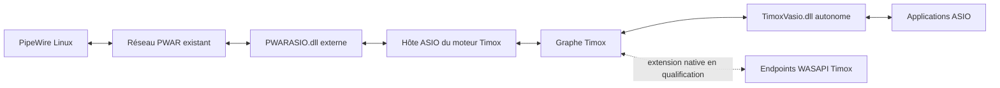

# PWAR et TimoxVasio : intégration envisagée

Revue statique du 22 octobre 2026, avec la grille `audio-dsp-review`. Aucun
pilote PWAR installé ou exécuté. **L'architecture convient ; la compatibilité
opérationnelle reste à qualifier.** Le contenu GitHub consulté provient de
`master`, avec un cache annoncé ancien de deux mois : pas de commit immuable
vérifié, donc les constats doivent être recoupés avec la version réellement utilisée.

Le [projet PWAR](https://github.com/ripxorip/PWAR) annonce un pont bidirectionnel
Windows ASIO/Linux PipeWire, à buffers variables, sans dérive. Il distribue un
pilote ASIO Windows distinct. Ces annonces ne constituent pas une mesure de
latence, de stabilité ou de dérive avec TimoxVasio.

PWAR devient un pilote externe sélectionné par le moteur. Aucun nouveau protocole
réseau ni fusion des deux DLL n'est nécessaire. Le pilote ASIO Timox reste
autonome ; le travail WASAPI natif conserve son périmètre indépendant.

## Compatibilité et limites observées

Dans [le pilote PWAR](https://github.com/ripxorip/PWAR/blob/master/windows/asio/pwarASIO.cpp),
le format est `ASIOSTFloat32LSB`, les fréquences acceptées 44,1/48 kHz, et la taille
est contrôlée par minimum, maximum et granularité. Le listener réseau déclenche
les callbacks : l'étiquette d'horloge « Internal » ne prouve pas une cadence locale
indépendante du réseau.

Trois points empêchent de déclarer cette révision directement compatible :

- `createBuffers` alloue seulement les canaux demandés ; le listener lit toujours
  deux sorties. Une ouverture avec zéro ou une sortie risque un accès invalide.
- Le listener copie le premier canal reçu dans chaque entrée : séparation stéréo
  non garantie.
- `stop` baisse un drapeau ; `disposeBuffers` libère ensuite les buffers sans
  drainage visible du listener. Une course avec un callback reste à exclure.

Enfin, `pkt.n_samples` sert de diviseur avant validation visible ; les entrées
réseau malformées nécessitent un audit. Les appels réseau sur le thread des
callbacks ne fournissent aucune borne de temps réel démontrée.

Côté Timox, [PhysicalAsioHost](../src/physical_asio_host.cpp) accepte le
[float32](../src/asio_sample_conversion.cpp), valide les tailles annoncées et
installe les callbacks. Il alloue uniquement les canaux routés ; sans route, il
peut ouvrir une seule entrée pour l'horloge. Ce comportement explique le conflit
avec les deux sorties imposées ci-dessus. Un seul pilote ASIO physique sert de
maître : PWAR occuperait cette place, pas celle d'un second périphérique agrégé.

L'hôte retourne zéro aux messages ASIO, notamment reset/resynchronisation ;
la notification de changement de fréquence provoque un arrêt avec demande
explicite de réapplication dans [AudioController](../src/audio_controller.cpp).
Une reprise transparente après changement distant n'est donc pas acquise.

## Qualification minimale proposée

1. Identifier version, architecture x64, chemin et SHA-256 du PWAR réellement
   utilisé ; confronter son code aux constats avant chargement.
2. Corriger ou confirmer résolus les problèmes de canaux et d'arrêt. Tester les
   configurations sans route, entrée seule, sortie seule et duplex ; demander
   systématiquement deux sorties ne suffit pas à résoudre le cycle de vie.
3. À 48 kHz et une taille commune annoncée par les deux côtés, envoyer deux tons
   distincts dans chaque sens : séparation, ordre, amplitude et continuité.
4. Mesurer cadence, dérive et sous-alimentations sur durée ; provoquer pertes,
   silence et redémarrage distant, puis stop/reconfiguration sous trafic.

Ces essais réutilisent la solution réseau existante. Aucun résultat de cette
matrice n'est actuellement revendiqué ; le benchmark local Timox et la compilation
du pilote WASAPI ne qualifient pas PWAR.
