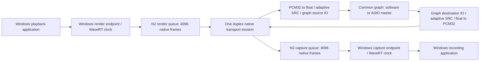

# Native Audio Backend N3 Implementation Plan

> **For agentic workers:** REQUIRED SUB-SKILL: Use superpowers:executing-plans to implement this plan task-by-task. Steps use checkbox (`- [ ]`) syntax for tracking. This document authorizes no driver deployment or production privilege change.

**Goal:** Build an optional, independently testable duplex backend connecting the existing N2 private transport to the common engine graph, with a bounded worker and no transport operation in graph callbacks.

**Architecture:** One native session owns one duplex transport handle, two immutable graph-rate IO buffers, and two independent adaptive SRC paths. The selected software/ASIO master remains the only graph clock. A direct Windows transport is restricted to an explicit elevated laboratory executable; production access requires the authenticated service broker in N4.

**Tech Stack:** C++17 engine code, existing SPSC IO and `DriftResampler`/`FillLevelController`, Win32 worker/event/timer primitives, N0 little-endian packets and N2 METHOD_BUFFERED IOCTLs, fake transport tests without WDK or audio hardware.

**Spec:** [Native Windows audio driver design](../specs/2026-10-22-native-windows-audio-driver.md). Read alongside this plan; this implements N3 only. N1/N2 compilation and host tests do not prove kernel loading or audio transfer on a target.

## Global Constraints

- « PCM signé 32 bits, 48 kHz, deux canaux » is the initial native wire format; graph format remains independently selected.
- « Aucun second appel du callback du graphe par le pilote natif. »
- « Aucun code noyau, WASAPI ni SRC n'entre dans la DLL ASIO. »
- « Ne pas rendre Electron administrateur permanent ni autoriser tous les utilisateurs à injecter/capturer le son d'une autre session. »
- No change to the installed ASIO CLSID, profiles or shared-memory transport; absence or failure of the native driver is nonfatal to the existing engine.
- No automatic Windows-render-to-Windows-capture route. No new API/store/GUI surface or packaging in N3; those remain N4/N6.
- Before each build: `git rev-parse --show-toplevel` and `git status --short`. Coordinate canonical builds with their current owner.

## Review Focus

1. Driver missing, access denied or owner already present: distinguish statuses and retain the running master (tasks 1 and 3).
2. Kernel handle reopened or devnode recreated: old packets and IO references cannot enter a replacement generation (tasks 1–3).
3. Empty render queue, full capture queue or stalled device: bounded pumping, no busy loop, no unbounded pending data (task 2).
4. Different graph/native rates and extreme ratios: preserve SRC fragments and count genuine drops/silence; FIFO reserve is not a stability guarantee (task 2).
5. Stop/removal during a transfer and graph replacement: retire borrowed pointers before destroying IO, cancel and join off RT (tasks 1–3).

## Current boundaries and signal flow



Windows render is a **source** for our graph. Windows capture is a **destination**. Names in the transport follow Windows direction; graph IO direction follows the graph. Existing `WasapiBridgeIo` supplies the bounded user-mode IO mechanism, but endpoint identities must never become `wasapi:*`. Reuse that class internally through a native-owned wrapper; defer a repository-wide neutral-name refactor.

`WasapiBridge` itself is not the native backend: its one-endpoint `IWasapiBackend` factory and capture/render worker lifecycle would open two competing N2 owners. Reuse the pure SRC/controller and PCM conversion primitives; keep native packet pacing, ownership and errors in a separate duplex worker. Windows PCM format descriptors may be constructed for conversion helpers internally, without publishing a fictitious WASAPI endpoint.

Latency consists of Windows buffering, WaveRT cadence, kernel queue, copied transport, graph IO, SRC delay and graph quantum. Do not report the sum of capacities as measured latency. N3 health distinguishes native frames from graph frames, and never labels tone presence as SNR/latency qualification.

## Actual N2 contract, not proposed capabilities

Current `native-windows-audio/include/native_audio_control_protocol.h` has four IOCTLs: SESSION, WRITE_CAPTURE, READ_RENDER and STATUS. Open/CLOSE are file lifecycle, not additional IOCTLs. There is no GET_CAPABILITIES, queued wait notification, capture occupancy query or driver-provided demand timestamp. The protocol format is fixed by N0; capability/version negotiation beyond validated N0 packets requires a later protocol increment.

The direct adapter opens `\\.\Global\TimoxWindowsAudioControl` with GENERIC_READ|GENERIC_WRITE. SESSION returns exactly eight generation bytes. READ_RENDER takes generation u64, maxFrames u32 and reserved zero u32; returns one validated packet or empty. WRITE_CAPTURE transfers one complete packet or reports full; retrying an unaccepted packet retains the same sequence. STATUS returns three u64 counters, not queue fill. All wire integers are decoded explicitly. Buffers are at most 32832 bytes, including the 64-byte header; frames are 1..4096. Distinguish expected empty/full statuses from disconnect, permission and malformed-response errors.

The session generation from the kernel is scoped to that device lifetime. A separate monotonically increasing engine epoch identifies each locally allocated generation, including a driver restart whose wire generation could repeat. Neither value comes from a UI selector.

## Files and interfaces

| File | Responsibility |
|---|---|
| `include/native_audio_transport.h` (new) | Injectable duplex wire transport and typed outcomes; no graph objects |
| `src/native_audio_transport_win32.cpp` (new) | Explicit direct-laboratory implementation; session validation, bounded buffers, cancellation |
| `include/native_audio_backend.h`, `src/native_audio_backend.cpp` (new) | Native generation, worker, two SRC/PI paths and health |
| `include/audio_routing_runtime.h`, `src/audio_routing_runtime.cpp` | Native bindings, source reads before routing and destination writes after routing |
| `include/routing_graph.h`, `src/routing_graph.cpp` | Native source/destination endpoint types and links |
| `tests/native_audio_transport_tests.cpp` (new) | Wire/session failures with fake system-call boundary |
| `tests/native_audio_backend_tests.cpp` (new) | Deterministic fake transport and clock; bounded worker tests |
| `tests/native_audio_routing_tests.cpp` (new) | Actual transfer, meters, retirement and callback allocation checks |
| `tests/native_audio_lab_probe.cpp` (new, explicit lab target) | Standalone integration harness, no controller publication or install |
| `CMakeLists.txt` | Opt-in test/probe targets and source/include dependencies; no WDK dependency for engine |

Define the following public contract in task 1:

```cpp
enum class NativeTransferCode { Ok, Empty, Full, Unavailable, AccessDenied,
    OwnedElsewhere, Removed, Cancelled, InvalidPacket, Failed };
struct NativeTransferResult { NativeTransferCode code; uint32_t bytes; uint32_t systemError; };
struct NativeSessionInfo { uint64_t wireGeneration; }; // N0 fixes 48000 Hz / stereo S32
class INativeAudioTransport {
public:
    virtual ~INativeAudioTransport() = default;
    virtual NativeTransferResult Open(NativeSessionInfo&) noexcept = 0;
    virtual NativeTransferResult ReadRender(uint32_t maxFrames, void* packet, uint32_t capacity) noexcept = 0;
    virtual NativeTransferResult WriteCapture(const void* packet, uint32_t bytes) noexcept = 0;
    virtual NativeTransferResult ReadStatus(uint64_t (&counters)[3]) noexcept = 0;
    virtual void RequestCancel() noexcept = 0; // sole method allowed concurrent with worker calls
    virtual void Close() noexcept = 0; // worker only, after outstanding operations finish
};
```

Transport completion may wait on its private IO event and stop event on the worker only. Use overlapped handles/events for the direct adapter, although current N2 normally completes immediately. On cancellation, cancel the outstanding operation and observe its completion before reusing memory or closing events. Limit to one outstanding operation per duplex session. Do not promise a hard stop deadline if a broken kernel driver fails to complete cancellation.

## Task 1 — Small first implementation lot: transport session only

**Files:** new transport header/Win32 source/test above; CMake opt-in `NativeAudioTransportTests`. No graph, controller, API or kernel changes.

**Consumes:** N0 packet validator and N2 IOCTL constants. **Produces:** `INativeAudioTransport` and `CreateDirectNativeAudioLabTransport()` returning `std::unique_ptr<INativeAudioTransport>`; implementation receives a fakeable Win32-operation boundary in tests.

- [x] Write failing tests for exact SESSION length/nonzero generation, malformed/truncated render replies, wrong direction/generation, monotonic render sequence, independent capture sequence, empty/full distinction, failed open with no leaked handle, and cancellation before buffer reuse.
- [x] Add tests proving open/close/reopen rejects packets carrying the previous wire generation; separately simulate repeated wire generation after devnode recreation and ensure the future backend must distinguish local epochs.
- [x] Configure `cmake -S . -B build_native_transport -DVASIO_BUILD_NATIVE_TRANSPORT_TESTS_ONLY=ON`, build `cmake --build build_native_transport --config Release --target NativeAudioTransportTests`, then run `ctest --test-dir build_native_transport -C Release --output-on-failure`. Run root/status checks first. This isolated target does not rebuild or interrupt the canonical engine.
- [x] Implement the adapter with RAII, exact byte counts, explicit error mapping, and fixed packet storage allocated before audio pumping. Inject syscall outcomes rather than requiring a driver for tests. Never elevate or retry access-denied with a broader ACL.
- [x] Re-run tests and review callback-independent lifetime. Record verification before a focused commit, if commits are authorized by the parent task.

**Verification (2026-10-22):** initial stub produced RED (`valid session must open`). Added PnP removal fixtures produced RED (`PnP removed-device error distinct`), then the explicit ERROR_DEVICE_REMOVED/ERROR_NO_SUCH_DEVICE mapping restored GREEN. Final isolated Release build passed with `/W4 /WX`; CTest passed 1/1 (0.03 s). The fake Win32 boundary exercises the actual adapter, including delayed cancellation completion, ERROR_NOT_FOUND cancellation races, sequence exhaustion, malformed replies and DRM AccessDenied with cleared output. Independent lifecycle review found no further issue after the mapping correction. No driver was opened and no real audio qualification was performed. Cancellation is sticky per transport instance; construct a fresh instance after cancellation. The adapter is laboratory-only; production broker and backend tasks remain incomplete.

**Gate:** this lot can land independently. It demonstrates protocol ownership and error handling only; it must not claim native audio delivery or production availability.

## Task 2 — Duplex generation and bounded worker

**Files:** native backend header/source/tests. **Consumes:** task 1 interface; existing `DriftResampler`, `FillLevelController`, `WasapiBridgeIo` and `WasapiBridgeCapacityFrames`.

**Produces:** `NativeAudioGeneration` holding `const uint64_t epoch`, session wire generation, and two `shared_ptr<WasapiBridgeIo>` named `windowsRenderSource` (Capture direction) and `windowsCaptureDestination` (Render direction). `NativeAudioBackend::Start(graphRate, maxQuantum, epoch) -> NativeTransferCode`, `RequestStop() noexcept`, `Stop() noexcept`, `Generation() const` (control thread), and `Health() const noexcept` (atomic observations). Constructor injects one `unique_ptr<INativeAudioTransport>` and one `unique_ptr<INativeAudioScheduler>` prepared off RT. Each backend is single-use, including failed Start; reconnection creates a new backend and local epoch. RequestStop is concurrent and sticky; Start/Stop/Generation/destruction remain serialized by the control owner.

- [x] Write failing deterministic tests: duplex shares one Open; two SRC streams preserve channel order and pending fragments at 44.1/48/96 kHz; ±1000 ppm mismatch converges without conflating native and graph frame counts; malformed packets retire both worker directions. Preserving unrelated audio during backend failure remains an integration-harness check in task 3.
- [ ] Backend capture-sequence exhaustion remains unexercised directly: the production branch prevents wrap and transport tests cover the wire boundary; no production test hook was introduced. Backend tests now cover render sequence MAX then wrap and repeated-wire-generation across two instances, as well as 1000 Empty/Full timer ticks, cancel during pending Open, worker allocation count zero, graph-rate/quantum bounds and reserve rejection. Callback allocation and graph retirement are task 3.
- [x] Allocate IO from a conservative native burst of 4096 frames at 48000 Hz using the existing reserve helper. Native transport has no discovered smaller maximum. Allocate packet, float, SRC and scratch storage before starting the worker; reject impossible reserve instead of clamping.
- [x] Implement one worker owning transport, conversion and two PI controllers. Graph source uses native-to-graph SRC; graph destination uses graph-to-native SRC. Track pending input/output until consumed. Apply the existing complete-drain midpoint observation policy, including its bounded backlog diagnostic; do not reset PI or SRC at each packet.
- [x] Implement a monotonic 5 ms laboratory pump deadline, with at most four READ_RENDER and four WRITE_CAPTURE operations per turn, each at most 512 native frames. Fairly alternate directions; query STATUS no faster than once per 250 ms. Empty ends that direction immediately; full preserves one pending packet and stops writes until the next tick. After the per-turn budget, wait on stop plus deadline even if more data exists; do not poll empty queues or replay an unbounded number of missed ticks.
- [x] Pace Windows-capture submission at 48000 native frames/s with a fractional accumulator (240 frames per ideal 5 ms tick), capped catch-up at 2048 frames per turn. Count skipped deadlines and discarded excess pacing credit. Initial/reprime shortage emits explicitly counted silence; retain a full-rejected packet before advancing sequence. Kernel STATUS has no demand/fill information: expose this limitation, including bounded stale buffered audio when the Windows capture client is inactive. Do not invent driver timestamps or feed capture kernel occupancy into the PI.
- [x] Test max-operation counts and absence of tight loops using the injected scheduler. Simulate slow consumers, a full pending packet, different graph callback phases and scheduling gaps. Exercise signal transfer through real SRC, rather than only a fluid FIFO model.
- [x] Record final isolated suite results after the added preparation-bound fixtures. Root rebuilt the three isolated targets in Release and ran `ctest --test-dir build_native_transport -C Release --output-on-failure`: 3/3 passed in 44.71 s. No reusable DSP primitive changed. Independent worker review found no P1/P2; silence diagnostics distinguish generated all-silent native packets, missing graph input frames and kernel counters.

**Verification so far (2026-10-22):** lifecycle stub RED (`duplex backend opens successfully`), then PCM RED (`native PCM passes real SRC to graph preserving channel polarity`), followed by GREEN. Real SRC tests cover 44.1/48/96 kHz PCM, independent +/-1000 ppm graph clocks for 60 simulated seconds each with no post-priming underrun/overflow and occupancy within 700 frames of target. Delayed wake1s emits at most four512-frame packets and records discarded credit; Full preserves identical pending bytes; malformed generation stops duplex; startup cancellation joins before release; stats poll every250ms. No heap allocation was detected after the worker entered its first wait. These are deterministic fake-transport tests, not loaded-driver audio or latency qualification.

**Gate:** deterministic worker behavior has partial qualification as recorded above; unchecked fixtures remain explicit. Poll cadence, reserve and adaptive control still require real target measurements; laboratory defaults are not advertised production latency or parity with ASIO.

## Task 3 — Native graph bindings and laboratory integration

**Files:** routing graph/runtime files and new routing tests/probe listed above; CMake. No automatic backend creation in `AudioController` yet.

**Consumes:** task 2 generation. **Produces:** `NativeRoutingBinding { std::string id; std::shared_ptr<NativeAudioGeneration> generation; }` and `AudioRoutingLayout::nativeBindings`; endpoint types `NativeSource` and `NativeDestination`.

- [x] Test stable endpoints `native:windows:input:1`, `native:windows:input:2` for Windows render sources and `native:windows:output:1`, `native:windows:output:2` for Windows capture destinations. The initial binding ID is exactly `windows`; epoch never enters the stable route ID. Reject duplicate binding IDs, shared IO pointers, mismatched rate/quantum/channel count and mixed epochs.
- [x] Extend existing source/destination link rules to native types while retaining the existing physical-to-physical restriction. Test native↔virtual-ASIO, native↔WASAPI and physical↔native; create no automatic native→native route. Existing WASAPI loopback protections remain intact. Document that cross-backend feedback through Windows cannot be inferred from N2 metadata and must not be advertised as automatically detected.
- [x] In runtime setup, retain generation references off RT and preallocate planes. `Process` borrows raw IO pointers, reads native source planes before the graph, then writes native destination planes afterward. Meter values follow the same graph endpoints. Actual-sample tests cover gain/mute/mix, priming, callback allocations and ownership counts. `Process` is unchanged: native bindings add no transport calls, locks or syscalls to the callback. Existing client signalling and timing calls are not claimed syscall-free.
- [x] Test lab removal publication with the software master still running (and the separate runtime test retaining a borrowed generation): publish replacement graph, wait for callback quiescence off RT, retire old runtime, stop/join old backend, then release the generation. Stable desired routes remain dormant while unavailable and can reactivate on a new epoch; integration harness owns that desired route list until N4 persistence exists.
- [x] Add a standalone lab probe using the software clock and explicit transport injection. With no driver, report unavailable cleanly. Never launch elevation, alter endpoints/default devices, install the driver, change TESTSIGNING or touch the permanent engine. A manual elevated launch on the dedicated target is a lab procedure, not a production deployment mode.
- [x] Run `NativeAudioRoutingTests`, existing routing regression targets and probe `--help` without hardware. Record that VM audio qualification is deferred unless actually performed; do not convert fake-transport success into a loaded-driver claim.

**Laboratory verification (2026-10-22):** isolated Release build succeeded, then all six CTest targets passed in 47.76 s: transport, backend, routing, lab session, probe help and probe fake. The backend run includes render sequence MAX then wrap rejection and repeated wire generation with independent epochs. The lab session exercises failure detach, master continuity, desired-route restoration, ownership rejection and route-only publication without reopening transport. Probe terminal-result regression was RED before correction: a failure between the last poll and final snapshot incorrectly reported success. Its shared predicate now requires Running/Ok plus callbacks and the expected fake PCM when applicable; the snapshot-to-Stop interval is not claimed failure-free. Only `--help` and `--fake --seconds 2` were executed; no native handle or loaded-driver qualification.

## N4 production boundary and deferred qualification

**Graph-binding verification (2026-10-22):** root reviewed the runtime/link changes, rebuilt and directly ran `WasapiRoutingRuntimeTests`, `AudioRoutingRuntimeTests` and `RoutingGraphTests` from `build_codex_110/Release`: all passed. Those canonical targets are not registered with CTest. `NativeAudioRoutingTests` also passed in the isolated CTest run above. Runtime tests prove local retention while a callback runs, followed by join and off-thread retirement; lab-session tests additionally exercise publication and fake-transport removal/recovery while the software master continues. Production controller publication and target-driver removal remain unqualified. The ASIO DLL SHA-256 remains `F4FC8AA0EDB929B74DB2459D6B69652955A1BE9FB21370C6A109DDB96983A0B6`.

N4 must supply a dedicated service identity allowed by the private-device ACL, authenticated IPC, authorization tied to the intended Windows session/user, bounded per-client requests and disconnect cleanup. The broker owns the sole kernel handle. The normal engine uses an `INativeAudioTransport` broker adapter; Electron and the permanent engine retain ordinary user privileges. Existing N2 allows SYSTEM/administrators only; selecting a service SID and modifying that ACL requires its own security review and tests. Shared IPC must preserve one-owner and epoch semantics rather than merely forwarding arbitrary IOCTLs.

Controller transactions, persisted enable/disable intent, native inventory/state, API schema and GUI context menus are N4. Driver loss must detach native bindings without changing the selected master; desired routes survive. Installation, signature, recovery and provenance remain separate N6 work.

N3 completion report must state whether these target tests were **not run**: real Windows playback→graph and graph→Windows recording; simultaneous duplex; cancellation/kill/reopen; suspend/resume/removal; Driver Verifier; ten-minute and endurance drift tests; p50/p95/max measured latency, CPU and discontinuity counts. A recoverable VM/target with the separately authorized test driver is required. Tests on a VM do not by themselves establish physical-machine latency parity.

## Handoff

Task 1 is committed independently. Task 2 worker and task 3 graph bindings are implemented with the remaining checks listed above. Laboratory publication/removal integration and the standalone probe are implemented and tested with fake transport. No production broker or kernel loading is claimed.
