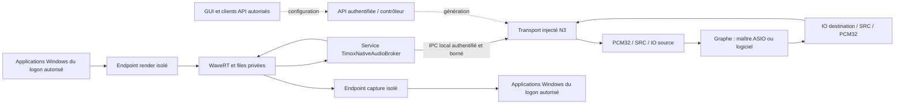

# Native Audio Production N4 Implementation Plan

> **Transport local remplacé le 24 octobre 2026 à la demande utilisateur :**
> AF_UNIX remplace les pipes comme cible ; voir
> [la migration sockets](2026-10-24-native-audio-unix-sockets.md).
> Les détails d'impersonation et de DACL de pipes ci-dessous sont historiques.
> L'identité par logon, l'arbitrage, l'isolation et les critères de performances
> restent requis ; leur mécanisme d'authentification socket doit être qualifié.

> **For agentic workers:** REQUIRED SUB-SKILL: Use superpowers:subagent-driven-development or superpowers:executing-plans to implement this plan task-by-task. Steps use checkbox (`- [ ]`) syntax for tracking. Ce document prépare du code et des essais ; il ne demande aucun chargement du pilote sur le poste actuel.

**Goal:** Donner au moteur ordinaire un accès authentifié au backend natif, avec configuration persistante, API et GUI, sans exposer le son d'une autre session Windows.

**Architecture:** Un service séparé possède exclusivement le contrôle noyau ; un transport injecté adapte son IPC au contrat `INativeAudioTransport`. Le contrôleur conserve la configuration désirée et publie des générations audio remplaçables, tandis que le maître ASIO/logiciel poursuit son fonctionnement en cas de panne native. L'isolation du PCM Windows est un lot distinct de l'authentification IPC : le pilote actuel ne porte aucune identité utilisateur dans ses paquets.

**Tech Stack:** C++17, Win32 SCM/service SID, named pipes locaux overlapped protégés par TLS Schannel mutuellement authentifié, stockage des clés CNG, N0/N2, backend N3, contrôleur et store existants, HTTP/WebSocket authentifiés, Electron/React.

**Spec:** [Conception du pilote natif](../specs/2026-10-22-native-windows-audio-driver.md), [transport N2](2026-10-22-native-audio-private-transport.md), [backend N3](2026-10-22-native-audio-backend.md). Les lots N5 de qualification et N6 de distribution restent séparés.

## Global Constraints

- « PCM signé 32 bits, 48 kHz, deux canaux » pour le transport natif initial.
- « Aucun second appel du callback du graphe par le pilote natif. »
- « Aucun code noyau, WASAPI ni SRC n'entre dans la DLL ASIO. »
- « Ne pas rendre Electron administrateur permanent ni autoriser tous les utilisateurs à injecter/capturer le son d'une autre session. »
- Identité initiale N3 `windows` ; ports persistants `native:windows:input:1`, `:input:2`, `:output:1`, `:output:2` (canaux numérotés à partir de 1). Input est le rendu Windows reçu par le graphe ; output alimente la capture Windows.
- La navigation gauche contient sections et actions globales uniquement. Actions d'objet par menu contextuel, détails en modale ; sélectionner un câble n'ouvre aucun panneau ni dialogue.
- Aucun câblage render→capture automatique, aucun changement du périphérique Windows par défaut. `TimoxVasio.dll` reste utilisable sans ce service ni ce pilote.
- Avant tout build : `git rev-parse --show-toplevel`, `git status --short`. Pas de chargement, changement de sécurité Windows ou installation globale dans l'exécution courante.

## Review Focus

1. Autre compte, même compte dans un autre logon, client distant ou serveur IPC usurpé : aucun paquet audio ni commande privilégiée accepté (lots 1–2).
2. Endpoints Windows déjà ouverts lors d'un changement de session : aucun PCM antérieur ou étranger remis à un nouveau propriétaire (lots 1 et 3).
3. Service absent, pilote retiré, moteur tué pendant une opération : maître inchangé, retrait des références après quiescence, configuration conservée (lots 2 et 4).
4. Requête HTTP/WebSocket locale venant d'un autre processus/utilisateur : aucune utilisation indirecte du broker par un moteur autorisé (lot 5).
5. Mise à jour partielle ou concurrente de configuration : routes natives préservées, conflit de révision explicite, pas d'activation dupliquée (lots 4–6).

## État constaté et frontière de confiance

Au 22 octobre, N2 est compilé et testé sur hôte, sans chargement noyau. Son ACL de laboratoire accepte SYSTEM/Administrateurs ; son unique session contrôle deux files globales. N3 apporte un transport direct explicitement laboratoire, un worker duplex avec SRC et des bindings de graphe ; l'intégration du contrôleur évolue indépendamment. Réutiliser les composants N3 effectivement présents au début de chaque lot, sans créer un deuxième gestionnaire concurrent.

Chemins existants vérifiés avec `rg --files` : `api/openapi-v1.json`, `api/schemas/api-v1.json`, `docs/API.md`, `gui/electron/engine-process.js`, `gui/electron/api-client.js` et leurs fichiers `.test.js`, `tests/audio_configuration_store_tests.cpp`, `tests/persistent_routes_tests.cpp`. Les chemins annoncés « créer » ci-dessous sont de nouveaux livrables ; les options/cibles `NativeAudioAccessPolicyTests`, `NativeAudioBroker*Tests` et `VASIO_BUILD_NATIVE_PRODUCTION_TESTS_ONLY` sont à ajouter, pas des commandes déjà disponibles.

`src/control_api_server.cpp` lie actuellement le serveur à `127.0.0.1` et valide des origines, dont l'origine absente. Ce n'est pas une authentification Windows : un programme local peut fabriquer ces requêtes. Protéger uniquement le pipe laisserait le moteur autorisé servir de relais à un autre compte. Les routes, inventaires et commandes concernées doivent donc passer par une API authentifiée avant activation publique.

Le service ne mixe pas, ne choisit pas l'horloge du graphe et ne lance pas Electron. Le coût du pipe copié s'ajoute au transport N2 ; conserver les métriques de pertes et mesurer la latence, sans assimiler capacité des files et latence réelle.

## Décisions retenues

### Identité du service et IPC

Nom SCM `TimoxNativeAudioBroker`, exécutable propre sous Program Files, compte LocalService, service SID `NT SERVICE\TimoxNativeAudioBroker` activé avec `SERVICE_SID_TYPE_UNRESTRICTED`, processus dédié. Le mot UNRESTRICTED désigne ici l'ajout du SID au jeton, pas des droits administrateur. Définir une liste minimale de privilèges et vérifier le jeton réel ; ne pas passer implicitement à LocalSystem si une API manque. L'accès à l'objet noyau est accordé au SID du service et à SYSTEM, pas à LocalService globalement ni au groupe Administrateurs dans le profil de production. Les administrateurs machine restent hors modèle d'attaquant, puisqu'ils contrôlent l'installation. [Service SID Microsoft](https://learn.microsoft.com/en-us/windows/win32/api/winsvc/ns-winsvc-service_sid_info).

Un seul propriétaire audio global tant que N2 possède une seule paire de files. Le broker garde le handle noyau dans son processus ; aucune duplication vers le moteur. Une connexion moteur acquiert un bail attaché à son jeton authentifié : SID utilisateur, SID de logon, `TokenSessionId` et `AuthenticationId`. PID et nom du processus ne constituent pas l'identité. Une deuxième connexion audio reçoit `OwnedElsewhere`, même avec le même compte ; elle ne peut pas reprendre le bail de force. La déconnexion annule, attend les completions, ferme le handle noyau et retire le bail avant une nouvelle ouverture.

Bootstrap local `\\.\pipe\Timox.NativeAudio.v1`, `PIPE_REJECT_REMOTE_CLIENTS`, première instance avec `FILE_FLAG_FIRST_PIPE_INSTANCE`, taille et nombre de connexions bornés. Politique machine initiale : un SID utilisateur autorisé explicitement par le provisioning, pas Users/Everyone. Le bootstrap ne transporte aucun PCM. Après lecture du handshake, impersonation pour relever le jeton, puis retour immédiat à l'identité service ; tout échec d'identification ou de `RevertToSelf` ferme la connexion et arrête le traitement privilégié. Le client utilise `SECURITY_SQOS_PRESENT | SECURITY_IDENTIFICATION` ; aucune délégation nécessaire. Un pipe de données distinct, nommé avec un nonce aléatoire, possède une DACL limitée au service/SYSTEM et au SID de logon authentifié. Son nom n'est pas un secret d'autorisation.

Accorder aux clients les droits individuels lecture/écriture de données, attributs nécessaires et synchronisation ; exclure `FILE_CREATE_PIPE_INSTANCE`, WRITE_DAC et WRITE_OWNER. Ne pas employer `GENERIC_WRITE` dans l'ACE client : il inclut le droit de créer une instance de pipe. Le client ouvre lui aussi avec les droits spécifiques correspondants. La DACL de logon isole des comptes et des logons, pas les processus du même logon, considérés ici comme une seule frontière de confiance. [Sécurité des pipes](https://learn.microsoft.com/en-us/windows/win32/ipc/named-pipe-security-and-access-rights), [niveaux d'identification](https://learn.microsoft.com/en-us/windows/win32/secauthz/impersonation-levels).

Authentifier **et chiffrer toute la connexion** : une signature isolée du transcript ne suffit pas, car un proxy peut relayer challenge et signature puis lire le PCM transmis en clair. Retenir TLS via Schannel/SSPI sur le flux de chaque pipe, avec certificats serveur et client obligatoires, TLS 1.2 minimum et suites AEAD autorisées par la politique Windows. L'échange de clés, l'intégrité, les numéros de records et le chiffrement restent entièrement dans Schannel (`InitializeSecurityContext`/`AcceptSecurityContext`, puis `EncryptMessage`/`DecryptMessage`). Aucun protocole cryptographique local et aucun retour au clair. Un relais transparent peut transmettre des records chiffrés ; cela ne lui donne pas le PCM ni la capacité de modifier des commandes authentifiées.

Le provisioning crée un certificat serveur dédié dont la clé privée CNG machine est non exportable et accessible seulement au SID du service/SYSTEM. Il crée ou enrôle séparément un certificat client dédié à l'utilisateur autorisé, clé privée CNG accessible à ce compte, et inscrit sous HKLM les empreintes/clefs publiques autorisées et leur association au SID utilisateur. Ces inscriptions sont modifiables uniquement par administrateurs/SYSTEM. Les deux pairs vérifient explicitement le certificat attendu, son usage serveur/client, sa validité et sa présence dans cette liste ; aucune ancre reçue du réseau/pipe n'est adoptée. Schannel demande une validation applicative du certificat client : un handshake techniquement réussi sans cette validation n'accorde pas le bail. Pas d'installation d'une autorité de certification générale dans les magasins Windows pour ce besoin. La rotation et la révocation modifient la liste locale puis ferment les connexions précédentes ; ne pas autoriser une connexion à rester active avec une identité révoquée.

Le certificat identifie le compte, pas son logon : conserver l'identification Windows du client du pipe et comparer son SID utilisateur à celui associé au certificat. Après TLS, échanger un message de liaison chiffré contenant SID de logon, `AuthenticationId`, `TokenSessionId`, nom du pipe et bail ; le serveur les compare à son jeton client observé et le moteur compare la réponse à son propre jeton. Aucun PCM avant accord. Un proxy dans un autre logon peut relayer TLS mais provoque un désaccord de ces identités ; un processus du même logon appartient à la frontière de confiance déjà déclarée. Le pipe de données effectue son propre handshake TLS et sa liaison de bail, sans réutiliser aveuglément la validation du bootstrap.

Faisabilité retenue, à prouver par le prototype du lot 2 : Schannel échange des tokens indépendamment du transport, donc le flux de pipe peut les porter ; LocalService utilise le certificat et l'accès ACL à sa clé, sans supposer des identifiants de domaine. LocalService présente des identifiants réseau anonymes : ne pas choisir `Negotiate` en supposant que Kerberos ou une authentification mutuelle NTLM sera toujours disponible sur un poste autonome. Une variante SSPI Negotiate n'est acceptable qu'après preuve d'identité des deux pairs et des attributs d'intégrité/confidentialité effectifs sur les Windows ciblés ; ce n'est pas un fallback automatique. Si les credentials Schannel ou les ACL de clés échouent, rester indisponible, sans élever le compte de service. [Authentification Schannel](https://learn.microsoft.com/en-us/windows/win32/secauthn/performing-authentication-using-schannel), [création du canal Schannel](https://learn.microsoft.com/en-us/windows/win32/secauthn/creating-a-secure-connection-using-schannel), [contrat SSPI Schannel](https://learn.microsoft.com/en-us/windows/win32/secauthn/initializesecuritycontext--schannel), [compte LocalService](https://learn.microsoft.com/en-us/windows/win32/services/localservice-account), [propriétés et ACL des clés CNG](https://learn.microsoft.com/en-us/windows/win32/seccng/key-storage-property-identifiers).

### Ce que l'IPC ne résout pas : isolation du PCM

Les paquets N0 ne portent pas l'identité des applications Windows. Microsoft documente qu'un mix de loopback peut contenir plusieurs sessions Terminal Services et que les devices de redirection Remote Desktop sont, eux, spécifiques à une session. C'est un avertissement architectural applicable à notre mélange global, pas une preuve du comportement précis de notre miniport non chargé. Ajouter un SessionId à un paquet après mélange ne sépare pas les voix. [Loopback et sessions Microsoft](https://learn.microsoft.com/en-us/windows/win32/coreaudio/loopback-recording).

Trajectoire complète retenue : endpoint duplex dédié au logon propriétaire, avec admission des ouvertures Windows vérifiée à cette frontière, files et durée de vie propres. Conserver une seule paire active dans le premier incrément ; le support simultané de plusieurs paires appartient à une évolution N2 versionnée. L'identité persistante des routes reste `native:windows:*` dans le profil utilisateur, indépendante des GUID d'instance temporaires et de la génération noyau.

Le lot 1 doit déterminer expérimentalement si l'ACL du filtre/device est appliquée au client original ou à un intermédiaire audio SYSTEM. Si le service audio masque cette identité, ne pas lui accorder indistinctement l'accès en prétendant obtenir une isolation : documenter le chemin observé et construire un endpoint réellement spécifique à la session, sur le modèle d'isolation des devices de redirection Windows, avec prototype et références DDI précises avant adaptation du pilote. Le mécanisme de visibilité par session reste à démontrer ; ce plan ne prétend pas qu'un devnode simplement renommé suffira.

Un mode provisoire d'exclusivité console peut être développé pour le laboratoire : refuser dès qu'un autre logon interactif existe, retirer le bail sur verrouillage/déconnexion/logoff/changement de console, fermer les handles, purger les files et désactiver/retirer l'endpoint avant une nouvelle admission. Les notifications de session sont asynchrones : sans preuve de fermeture atomique de l'accès audio, ce mode ne satisfait pas l'isolation hostile et ne débloque pas la production. Il sert à tester les transitions, pas à contourner le lot d'isolation.

### Contrat IPC et reprise

Créer une enveloppe applicative little-endian explicite de 48 octets, toujours à l'intérieur du canal TLS : magic u32, version u16, opcode u16, headerBytes u32, payloadBytes u32, requestId u64, leaseId u64, status u32, reserved u32=0, reserved u64=0. Version 1 ; taille maximale de payload 32832 octets ; une requête outstanding par connexion de données ; pas de pointeur, de chemin arbitraire, d'IOCTL arbitraire ni de handle sérialisé. Les opérations audio sont SESSION, READ_RENDER, WRITE_CAPTURE, STATUS et CLOSE ; les formats N0 restent inchangés à l'intérieur. Les opcodes de liaison applicative sont validés avant tout accès au pilote et utilisent le même plafond. Le framing TLS est distinct : consulter les tailles Schannel, traiter records fragmentés/coalescés et `SECBUFFER_EXTRA`, refuser plus de 256 KiB de stockage total par connexion et un handshake dépassant 5 secondes. Ne jamais interpréter les limites N0 comme les tailles des records chiffrés.

Les réponses portent un statut du domaine broker défini séparément des codes Win32 ; conserver un `systemError` diagnostique dans le payload d'erreur borné, sans chemins ni secrets. Le broker valide N0 à l'entrée et à la sortie, le propriétaire, la génération, les tailles et le numéro de requête ; une écriture Full peut être retentée avec le même paquet N0 mais un nouveau requestId. Close puis Open n'utilisent jamais une instance de transport annulée. Transport moteur : mêmes garanties `RequestCancel` sticky et completion avant libération que N3.

Le contrôleur réessaie seulement `Unavailable`/`Removed` avec temporisation 1, 2, 4, 8 puis 30 secondes, sur sa boucle hors RT, tant que la configuration reste activée. AccessDenied, échec d'authentification, incompatibilité protocole et Protected ne déclenchent pas de boucle de reconnexion. Aucun redémarrage du maître pour ces échecs. Un nouvel essai alloue un nouvel epoch moteur et une nouvelle instance de transport ; génération filaire et bail ne sont jamais persistés.

## Lots d'implémentation

### Lot 1 — Politique d'admission testable et preuve d'isolation audio

**Politique pure vérifiée :** `NativeAudioAccessPolicyTests` est disponible via `VASIO_BUILD_NATIVE_PRODUCTION_TESTS_ONLY`. Après RED observé, revue indépendante, compilation parent MSVC `/W4 /WX` et CTest 1/1, les décisions d'admission et de retrait couvrent les identités incomplètes, comptes/logons distincts, LUID 64 bits, réutilisation de SessionId, verrouillage et absence de qualification. L'identité console complète est obligatoire ; le collecteur Windows reste à implémenter. Le [protocole de qualification](../../native-audio-session-qualification.md) distingue ces preuves synthétiques des essais PCM et des handles préouverts, encore non exécutés.

**Files:** créer `include/native_audio_access_policy.h`, `src/native_audio_access_policy.cpp`, `tests/native_audio_access_policy_tests.cpp`, `tests/native_audio_session_qualification.ps1`, `docs/native-audio-session-qualification.md` ; modifier `CMakeLists.txt` pour une option isolée `VASIO_BUILD_NATIVE_PRODUCTION_TESTS_ONLY` sans SDK ASIO ni WDK, enrichie par les tests purs/IPC des lots suivants. Les changements éventuels du pilote feront l'objet d'un plan fils fondé sur le rapport cible.

**Interfaces:** `NativePeerIdentity { userSid, logonSid, authenticationId, sessionId }`, `NativeSessionPolicySnapshot { allowedUserSid, consoleSessionId, interactiveLogonCount, unlocked, audioIsolationQualified, optionalActiveLeaseIdentity }`, `NativeAdmission EvaluateNativeAdmission(const NativePeerIdentity&, const NativeSessionPolicySnapshot&) noexcept`. Résultats : Allowed, WrongUser, WrongLogon, UnsupportedSession, Locked, IsolationUnqualified. Un SID est une valeur issue d'un jeton, jamais d'un champ client.

- [ ] Écrire les tests rouges : utilisateur B refusé, même SID utilisateur/logon différent refusé lorsqu'un bail appartient déjà à un logon, session distante refusée dans le périmètre initial, identité incomplète refusée, endpoint non qualifié refusé ; transition de session retire le bail.
- [ ] Configurer `cmake -S . -B build_native_production -DVASIO_BUILD_NATIVE_PRODUCTION_TESTS_ONLY=ON`, puis `cmake --build build_native_production --config Release` pour observer les tests rouges. Implémenter la politique pure, reconstruire et exécuter `ctest --test-dir build_native_production -C Release -R NativeAudioAccessPolicyTests --output-on-failure` ; attendu : tous les cas passent.
- [ ] Préparer le banc cible sans l'exécuter sur l'hôte : comptes A/B, deux logons du même compte, console/RDP, flux préouverts, WASAPI partagé/exclusif et accès KS. Chaque source émet une séquence identifiable et chaque récepteur vérifie l'absence de celle de l'autre logon.
- [ ] Sur cible récupérable uniquement, mesurer identité vue à l'ouverture et après changement de session, enregistrer les refus d'accès et rechercher les derniers samples de l'ancienne génération dans toutes les files/DMA. Critère : aucun sample étranger et aucune ouverture conservée donnant accès au nouveau logon ; échec implique adaptation de la frontière endpoint, pas assouplissement des tests.
- [ ] Livrer rapport avec chemin DDI retenu pour l'endpoint dédié et plan fils de son implémentation. Le développement fake des lots suivants peut continuer avant la disponibilité de la cible ; `audioIsolationQualified` reste faux pour tout accès réel.
- [ ] Commit distinct `test(native-audio): define session admission and isolation qualification`.

### Lot 2 — Broker borné et transport client injecté

**Noyau de session vérifié :** `native-windows-audio/broker/broker_session.*` arbitre un propriétaire audio unique parmi quatre connexions déjà authentifiées au maximum. La politique injectée refuse l'accès réel non qualifié ; connexion, bail et génération restent distincts. Le composant valide requêtes et réponses N0, suit les séquences sans wrap et conserve au plus un paquet capture pour les reprises Full strictement identiques. L'annulation concurrente protège la durée de vie du transport jusque pendant Open, Read et Write ; les autres méthodes restent sérialisées sur le worker du service.

Après RED observé, compilation parent `/W4 /WX`, CTest production 2/2 et revue indépendante favorable, les tests couvrent propriétaire concurrent, requêtes rejouées, petits buffers sans mutation, erreurs d'accès conservées, annulation et retrait. Les identités et transports sont simulés : TLS, pipe, collecte Windows et isolation PCM restent hors de cette preuve. Le futur canal doit transmettre exactement le nombre d'octets retourné, abandonner les réponses non envoyées après révocation et annuler les IO avant d'attendre le worker pour une transition de politique. Ce noyau n'est pas encore un service utilisable par le moteur.

**Faisabilité Schannel vérifiée :** le [prototype autonome](../../../native-windows-audio/schannel-probe/README.md) réalise en mémoire un handshake TLS 1.2 mutuel avec certificats épinglés et AES-GCM. Le parent a reproduit le succès du mode explicite à clés utilisateur temporaires, y compris trois suppressions et trois vérifications d'absence. Le mode éphémère est SKIP hors sandbox, pas une réussite TLS. Revue indépendante favorable et build parent vérifié. Aucun pipe, service LocalService, collecteur d'identité ou mécanisme d'isolation audio n'est qualifié par ce prototype.

**Files:** créer `include/native_audio_broker_protocol.h`, `include/native_audio_broker_transport.h`, `src/native_audio_broker_transport.cpp`, `native-windows-audio/broker/broker_session.h`, `native-windows-audio/broker/broker_session.cpp`, `native-windows-audio/broker/pipe_server.cpp`, `native-windows-audio/broker/service_main.cpp`, `native-windows-audio/broker/schannel_channel.h`, `native-windows-audio/broker/schannel_channel.cpp`, `tests/native_audio_broker_tests.cpp`, `tests/native_audio_broker_transport_tests.cpp`. Le canal Schannel est partagé par client et serveur. Réutiliser `include/native_audio_transport.h`, adaptateur direct N3 uniquement dans le service et les outils labo.

**Premier sous-lot vérifié (2026-10-22) :** le validateur pur `include/native_audio_broker_protocol.h` et `tests/native_audio_broker_protocol_tests.cpp` définissent l'enveloppe audio v1 post-authentification : magic TVAB, opcodes 1..5, bit 15 réponse, tailles exactes et payloads documentés dans le header. SESSION attribue un bail non nul uniquement dans sa réponse réussie ; les autres messages corrèlent le bail et la génération du contexte. Le code ne gère ni TLS, ni autorisation, ni état de session ou anti-rejeu : il valide des octets contre un contexte fourni par le futur handler. Après test rouge, compilation `/W4 /WX`, revue indépendante favorable et reconstruction parent via `NativeAudioBrokerProtocolTests`, CTest ciblé réussit 1/1. Les tailles tronquées/surdimensionnées, réservés, statuts, N0, adresses non alignées et limite UINT64_MAX sont couverts. Ce n'est pas encore un broker utilisable.

**Interfaces:** `CreateBrokerNativeAudioTransport() -> std::unique_ptr<INativeAudioTransport>` ; `BrokerSession` reçoit une identité authentifiée, une décision Allowed et un `INativeAudioTransport` injecté. Le parseur pur retourne un résultat explicite sans modifier le lease en cas d'échec. Le service possède l'unique `BrokerSession` audio.

- [ ] Tests rouges du parseur : toutes troncatures du header, payload au-delà de 32832, reserved non nul, opcode/version inconnu, overflow, requestId répété, bail/génération incorrects, capture/render inversés. Tests du bail : deux clients concurrents, déconnexion entre Full et retry, kill et nouvelle connexion, invalidation des anciens paquets.
- [ ] Implémenter le parseur et le relais fake ; aucune file audio supplémentaire non bornée. La lecture lente d'un client conserve au plus une réponse de 32880 octets ; délai handshake 5 secondes, 4 connexions bootstrap maximum. Toute opération de shutdown attend ses completions avant de libérer ses buffers.
- [ ] Ajouter les tests Windows IPC sans pilote : DACL de logon, refus connexion distante, impossibilité de créer une seconde instance côté client, serveur précréé malveillant, certificat serveur substitué/expiré, certificat client absent/non autorisé, `RevertToSelf` en échec, annulation pendant une réponse partielle. Zéro PCM avant validation TLS et liaison de bail des deux pipes.
- [ ] Ajouter un véritable proxy de test relayant le handshake puis enregistrant/modifiant/rejouant les records : il ne doit obtenir aucun PCM en clair, toute modification doit interrompre la connexion, et un relais depuis un autre logon doit échouer à la liaison d'identités. Tester records TLS fragmentés/coalescés, EOF au milieu d'un record, limite de mémoire et renouvellement/révocation des certificats. Les fakes seuls ne prouvent pas les propriétés du canal réel.
- [ ] Implémenter le canal Schannel et le transport avec dépendances Win32 injectables ; vérifier credentials LocalService et certificats client en session utilisateur sur poste autonome avant adoption. `RequestCancel` reste l'unique opération concurrente. Ne jamais exécuter de commande shell ou ouvrir un chemin fourni par le client.
- [ ] Exécuter `ctest --test-dir build_native_production -C Release -R "NativeAudioBroker" --output-on-failure`, puis revue sécurité indépendante. Les tests Windows nécessitant installation du service restent marqués non exécutés tant qu'aucune cible n'est disponible.
- [ ] Commit `feat(native-audio): add authenticated bounded broker transport`.

### Lot 3 — Provisioning du service et retrait des droits laboratoire

**Files:** créer `native-windows-audio/scripts/provision-broker.ps1`, `native-windows-audio/scripts/remove-broker.ps1`, `native-windows-audio/broker/README.md` ; modifier ultérieurement `native-windows-audio/driver/control.cpp` et le paquet/INF pour l'ACL de production, dans un commit séparé du broker.

**Interfaces:** provisioning prend `-AllowedUserSid` et des chemins absolus de livrables vérifiés ; il produit un manifeste local contenant service SID, version/hash, certificats/empreintes publics autorisés et état d'installation. Aucun secret privé dans le dépôt ou le manifeste. Mode `-WhatIf` obligatoire avant installation réelle. L'enrôlement du certificat client est une opération de provisioning authentifiée, jamais une commande disponible au premier client d'un pipe public.

- [ ] Tests rouges : binaire absent/hash erroné, cible hors répertoire produit, mauvais SID, service d'un autre produit, rollback après création clé mais avant service, mise à jour empêchée par handle existant. Aucun wildcard de suppression.
- [ ] Créer certificats/clés/ACL/liste de confiance/registre/service dans l'ordre avec rollback limité aux objets créés par cette transaction. Répertoire et SCM modifiables seulement par administrateurs/SYSTEM ; SID de service autorisé en lecture/exécution et usage de la clé serveur. Vérifier que seul le compte enrôlé accède à sa clé client, que le service ne sélectionne pas silencieusement un autre certificat et que le jeton effectif contient le service SID.
- [ ] Retirer l'ACE Administrateurs du contrôle privé de production ; dériver/vérifier le SID attendu du nom de service exact, conserver le GUID de classe privé. Tester que le moteur ordinaire ne peut pas ouvrir directement le pilote, que le service le peut et que le probe laboratoire signale clairement ce changement.
- [ ] Tester arrêt service, crash, mise à jour et désinstallation sur cible : session audio retirée, aucun handle hérité, ASIO autonome toujours fonctionnel. Les notifications PnP/WTS déposent un travail de retrait, sans attendre dans le handler. [Événements de service Microsoft](https://learn.microsoft.com/en-us/windows/win32/services/receiving-events-in-a-service).
- [ ] Commit `feat(native-audio): provision isolated broker identity` ; ne pas intégrer au Setup général avant les gates N5/N6.

### Lot 4 — Activation contrôleur et persistance transactionnelle

**Vérification d'intégration complémentaire :** reconstruction Release de `TimoxVirtualAsioEngine`, `ApplicationProfilesApiTests` et `WasapiBridgeApiTests` réussie ; les deux exécutables de tests API ont ensuite terminé avec code 0. Le moteur compilé mesure 1 222 144 octets, SHA-256 `A8E026EEAF95A9C5B614DC235842F78D2693E2CA0693BF48BC13F52E182E0103` (UTC 2026-10-22 18:02:51). Il n'a pas été lancé pour cet essai ni intégré à un Setup. Ces tests de régression ne valident pas les futurs champs natifs ou l'authentification de l'API.

**Intégration contrôleur vérifiée (2026-10-22) :** le contrôleur accepte une factory de transport native injectée, réconcilie le manager sur son worker et publie ses bindings dans les remplacements de graphe. Sans factory, l'état reste Unavailable sans ouverture directe du pilote. Les changements de format conservent l'ancien propriétaire pendant la préparation et la sauvegarde : un échec restaure le même IO/epoch ; un succès retire l'ancien propriétaire avant une nouvelle ouverture. Disable et StopAudio retirent le graphe et attendent les callbacks avant l'arrêt du backend. L'epoch réellement publié est suivi indépendamment des snapshots, afin qu'une exception après publication n'arrête pas un backend encore emprunté.

Après test rouge observé, revue indépendante et correction du chemin d'exception, le parent a reconstruit les quatre cibles Release et exécuté `AudioControllerNativeTests`, `AudioControllerWasapiTests`, `AudioControllerPersistenceTests` et `AudioControllerClockTests` : toutes réussissent. Le test natif couvre PCM dans les deux sens via le vrai graphe/SRC avec maître et transport simulés, absence/reprise, retrait/réactivation, refus d'accès sans retry automatique, restauration et omission legacy, conflits, échec Save et échec du maître. Le PCM constant ne démontre pas l'absence de samples anciens entre epochs ; aucune qualification du pilote, service, isolation de session ou latence matérielle n'en découle. API, broker de production et GUI native restent à intégrer.

**Premier sous-lot vérifié (2026-10-22) :** `PersistentRoutes::ResolveForClock` accepte désormais les bindings natifs en dernier argument optionnel. Sans binding, les routes natives sont filtrées du graphe actif sans modifier la liste désirée ; une nouvelle génération les réactive avec les mêmes identifiants stables. `NativeEndpointType` reconnaît uniquement les quatre ports stéréo 1/2. Test rouge observé (`unavailable native route was activated`), puis reconstruction Release et `PersistentRoutesTests` réussis ; revue indépendante favorable. Ce sous-lot ne fournit ni sauvegarde du booléen d'activation, ni branchement contrôleur/API/broker. Les étapes ci-dessous restent à compléter.

**Configuration désirée vérifiée (2026-10-22) :** `NativeAudioConfiguration` et `configuredNativeAudio` conservent maintenant le booléen désiré sans ouvrir de backend. Le store accepte exclusivement `{enabled:boolean}` et considère l'absence du champ comme désactivée. Les appels historiques à `ApplyConfiguration` préservent cette valeur ; un appel qui la remplace passe explicitement le dernier argument `preserveNativeAudio=false`. Après le test rouge du chargement natif, `AudioConfigurationStoreTests` et `AudioControllerPersistenceTests` ont été reconstruits et exécutés avec succès par l'agent puis réexécutés par le parent. Le parent a aussi reconstruit et exécuté `AudioControllerWasapiTests` avec succès. Couverture : ancien store, valeurs true/false, JSON invalide sans mutation de sortie, conflit de révision, échec Save et redémarrage. L'activation effective, le manager, l'API et le broker restent à réaliser.

**Manager et maintien du maître vérifiés (2026-10-22) :** `NativeAudioManager` fournit des actions explicites `Detach`/`AttemptOpen`, un propriétaire unique, des epochs partagés sans wrap et des reprises 1/2/4/8/30 secondes uniquement pour Unavailable/Removed. Aucune factory par défaut ne sélectionne le transport direct de laboratoire. Un backend échoué reste possédé jusqu'au retrait explicite ; l'appelant doit garantir la quiescence avant Stop/destruction. Un rejet de publication peut arrêter les reprises via une raison typée. Deux tests rouges ont précédé l'implémentation ; revue indépendante favorable, build parent `/W4 /WX`, puis CTest ciblé 1/1 réussi (1.80 s). Le manager n'est pas encore branché dans le contrôleur. Séparément, `AudioControllerWasapiTests` a reproduit puis vérifié le maintien du maître ASIO lorsque le natif est désiré, sans route active ni client, ainsi que StopAudio/StartAudio. Réserver les canaux physiques des routes natives dormantes et intégrer les transactions/reconnexions restent à faire.

**Réservations physiques vérifiées (2026-10-22) :** les routes natives désirées réservent maintenant leurs canaux physiques valides lors de l'ouverture ASIO. Le contrôle de permutation à chaud tient compte de ces réservations : une modification compatible conserve le maître ; un nouveau canal absent des buffers impose une reconfiguration. Les indices restent globaux, triés et uniques ; les identifiants malformés ou hors capacités ne réservent aucun canal. Cette vérification n'est pas encore un rejet global de toute route désirée invalide. Test rouge confirmé avec activation explicite et réservation retirée, puis build Release et `AudioControllerWasapiTests` réussis, réexécuté par le parent. Tests : canaux non contigus, gain/mute inchangés, ajout et retrait de réservation. Le routage PCM natif à travers le contrôleur attend toujours l'intégration du manager.

**Files:** modifier `include/audio_controller.h`, `src/audio_controller.cpp`, `src/audio_configuration_store.cpp`, `src/persistent_routes.h` ; créer `include/native_audio_configuration.h`, `src/native_audio_configuration.cpp`, `tests/audio_controller_native_tests.cpp` ; étendre `tests/audio_configuration_store_tests.cpp` et `tests/persistent_routes_tests.cpp`. Réutiliser bindings/runtime N3.

**Interfaces:** `NativeAudioConfiguration { bool enabled=false; }` dans la configuration désirée ; factory injectée `std::function<std::unique_ptr<INativeAudioTransport>()>`, valeur production `CreateBrokerNativeAudioTransport`. Snapshot distingue configuration désirée, présence broker/pilote, état effectif, code/erreur, format et métriques avec unités. Aucun transport direct sélectionnable depuis JSON.

- [ ] Tests rouges : ancien store sans champ → désactivé ; configuration partielle sans champ conserve sa valeur ; routes `native:windows:*` valides même pilote absent ; ID/canal invalide rejeté ; conflit expectedConfigurationRevision → aucune mutation durable ni effective.
- [ ] Brancher préparation/activation et retrait sur le worker du contrôleur ; le callback ne possède que des pointeurs empruntés. Sur remplacement, publier le runtime préparé, attendre la quiescence de l'ancien, puis arrêter/détruire ses ressources hors RT. Si l'activation native échoue, conserver maître et routes désirées, publier ports indisponibles sans fausse liaison WASAPI.
- [ ] Tester faux broker absent, removed pendant IO, panne après publication, retry plafonné, désactivation pendant backoff, nouvelle génération et epoch après reprise. Vérifier que les routes ASIO indépendantes continuent et qu'aucune boucle automatique n'est ajoutée.
- [ ] Reprise de route après changement de logon : nouvelle admission explicite, jamais transfert silencieux du bail précédent. La configuration est conservée dans le store utilisateur existant ; aucune configuration audio utilisateur n'est écrite dans le service machine.
- [ ] Exécuter les cibles `AudioControllerNativeTests`, `AudioConfigurationStoreTests`, `PersistentRoutesTests` et les tests runtime N3 pertinents ; commit `feat(native-audio): persist optional native activation safely`.

### Lot 5 — API authentifiée et schémas cohérents

**Précision après inspection des clients (2026-10-22) :** le bearer seul sur HTTP localhost ne suffit pas à authentifier le serveur. Après un arrêt du moteur, un processus peut reprendre son port et recevoir le secret d'un client utilisant une découverte périmée. Vérifier PID, heure de création et port est utile pour rejeter un état périmé, mais laisse une course ; un challenge HMAC préalable peut lui-même être relayé par un proxy actif. Avant la migration, qualifier un canal qui authentifie le serveur et protège toute la connexion : TLS avec certificat épinglé depuis la découverte protégée et clé distincte du bearer, ou IPC authentifié de bout en bout. Aucun repli HTTP non authentifié ne doit subsister. Cette exigence reste à implémenter et tester, elle n'est pas une propriété de l'API actuelle.

La migration doit couvrir le filtre central `set_pre_request_handler` de `src/control_api_server.cpp` avant dispatch et upgrade WebSocket, les deux chemins HTTP et le constructeur WebSocket de `gui/electron/api-client.js`, ainsi que l'attachement à un moteur déjà actif dans `gui/electron/main.js`. Le moteur détaché peut survivre à Electron : un canal parent utilisé uniquement au lancement ne couvre donc pas la reconnexion. Le renderer conserve son interface IPC sans recevoir le credential. Ajouter un essai de port repris et un proxy actif aux tests de rotation, de découverte périmée et de refus REST/WS ; aucune donnée d'état ou de vumètre ne doit précéder l'authentification.

**Files:** modifier `include/control_api_server.h`, `src/control_api_server.cpp`, `api/openapi-v1.json`, `api/schemas/api-v1.json`, `docs/API.md`, `gui/electron/engine-process.js`, `gui/electron/api-client.js`, leurs tests ; créer `tests/control_api_auth_tests.cpp` et `tests/control_api_native_tests.cpp`.

**Interfaces:** ajout JSON `nativeAudio: { enabled: boolean }` dans la mutation transactionnelle existante et `nativeAudio` dans le snapshot. Champs d'état explicites : `disabled`, `starting`, `running`, `unavailable`, `denied`, `ownedElsewhere`, `removed`, `failed`. Garder séparés `configuredRoutes` et routes actives. Aucun endpoint API d'installation, d'élévation, de SID arbitraire ou d'ouverture IOCTL.

- [ ] Tests rouges REST et WebSocket : pas de credential, credential périmé/faux, bon Origin sans credential, requête sans Origin, reconnexion WebSocket, autre compte lisant le fichier de découverte. Toutes les commandes et données de routage doivent être protégées ; une simple route native indirecte ne contourne pas le contrôle.
- [ ] Générer un bearer aléatoire 256 bits par démarrage moteur. Le publier seulement via canal parent hérité explicitement ou fichier de découverte avec DACL du logon propriétaire et SYSTEM ; jamais ligne de commande, URL, logs ou localStorage. Le main Electron conserve le credential et effectue REST/WebSocket ; le renderer invoque seulement les opérations IPC autorisées. Les clients API externes du même logon utilisent le même mécanisme de découverte documenté.
- [ ] Exiger l'authentification avant dispatch HTTP et avant upgrade WebSocket ; maintenir les contrôles Origin en complément, pas comme preuve d'identité. Rotation au redémarrage, erreurs sans secret. Ce durcissement touche les clients existants : les migrer et tester dans le même lot ; ne pas laisser une voie legacy non authentifiée permettant de changer les routes lorsque le natif est actif.
- [ ] Ajouter les contrats native : format 48 kHz/PCM32/stéréo, format graphe distinct, compteurs avec unités native/graphe, absence de mesure de latence tant qu'elle n'existe pas. Une mutation syntaxiquement valide peut conserver `enabled=true` avec état `unavailable`, sans déclarer le backend actif.
- [ ] Exécuter tests API C++, `node --test gui/electron/api-client.test.js gui/electron/engine-process.test.js`, puis `npm --prefix gui run contract-test` ; commit `feat(api): authenticate native audio control and publish status`.

### Lot 6 — GUI unifiée et qualification du parcours

**Sous-lot de statut en lecture seule (23 octobre 2026) :** `NativeAudioDialog`
est accessible depuis le menu contextuel du fond du graphe. Il distingue les
états d'admission, l'absence de périphérique et la déconnexion, sépare format
natif et graphe actif, et affiche les compteurs avec leurs unités. Aucun appel
d'activation ni détail contextuel ajouté à la navigation. Focus modal, Escape
et retour du focus couverts. La revue a détecté le retour prématuré d'un ancien
état Running pendant la reconnexion : correction par génération de connexion,
avec régression couvrant aussi une deuxième déconnexion pendant la requête.
Les trois suites App, RoutingPatchbay et NativeAudioDialog passent : 71 tests.
Contrôle visuel sur fixture locale simulée à 1280×900 et 390×844 ; captures dans
`output/playwright/native-audio-desktop.png` et `native-audio-mobile.png`.
Ce sous-lot ne valide ni activation, ni ports routables natifs, ni audio réel.
Le lot 6 complet reste à réaliser après raccord de l'API authentifiée.

**Files:** modifier `gui/src/App.js`, `gui/src/RoutingPatchbay.js`, `gui/src/api-contract.js`, leurs tests et `gui/src/api-contract.test.cjs` ; créer `gui/src/NativeAudioDialog.js` et `gui/src/NativeAudioDialog.test.js` si une modale dédiée évite d'alourdir les composants existants.

**Interfaces:** consomme uniquement le snapshot et la mutation du lot 5 via le client API Electron. Une paire de ports native est un objet distinct du pilote ASIO et des bridges WASAPI physiques.

- [ ] Tests rouges : service absent visible sans disparition des routes ; activation depuis menu de fond/objet puis modale ; sélection de câble seule sans modale ; navigation gauche sans détail contextuel ; erreur d'accès distincte de pilote absent ; aucun bouton demandant d'exécuter Electron administrateur.
- [ ] Afficher « Sortie Windows vers le graphe » et « Entrée Windows depuis le graphe », format fixé, état et incidents. Les routes indisponibles restent inspectables/supprimables par menu contextuel. Une action globale d'état peut rester dans la navigation ; les réglages de l'objet restent en modale.
- [ ] Tests de parcours avec faux broker : désactiver/réactiver, redémarrer moteur, disparition/réapparition du service, révision concurrente et refus d'isolation. Vérifier route ASIO autonome inchangée et absence de route automatique entre les deux ports natifs.
- [ ] Exécuter `npm --prefix gui run react-test -- --watchAll=false --runInBand --testPathPattern="NativeAudioDialog|RoutingPatchbay|App.test"`, puis tests API/contrôleur concernés ; revue GUI et sécurité indépendante, commit `feat(gui): expose native audio lifecycle in routing dialogs`.

## Gates, inconnues et suite exécutable

### Avancement du 23 octobre : projection native en lecture seule

Décision de séquencement : rendre l'état déjà détenu par le contrôleur lisible
avant la migration d'authentification, sans ajouter de mutation native. Le
backend de production reste sans factory réelle ; aucune ouverture directe
du pilote n'est ajoutée. Le lot 5 complet reste non réalisé.

- `src/native_audio_api.h` projette le snapshot manager/worker dans `nativeAudio`
  de `/api/v1/state`. `running` exige manager attaché et worker Running ; les
  erreurs d'admission restent distinctes, et les observations historiques ne
  transforment pas un backend désactivé en flux actif.
- Format natif fixe distinct du format graphe ; ce dernier est null hors
  fonctionnement. Epoch/génération restent des chaînes décimales 64 bits.
  Compteurs natifs/graphe documentés avec leurs unités, aucune latence déduite.
- Schéma JSON et OpenAPI mis à jour, champ optionnel pour compatibilité des
  anciens snapshots 1.1. `configuration.apply` refuse toujours nativeAudio :
  test WebSocket réel du refus, sans mutation ni nouvelle voie d'activation.
- Test HTTP rouge observé avant implémentation. Builds Release du moteur,
  WasapiBridgeApiTests et AudioControllerNativeTests réussis. Exécutables de
  tests code 0 ; quatre snapshots HTTP réels validés par le schéma ; tests
  contrat GUI 7/7. Tests du contrôleur sur maître/transport simulés, pas sur VM.
- Revue indépendante favorable ; assertions ajoutées pour wireGeneration
  UINT64_MAX et erreurs lastResult sans worker. Suite native repassée, code 0.
- Moteur reconstruit dans `build_codex_110/Release/TimoxVirtualAsioEngine.exe`,
  1232896 octets, UTC 2026-10-23 16:50:47, SHA-256
  `3490580A39BE3BAE61804C4509B3CF3674142D25153ACA422FB3DF65D8AAB614`.
  Pas de lancement du moteur produit ni de repackaging Electron.
- Restant : API/clients authentifiés, broker/service et binding de logon,
  activation transactionnelle exposée après ces protections, GUI et essais VM.

Les lots 1 (politique), 2 (fake/IPC), 4 (contrôleur injecté), 5 et 6 sont développables sans charger le pilote. Le lot 3 peut produire scripts et tests de transaction sans installer. Chaque lot suit rouge → vert → revue → commit intermédiaire ; le propriétaire du travail coordonne les commits/push pour éviter les sources concurrentes.

Vraies dépendances externes : cible récupérable pour tester les ouvertures audio et la séparation des logons ; chaîne de signature et distribution pour le paquet final ; tests réels du jeton LocalService/CNG/ACL. Elles n'exigent aucune décision utilisateur immédiate pour écrire le code et les bancs. Le choix du mécanisme endpoint par session est tranché par le lot 1 et son prototype, puis un plan fils du pilote ; si l'ACL est contournée par la médiation Windows audio, la prochaine tâche est ce prototype, pas l'assouplissement de l'isolation.

Critères avant activation publique : séparation audio entre logons démontrée, API et IPC authentifiés, service seul propriétaire, retrait/reprise sans PCM ancien, performances du pipe mesurées, signature/installation/retrait qualifiés. Aucune réussite des seuls tests IPC ne remplit ces critères. Les essais ultérieurs N5 doivent inclure captures corrélées, charge CPU, jitter, latence p50/p95/max et endurance ; l'objectif de parité avec TimoxVasio reste mesuré, pas déduit du nombre de tests.

Choix sûrs déjà fixés : une seule paire et un seul propriétaire, pas de prise de contrôle forcée, pas de privilège permanent GUI/moteur, configuration désactivée par défaut, erreurs natives non fatales, clé privée et données audio absentes des logs, mêmes règles contextuelles GUI. Aucun de ces choix ne requiert de confirmation routinière supplémentaire.
