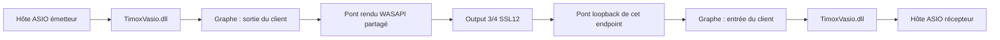

# Qualification réelle ASIO → WASAPI → loopback → ASIO

## Montage

Deux processus chargent la DLL ASIO canonique par son chemin absolu. Le moteur de test utilise son contrôleur, le runtime et l'API de production, avec une configuration séparée. Le script crée deux ponts et deux routes :

Il n'existe aucune route directe du loopback vers son rendu. Le signal comprend deux tons de 997/1709 Hz, chacun d'amplitude 0,0005. Aucun son capturé n'est enregistré : seuls des agrégats et les états API sont conservés.

## Première exécution : signal présent, défaut de préremplissage

Essai du 22 octobre 2026 : graphe 48000 Hz/2048 frames, endpoint `{0.0.0.00000000}.{c2461d21-c654-47bb-8360-90350a202f91}`, format Windows float32 stéréo 48000 Hz, buffer effectif 1056 frames. Deux secondes de chauffe puis dix secondes analysées.

Les **400 fenêtres de 25 ms** contiennent les deux tons attendus. Amplitudes par fenêtre : 0,0002592457 et 0,0002546978 ; RMS : 0,0002615630. Pas de reset ASIO ni valeur non finie. La différence de niveau peut dépendre du volume et des traitements Windows. L'analyse prouve la présence des deux tons, pas la fidélité numérique ou la latence. La projection cohérente longue, inadaptée aux horloges libres, ne sert pas de critère SNR dans ce mode ; les versions suivantes de la sonde publient `null` pour ces champs.

Les compteurs identifient un défaut malgré le succès de présence du signal :

| Capture loopback après l'essai | Valeur |
|---|---:|
| État | running |
| Préremplissage expiré | true |
| FIFO / cible | 2285 / 8192 frames |
| Correction du ratio | +2000 ppm, limite atteinte |
| Frames capturées | 694080 |
| Frames capture rejetées | 0 |
| Frames silencieuses côté graphe, démarrage inclus | 1281 |
| Discontinuités, démarrage inclus | 1 |

Le graphe consommait la capture pendant le préremplissage. Le FIFO ne pouvait pas atteindre sa cible ; après le timeout, le contrôleur de débit tentait de combler ce déficit. La correction instantanée en ppm n'est pas une mesure directe de la dérive de l'oscillateur matériel.

**Cet essai ne constitue pas une preuve de stabilité.** Un test déterministe a reproduit le drainage prématuré ; le correctif retient les données dans le FIFO jusqu'à la cible et fournit du silence au graphe pendant cette phase. Un timeout reste visible comme diagnostic et ne libère pas un FIFO insuffisamment rempli. Le contre-essai matériel ci-dessous valide ce changement sur une courte période ; les essais prolongés restent nécessaires.

## Contre-essai après correction : présence du signal et stabilité courte

Nouvel essai du 22 octobre 2026, même endpoint SSL12, graphe logiciel à 48000 Hz/2048 frames et format Windows float32 stéréo à 48000 Hz. Le contrôle utilise `-Seconds 10 -RequireStableBridges -MinimumStableSeconds 5 -AllowExistingClients`. Les applications ASIO préexistantes restent ouvertes : il s'agit d'un environnement partagé, pas d'une mesure de performance isolée.

Le récepteur analyse **480000 frames et 400/400 fenêtres conformes**, sans reset, valeur non finie ni échantillon nul dans cette période. Amplitudes par fenêtre : 0,0002603662 et 0,0002580098 ; RMS : 0,0002615588. Les champs de projection longue `amplitude997`, `amplitude1709` et `snrDb` valent désormais `null`. Le résultat de présence reste distinct de celui de stabilité.

| Contrôle de stabilité | Preuve observée |
|---|---|
| Première / dernière observation retenue | 2,2758634 / 11,2970979 s après lancement |
| Durée effectivement observée | **9,0212345 s**, et non dix secondes |
| Nombre d'états retenus / écart maximal | 9 / 1,2054484 s, sous la limite de 2,5 s |
| Générations rendu / loopback | 1 / 2, inchangées |
| État / erreur / timeout des deux ponts | running / 0 / false |
| Frames natives rendues, première → dernière | 109536 → 544896, progression à chaque observation |
| Frames natives capturées, première → dernière | 106080 → 541440, progression à chaque observation |
| Sept compteurs d'incidents surveillés | Aucun delta pendant cette période |
| Résultats distincts | `signalPresencePassed=true`, `stabilityPassed=true` |

Les sept compteurs sont `droppedCaptureFrames`, `rejectedFrames`, `renderSilencedInputFrames`, `silencedFrames`, `timestampErrors`, `discontinuities` et `renderSilencedDeviceFrames`. Aucun incident supplémentaire n'est apparu entre les observations retenues. Cette affirmation ne signifie pas que les compteurs absolus sont tous nuls : la référence conserve **10656 frames de silence de démarrage côté rendu**, **8192 frames de silence de démarrage côté graphe capture**, et **une discontinuité capture**. Ils n'ont pas été remis à zéro pour obtenir ce résultat.

Le défaut initial de préremplissage ne se reproduit pas : `primingTimedOut=false` sur les deux ponts. Les diagnostics de débit demandent néanmoins davantage de mesures. La correction atteint encore +2000 ppm sur plusieurs observations ; à l'état final, elle vaut +2000 ppm côté rendu et environ −1761 ppm côté capture. Les remplissages finaux sont respectivement de 6882 et 9256 frames, pour une cible de 8192. Ces instantanés non transactionnels ne prouvent ni une dérive matérielle de cette valeur, ni la convergence à long terme du contrôleur.

**Portée :** trajet réel dans les deux instances de la DLL ASIO, rendu WASAPI, loopback Windows et retour au graphe confirmé ; aucun nouvel incident exposé par les compteurs pendant les 9,0212345 secondes observées. La latence, la fidélité numérique, la convergence du SRC, la stabilité de dix minutes et la parité de performance restent à qualifier. Les transitions d'état entre deux observations ne sont pas directement mesurées.

Session locale du contre-essai : `build_wasapi_e2e/session-716befd05c9341e8912fb940e081958e/asio-engine-7e2c4f1674ff4a9bb71d76799824615b`. Preuves : `report.json`, `stability-baseline.json`, `stability-snapshots.jsonl`, `before.json`, `applied.json`, `after.json`, sorties des deux sondes. DLL SHA-256 inchangé : `F4FC8AA0EDB929B74DB2459D6B69652955A1BE9FB21370C6A109DDB96983A0B6`. Sonde SHA-256 : `21123FC6DD75BDA636A76D90B169D9F07A06CDD190EFB02E747FBD01D9A098D2`.

La configuration temporaire a été restaurée (`restore=restored`). Le wrapper a confirmé le retour de Control et du moteur installés ainsi que l'absence de changement du hash de configuration utilisateur. L'état `installed-restored.json` confirme API 1.0, moteur running à 48000 Hz/2048 frames, sans erreur moteur. Aucun paquet installé ni enregistrement du pilote n'a été modifié.

Le moteur canonique après correctif, `build_codex_110/Release/TimoxVirtualAsioEngine.exe`, possède le SHA-256 `F6E46D6257EB842AACDCF279137D0780F3BA6C041E7E596754D5495B5C71CC8A`, une taille de 1177600 octets et une date d'écriture UTC du 21 octobre 2026 à 23:21:47. La lecture de provenance a été effectuée après le contre-essai, avant l'essai prolongé.

## Essai prolongé : continuité observée, qualité encore ouverte

L'exécution `-Seconds 610 -RequireStableBridges -MinimumStableSeconds 600` a terminé avec code 0, après vérification des PID et chemins de Control et du moteur installé. Même format et endpoint que le contre-essai court, mêmes hashes moteur/DLL/sonde. Session locale : `build_wasapi_e2e/session-8fe4987100f042aaabf308dcead850d5/asio-engine-458e179bcf904fe499d261ac5d1fbbfe`.

| Mesure | Résultat |
|---|---:|
| Frames analysées par le récepteur | 29280000 |
| Fenêtres contenant les deux tons / total | 24276 / 24400 (99,49 %) |
| Fenêtres non conformes | 124 |
| Intervalle observé | 2,2713069 → 612,2174906 s |
| Durée observée / observations | 609,9461837 s / 551 |
| Écart maximal entre observations | 1,2285983 s |
| Nouveaux incidents des sept compteurs | 0 |
| Reset ASIO / valeurs non finies / échantillons nuls | false / 0 / 0 |
| Présence du signal / stabilité surveillée | true / true |

Les deux générations sont restées `running`, sans erreur ni timeout de préremplissage, avec progression des frames natives à chaque observation. Les références de démarrage sont de 10176 frames silencieuses côté rendu, 10240 côté graphe capture et une discontinuité capture ; elles restent inchangées. La durée totale des processus est de 614,4067694 secondes, différente de la durée analysée et de celle observée.

**Limites importantes :** le critère de présence est de 90 % des fenêtres ; le succès ne signifie donc pas que les 24400 fenêtres sont conformes. Les 124 échecs et le RMS global de 0,0017282491, supérieur à celui de l'essai court, restent inexpliqués. L'environnement Windows partagé peut contenir d'autres sons, mais ce n'est pas une cause démontrée. Aucun enregistrement PCM n'a été effectué. La correction de débit atteint encore ±2000 ppm à l'état final ; un test déterministe séparé reproduit une modulation due aux échanges par blocs, même sans dérive d'horloge. Un correctif est étudié séparément et n'était pas présent dans ce moteur testé. Cet essai prouve la continuité exposée par les compteurs et la présence majoritaire du signal, pas la fidélité, l'absence de tout artefact, la latence ou la parité CPU.

Le wrapper confirme `restore=restored` et un hash de configuration utilisateur inchangé. Après restauration, une lecture HTTP indépendante confirme API 1.0, moteur installé `running`, 48000 Hz/2048 frames, 22 routes, santé `healthy` et aucune erreur moteur. Aucun remplacement du moteur installé ni de la DLL.

Les prochaines preuves portent sur la modulation du ratio, les fenêtres non conformes, les autres fréquences/quanta et la mesure de latence/CPU.

## Provenance et restauration de la première exécution

Session locale : `build_wasapi_e2e/session-c088d40984694c639df5ce4d08ebc458/asio-engine-8e6e9233b1b9491c8fdcbe435cb935ab`. Les états utilisateur détaillés restent locaux.

- DLL SHA-256 : `F4FC8AA0EDB929B74DB2459D6B69652955A1BE9FB21370C6A109DDB96983A0B6`.
- Sonde SHA-256 : `187C1C8DA7FC86BF01B404394032632764ABA8D296F3407320A686A572FB47B0`.
- Moteur SHA-256 avant correctif : `7EA53418E5337A9F75B7DD95A04A5481C0D992E82DB588E1D1965199C26F2175`.

La configuration temporaire a été restaurée par révision. Control et le moteur installés ont été relancés ; le hash du fichier de configuration utilisateur est inchangé. Vérification après retour : API 1.0, moteur running, 48000 Hz/2048 frames, 22 routes, trois clients, buffer health healthy, aucune erreur moteur. Aucun binaire installé ni enregistrement de pilote modifié.

L'état HTTP réel avec les deux ponts actifs a également passé `Test-Json` contre le schéma API 1.1. Cela valide la sérialisation de cet état, pas sa stabilité audio.
