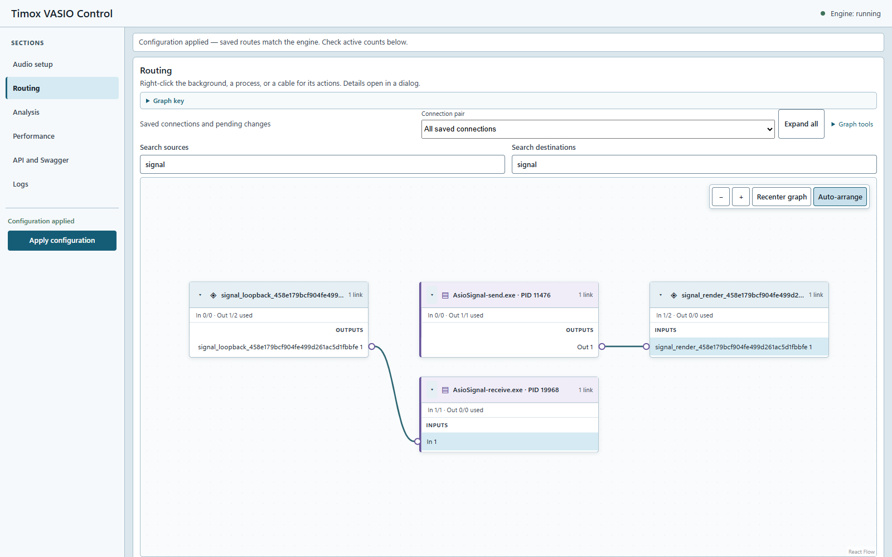

# GUI WASAPI — état réel du test audio

Cette capture montre le **code de la GUI**, avec les données d'un état API 1.1 réellement reçu le **22 octobre 2026 à 05:32:26 UTC (07:32:26 à Paris)** pendant le test audio de 610 secondes. La capture finale a été réalisée après le test, à partir de cet état conservé. Le badge `Engine: running` décrit donc cet état daté, pas l'état actuel de la machine. Ce n'est ni une maquette ni une simulation de résultats audio.

La vue est filtrée sur `signal` pour montrer seulement les processus et ponts du test :

- `AsioSignal-send.exe` → pont de rendu WASAPI ;
- pont de capture loopback WASAPI → `AsioSignal-receive.exe`.

La liaison interne entre rendu Windows et capture loopback n'est pas un câble du graphe : les deux ponts ciblent le même endpoint Windows. Aucune route loopback → rendu n'a été créée.

## Méthode et limites

Un serveur local a servi le build de production de la GUI avec un adaptateur limité aux lectures HTTP de l'état, des profils et des diagnostics. Toutes les commandes audio étaient rejetées. Une première capture a été obtenue pendant la connexion au moteur API 1.1. Après la restauration du moteur habituel, seul l'état conservé a été utilisé pour recadrer les quatre blocs du test et vérifier la correction ci-dessous. Les profils auxiliaires restaient lus séparément et ne sont pas qualifiés par cette capture filtrée.

Aucun endpoint d'écriture, commande WebSocket, arrêt moteur ou application de configuration n'a été utilisé. Les seules actions graphiques ont été la navigation, la recherche et le rangement visuel des blocs. Aucun identifiant d'endpoint Windows ni profil utilisateur n'est inclus dans l'image publiée. Les identifiants de ponts et PID visibles appartiennent aux sondes temporaires.

La capture ne valide pas le lancement Electron, son IPC, les vumètres WebSocket, ni une nouvelle circulation audio après la correction. Elle valide le rendu du code actuel sur un état moteur réel daté ; la qualification audio est documentée séparément.

## Défaut découvert et corrigé

Les connexions persistées utilisent un identifiant `app:nom.exe`, tandis que l'inventaire actif utilise le PID. Le graphe rattachait le bloc au processus actif mais conservait le port dans un groupe « Process not open ». Le libellé était donc faux malgré la présence du canal dans l'inventaire.

La GUI associe maintenant le port persisté à son groupe actif lorsque le nom désigne un unique client et que le canal demandé est effectivement ouvert. L'identifiant persisté est conservé pour les éditions. Les processus ambigus et canaux indisponibles gardent leur représentation différée.

Un test a d'abord reproduit l'échec avec un client actif unique ; le cas de deux clients du même nom restait correctement différé. Les cas complémentaires contrôlent un canal absent et la conservation simultanée d'une route par PID et d'une route par nom après édition et application. Après correction : **73 tests React réussis**, compilation de production réussie, puis inspection de la capture corrigée après rechargement.

L'état brut reste un artefact local non publié. Son SHA-256 est `53FF0F95551F73AD1E65027479CC4BE23520C0159ED18B533942C644C1B48F71`.
