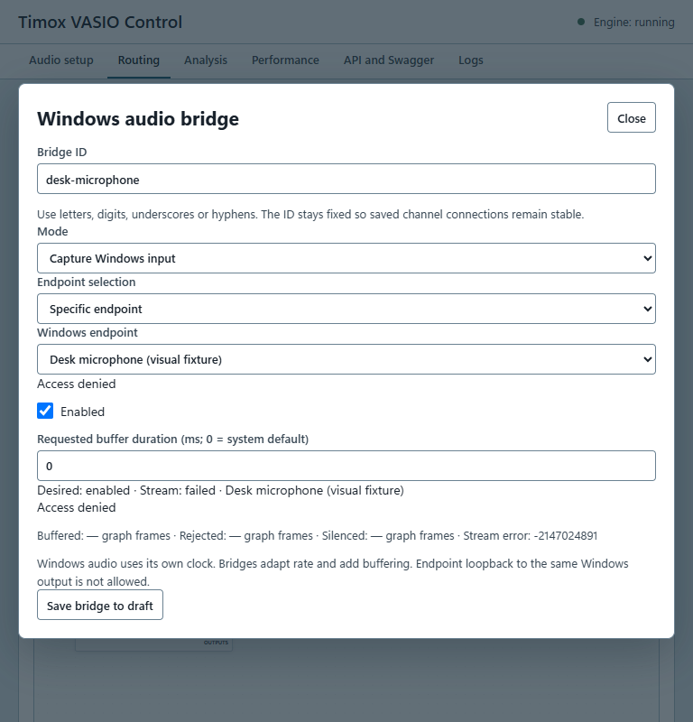
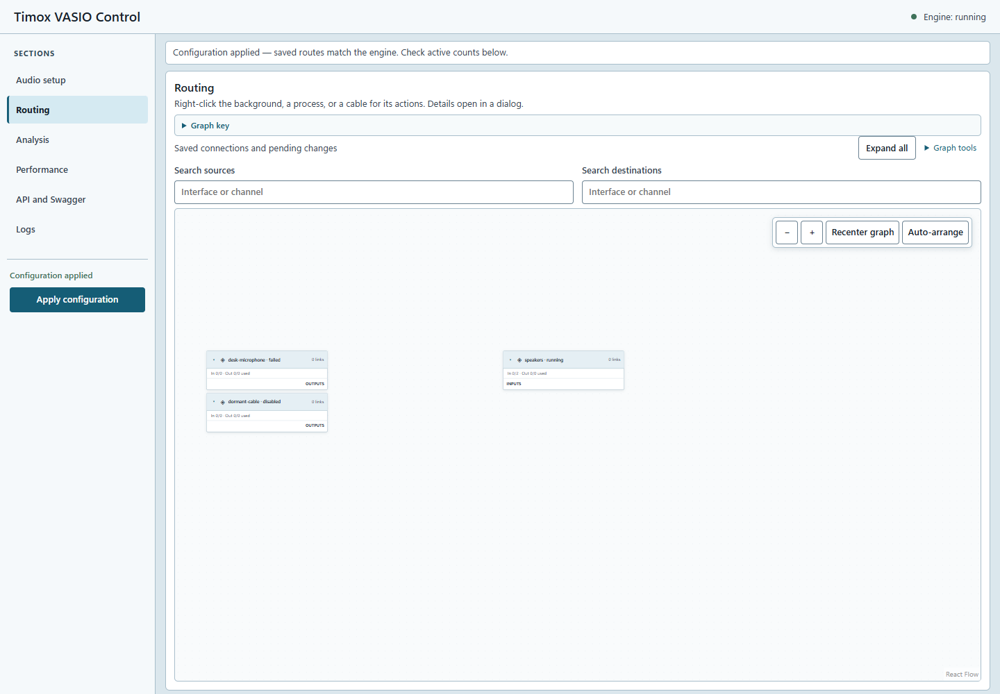

# Vérification visuelle WASAPI — 22 octobre 2026

Cette vérification concerne le rendu de la GUI avec une **simulation locale** de `window.vasio` API 1.1. Elle ne prouve ni l'ouverture d'un périphérique Windows, ni la circulation audio, ni le fonctionnement d'Electron avec le moteur installé. Aucun moteur utilisateur n'a été arrêté et aucune configuration audio réelle n'a été modifiée.

## Méthode

Le navigateur intégré a été tenté mais son outil a rejeté l'appel avant exécution (`sandboxPolicy` manquant). Le contrôle a donc utilisé le skill Playwright CLI, session isolée `wasapi-gui`, et un serveur local sur `127.0.0.1:52539` servant le build de production avec un adaptateur simulé.

La fixture contient un pont rendu `running`, un microphone `failed` avec refus d'accès et un pont de capture `disabled` sans ports. Il n'y a pas de client ASIO ni de câble actif dans cette fixture. Les captures sont des artefacts locaux sous `output/playwright/` ; elles ne sont pas une preuve de périphériques réels.

## Observations et corrections

- À 1440 × 1000, navigation limitée aux sections et état/actions globaux. Aucun panneau permanent de propriétés à côté du graphe.
- À 768 × 800, navigation horizontale et modale accessible. Largeur du document mesurée : 768 pixels pour 768 pixels de viewport, sans débordement horizontal.
- Le menu contextuel du pont ouvre sa configuration dans une modale. Échap ferme cette modale ; contrôle DOM après fermeture : zéro dialogue.
- Les ponts indisponible et désactivé restent visibles sans inventer de canaux. L'erreur simulée est affichée dans la configuration et dans la modale.
- Défaut corrigé : la case « Enabled » héritait des dimensions des champs textuels et était séparée de son libellé. Elle utilise désormais une ligne dédiée avec une case de 18 pixels.
- Le délai demandé s'affiche désormais en millisecondes, avec `0 = system default`. L'API conserve `bufferDuration100ns` : 10 ms donnent 100000 unités. Les valeurs existantes gardent leur précision de 100 ns, avec une plage de 0 à 1000 ms.

## Validation

`npm run react-build` : compilation réussie après les deux corrections.

Tests ciblés `App.test.js` (motif `API 1.1 bridges|Windows bridge|WASAPI capture`) : **8 réussis, 33 non exécutés**. Les cas couvrent création/modification/désactivation/suppression, sélection rendu/loopback, routage des ports et conversion des millisecondes. La conservation de la durée est contrôlée pour 0, 1, 123456 et 10000000 unités ; une valeur supérieure à 1000 ms désactive l'enregistrement.

Les captures finales ont été inspectées après reconstruction et rechargement :

- [Modale à 768 × 800](assets/2026-10-22-wasapi-gui/wasapi-narrow-modal-final.png) : case corrigée et durée en millisecondes.
- [Graphe à 1440 × 1000](assets/2026-10-22-wasapi-gui/wasapi-desktop-routing-final.png) : graphe et navigation.

Le contrôle visuel des interactions d'un câble réel et le parcours Electron connecté au moteur restent à effectuer. Les tests React couvrent les connexions, mais ne remplacent pas cette qualification visuelle et audio de bout en bout.
