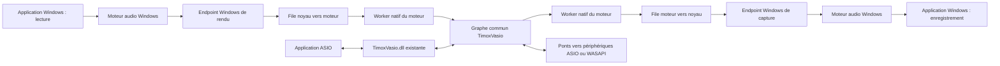

# Endpoints Windows natifs pour TimoxVasio

Date : 22 octobre 2026. **Prototype minimal compilé, pas encore chargé ni certifié.** Ce lot prolonge le [moteur commun](2026-10-21-unified-audio-engine-design.md) et le [plan WASAPI](../plans/2026-10-21-wasapi-bridge.md). Il conserve le périmètre final : applications Windows et ASIO dans un graphe commun, GUI/API unifiées et performances mesurées.

## Ce que l'utilisateur sélectionnera

Deux périphériques Windows indépendants : **Timox Windows Input**, sortie de lecture choisie par une application pour envoyer son son au graphe ; **Timox Windows Output**, entrée d'enregistrement choisie par une application pour recevoir le son du graphe. Les noms sont provisoires ; le sens doit rester explicite dans Control. Un seul exemplaire stéréo de chaque endpoint constitue le premier incrément, pas la limite finale du produit.

Rendu Windows = source du graphe ; capture Windows = destination du graphe. Aucun raccordement automatique entre les deux endpoints. Le pilote Windows ne mixe pas les routes du graphe. L'absence du moteur donne du silence en capture et une consommation avec compteur de pertes en rendu, sans bloquer le moteur audio Windows. L'endpoint reste visible tant que son périphérique PnP existe.

TimoxVasio.dll reste le pilote ASIO actuel avec CLSID, profils et transport inchangés. Le nouveau composant est **TimoxWindowsAudio.sys**, paquet INF/CAT distinct, et un backend du moteur. Aucun code noyau, WASAPI ni SRC n'entre dans la DLL ASIO. L'autonomie de la DLL concerne ses backends ; le moteur reste nécessaire au routage.

## Modèle de pilote retenu pour le prototype

Proposition : **PortCls + miniports WaveRT/topologie**, à partir d'une révision épinglée de SysVAD dont seuls les éléments nécessaires seront conservés. SysVAD fournit un exemple d'adaptateur audio virtuel WaveRT ; il ne fournit pas à lui seul notre transport bidirectionnel vers le graphe. Préserver sa licence et consigner révision et différences dans le dépôt. [Exemple Microsoft SysVAD](https://learn.microsoft.com/en-us/windows-hardware/drivers/audio/sample-audio-drivers), [architecture PortCls](https://learn.microsoft.com/en-us/windows-hardware/drivers/audio/introduction-to-port-class).

| Option | Décision et raison |
|---|---|
| PortCls/WaveRT | Base du prototype : exemple virtuel officiel et interfaces audio Windows établies. Simplifier les endpoints, pas réécrire la gestion des streams sans référence. |
| ACX/KMDF | Alternative à réévaluer avant figer la distribution : modèle audio moderne construit sur KMDF, avec objets de circuits et flux. Sa compatibilité précise avec les OS ciblés et son exemple virtuel doivent être vérifiés. |
| AVStream | Non retenu : la documentation AVStream oriente les pilotes purement audio vers PortCls. |
| APO ou simple DLL utilisateur | Ne remplace pas ce lot : le besoin est un périphérique Windows avec flux de capture et rendu, pas seulement un traitement audio. |

ACX est un modèle noyau, pas un moyen d'éviter la signature de pilote. Le choix PortCls est une décision d'ingénierie pour ce prototype, pas une affirmation qu'ACX serait inadapté. [Vue ACX](https://learn.microsoft.com/en-us/windows-hardware/drivers/audio/acx-audio-class-extensions-overview), [vue AVStream](https://learn.microsoft.com/en-us/windows-hardware/drivers/stream/avstream-overview).

## Frontières et transport privé

Le pilote expose les interfaces audio standard aux applications et **une interface de contrôle privée** au backend natif. L'application Windows ne dépend pas de cette interface privée. Le backend ne réouvre pas l'endpoint de capture pour essayer d'y écrire : il fournit les données au côté noyau du flux de capture.

Premier transport implémenté dans N2 : IOCTL synchrones à tailles bornées, avec copie, sur un handle propriétaire unique. `METHOD_BUFFERED` pour session, états et premiers transferts PCM. Il n'y a pas d'IRP pendante : une file vide retourne un état explicite. Le worker utilisateur devra préallouer ses paquets et attendre hors callback entre traitements bornés ; les coûts d'IRP, copies et réveils restent à mesurer. Une attente asynchrone future exigera une file annulable et ses tests dédiés. Ce choix vise un prototype vérifiable ; il ne démontre pas la parité de performance. Le passage ultérieur à Direct I/O ou à une zone partagée n'est justifié que par des mesures et exige une nouvelle revue sécurité/lifetime.

Protocole C indépendant du STL : taille d'en-tête, version majeure/mineure, opcode, direction, génération 64 bits, format, numéro de séquence, nombre de frames, timestamp QPC et flags de discontinuité. Pas de pointeur utilisateur dans le protocole. Entiers de taille fixe, padding explicite, limites publiées ; rejet des champs réservés non nuls et versions incompatibles. Opérations : GET_CAPABILITIES, OPEN_SESSION, READ_RENDER_PACKET, WRITE_CAPTURE_PACKET, GET_STATUS, CLOSE_SESSION. Une requête d'attente peut rester en file annulable ; aucune attente bloquante en callback audio ou DPC.

Le transport privé a une ACL restrictive distincte des endpoints audio accessibles aux applications. Prototype : handle ouvert par outil/backend élevé en laboratoire ; produit : service broker à identité dédiée ouvrant ce handle, avec IPC authentifié vers le moteur. Ne pas rendre Electron administrateur permanent ni autoriser tous les utilisateurs à injecter/capturer le son d'une autre session. Le détail du broker multi-session est un livrable requis, pas déjà résolu par cette conception.

Toutes tailles et multiplications sont validées avant copie, y compris `frames × channels × bytesPerSample`. Zéro initialisation des buffers retournés, validation de l'ensemble du code IOCTL, droits READ/WRITE explicites et aucun accès à une adresse arbitraire. `METHOD_NEITHER` exclu. Les règles sont fondées sur les [recommandations IOCTL Microsoft](https://learn.microsoft.com/en-us/windows-hardware/drivers/kernel/security-issues-for-i-o-control-codes).

Les files noyau sont préallouées, non paginées et possèdent un producteur/consommateur identifié. Le callback noyau ne fait ni allocation, ni attente, ni accès pageable. Les transitions STOP/PAUSE/RUN, fermeture, annulation et retrait PnP utilisent une protection de durée de vie séparée des transferts audio ; aucun anneau ne se réinitialise pendant qu'un autre contexte l'utilise. À la fermeture du handle moteur : annuler toutes ses requêtes, marquer la génération retirée, attendre les références hors callback, puis libérer. Un processus tué doit produire le même nettoyage qu'une fermeture normale.

## Formats, cadence et latence

Premier format proposé : PCM signé 32 bits, 48 kHz, deux canaux, cohérent entre miniport, transport privé et tests. Le mélange de plusieurs applications en mode partagé reste effectué par Windows. Les formats 44,1/48 kHz, les quanta et le multicanal seront ajoutés avec négociation et tests ; ne pas exposer 256 canaux au pilote Windows simplement parce que la DLL ASIO les supporte. L'exclusif ne doit pas être annoncé comme qualifié avant ses tests.

L'horloge virtuelle noyau avance à partir d'un temps monotone et d'un compteur absolu de frames ; les positions WaveRT restent cohérentes avec les notifications et les transitions d'état. Il faut implémenter les positions et la latence du flux, pas incrémenter artificiellement une position seulement lorsqu'un IOCTL arrive. [Développement WaveRT](https://learn.microsoft.com/en-us/windows-hardware/drivers/audio/developing-a-wavert-miniport-driver).

Le maître du graphe reste le maître sélectionné dans le moteur (logiciel ou ASIO). Aucun second appel du callback du graphe par le pilote natif. Le backend utilise des anneaux bornés et un SRC adaptatif hors callback lorsqu'il relie des domaines distincts. Même avec deux cadences dérivées du QPC, les blocs et l'ordonnancement diffèrent ; contourner le SRC exige de démontrer une cadence commune et un transfert sans dérive sur la durée. Les structures existantes `WasapiBridgeIo` peuvent inspirer le contrat côté graphe ; leur C++ utilisateur n'est pas copié tel quel en noyau et le nouveau backend garde une identité propre.

Chemin de latence : tampon Windows + période virtuelle WaveRT + file privée + anneau du backend + retard SRC éventuel + quantum du graphe, puis même frontière inverse pour un aller-retour. Une somme de capacités ne prouve pas la latence mesurée. Mesurer avec un signal corrélé les distributions p50/p95/max ; publier séparément frames perdues, silence injecté, discontinuités et surcharges. Un routage aller-retour explicite peut créer une boucle : aucun retour automatique et conservation des garde-fous de graphe.

## État de l'outillage constaté

Mise à jour du 22 octobre : l'ensemble SDK/WDK NuGet `10.0.28000.2526`, Visual Studio 2026 et son composant WDK a depuis été acquis et vérifié. La compilation du SysVAD Microsoft épinglé a terminé avec code 0, InfVerif et ApiValidator réussis. Le `.sys` de référence est non signé ; il ne s'agit pas encore de TimoxWindowsAudio. Les versions, scripts reproductibles, erreurs intermédiaires et SHA-256 sont consignés dans [BUILDING.md](../../../native-windows-audio/BUILDING.md). Aucun pilote n'a été déployé. L'inspection initiale ci-dessous décrit l'état avant cette préparation.

Inspection locale en lecture seule le 22 octobre 2026 : `C:\Program Files (x86)\Windows Kits\10\Include\10.0.26100.0` contient cppwinrt/shared/ucrt/um/winrt. Les chemins standard `km/ntddk.h`, `km/portcls.h`, `Lib/10.0.26100.0/km/x64/portcls.lib`, `Windows Kits/10/build`, `bin/10.0.26100.0/x64/Inf2Cat.exe` et `InfVerif.exe` sont absents ; `signtool.exe` est présent. Aucun environnement WDK/EWDK n'a été trouvé dans les variables du processus. Cela ne prouve pas l'absence de toute installation non standard, mais **aucune chaîne WDK utilisable n'est démontrée**.

Avant compilation, choisir et épingler un ensemble Visual Studio/SDK/WDK compatible, confirmer les versions et effectuer une compilation minimale. La documentation actuelle exige des numéros de build SDK/WDK correspondants et fournit des WDK via installation ou NuGet ; ne pas considérer le SDK existant comme un WDK. Aucune installation ou acquisition n'a été effectuée pour cette étude. [Installation WDK Microsoft](https://learn.microsoft.com/en-us/windows-hardware/drivers/download-the-wdk).

## Séquencement concret et preuves attendues

N0 est implémenté et vérifié comme sous-projet autonome. N1 possède son propre projet et binaire `TimoxWindowsAudio.sys` sous [native-windows-audio/driver](../../../native-windows-audio/driver/README.md), avec deux descriptions d'endpoints PCM32 stéréo 48 kHz. N2 ajoute un objet de contrôle privé, une session propriétaire et deux files PCM raccordées aux flux WaveRT. Une première compilation WDK, InfVerif et ApiValidator réussit ; les cinq tests hôte du protocole, de la géométrie, des sessions et des files passent. Les corrections de cadence après retard prolongé, de fin de flux et de protection du rendu sont vérifiées par les tests hôte et une revue statique indépendante. Le pilote n'a pas été chargé : N1/N2 restent incomplets tant que l'énumération, les flux et le cycle de vie ne sont pas vérifiés sur cible. Le [plan N2](../plans/2026-10-22-native-audio-private-transport.md) détaille les limites ; le backend utilisateur N3 est en développement. Les chemins des lots suivants sont des propositions historiques ; les sources du pilote se trouvent effectivement dans `native-windows-audio/driver/`.

| Lot | Fichiers proposés | Preuve avant passage au suivant |
|---|---|---|
| N0 — contrat pur | `native-windows-audio/include/native_audio_protocol.h`, `native-windows-audio/include/native_audio_packet_validation.h`, tests et CMake autonomes dans `native-windows-audio/` | Réalisé : format wire explicite, version/taille/overflow/direction/génération invalides refusés ; aucun pointeur sérialisé ; fixture indépendante ; traduction C ; tests x64 sans WDK. |
| N1 — pilote minimal | `drivers/windows-audio/TimoxWindowsAudio.sln`, projet `.vcxproj`, `adapter.*`, `miniport_wave.*`, `stream.*`, `topology.*`, `TimoxWindowsAudio.inx`, `THIRD_PARTY_NOTICES.md` | Build WDK épinglé ; INF validé ; deux endpoints énumérés en VM ; rendu consommé et capture silencieuse ; silence initial déterministe. |
| N2 — transport | `drivers/windows-audio/control.*`, `packet_queue.*`, `tests/native_audio_driver_probe.cpp` | PCM déterministe dans les deux sens ; annulation/kill/reopen ; tailles malformées ; refus autre session ; aucun leak après cycles. |
| N3 — backend | `include/native_audio_backend.h`, `src/native_audio_backend.cpp`, tests worker/runtime | Intégration des générations et routes ; indépendance DLL ASIO ; panne backend sans panne maître ; aucune syscall ajoutée au callback du graphe. |
| N4 — produit | Contrôleur, store, schémas API, GUI et broker dédié | Installation/présence/état/format/incidents visibles ; configuration transactionnelle ; reprise moteur ; menus contextuels et modales conformes à AGENTS.md. |
| N5 — qualification | `tests/native_audio_qualification.ps1`, rapport FR/EN | Applications Windows et ASIO réelles ; 44,1/48 kHz ; matrices de quanta ; dix minutes puis endurance ; latence, CPU, glitches ; veille/reprise, arrêt service, retrait/réinstallation ; Driver Verifier sur VM dédiée. |
| N6 — distribution | `scripts/build-native-audio-driver.ps1`, scripts installation/retrait, manifeste de provenance | INF/CAT/SYS vérifiés ; signature Microsoft appropriée ; installation/réparation/retrait/rollback ; DLL ASIO toujours utilisable après retrait du paquet Windows. |

N0 a été vérifié après test rouge : compilation MSVC 19.51 x64 Release avec `/W4 /WX`, puis CTest 1/1 réussi le 22 octobre 2026. Une revue indépendante n'a identifié aucun blocage. Voir le [contrat et ses limites](../../../native-windows-audio/README.md). N0 porte les paquets PCM et leur validation ; les sessions et IOCTL appartiennent à N2. La chaîne de compilation est disponible, mais une cible de test reste nécessaire : aucun test simulé ne peut prouver le chargement noyau. Avant chaque build/install : racine Git et statut. Aucun ajout du `.sys` au Setup existant avant que sa provenance, son chargement et son retrait soient vérifiés.

## Installation et signature : conditions réelles

Un périphérique virtuel noyau suit les exigences de signature des pilotes matériels. Pour un déploiement public Windows moderne, une signature locale du `.sys` n'est pas équivalente à une signature Microsoft du paquet. Le compte Hardware Dev Center/Partner Center et les certificats nécessaires ne sont pas vérifiés ici. [Exigences de signature noyau](https://learn.microsoft.com/en-us/windows-hardware/drivers/install/kernel-mode-code-signing-requirements--windows-vista-and-later-), [exigences de soumission](https://learn.microsoft.com/en-us/windows-hardware/drivers/dashboard/code-signing-reqs).

La documentation Microsoft présente l'attestation comme une voie de test, sans certification Windows et sans diffusion retail Windows Update ; la qualification HLK/WHCP est la voie à préparer pour la distribution certifiée. Ne pas promettre qu'une attestation suffira à toutes les cibles. [Options de signature](https://learn.microsoft.com/en-us/windows-hardware/drivers/dashboard/driver-signing-offerings).

Le développement se fait d'abord sur une VM/cible de test avec signature de test et procédure de récupération. TESTSIGNING implique redémarrage et peut être bloqué par Secure Boot ; HVCI n'autorise pas pour autant un binaire non signé. Cette étude ne modifie aucun de ces paramètres sur le poste utilisateur. [Chargement de code signé pour test](https://learn.microsoft.com/en-us/windows-hardware/drivers/install/the-testsigning-boot-configuration-option).

Le package doit créer ou retrouver **son propre devnode** root/software énuméré avec identifiant stable ; le mécanisme exact est à implémenter et tester. `pnputil /add-driver ... /install` ajoute le paquet et installe sur les périphériques correspondants : cela ne remplace pas la création initiale du devnode. Stocker son instance ID et le Published Name `oem*.inf` réel pour retirer exclusivement ce produit. Les scripts n'utilisent ni wildcard de suppression ni modification du périphérique audio par défaut. [PnPUtil](https://learn.microsoft.com/en-us/windows-hardware/drivers/devtest/pnputil-command-syntax), [installation de référence SysVAD](https://learn.microsoft.com/en-us/samples/microsoft/windows-driver-samples/sysvad-virtual-audio-device-driver-sample/).

## Inconnues qui empêchent encore une promesse de livraison

- Matrice Windows exacte du produit et choix définitif PortCls/ACX après compilation/prototype.
- Cible noyau récupérable et disponibilité des moyens de signature/soumission ; la chaîne WDK est désormais prouvée par compilation de référence.
- Broker, contrôle d'accès multi-session et comportement lorsque plusieurs utilisateurs ouvrent Control.
- Charge, jitter et latence du transport copié ; nécessité éventuelle d'un transport partagé plus complexe.
- Compatibilité HVCI, tests HLK applicables et acceptation du paquet par Microsoft.
- Nombre final d'endpoints/canaux exposés, conservation des identités après mise à jour et usages exclusifs.

Ces points restent du travail à accomplir. Les ponts WASAPI existants et un câble tiers permettent de qualifier le graphe dès maintenant ; ils ne constituent pas la livraison du pilote natif décrit ici.
