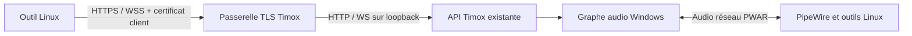

# Commandes Timox depuis Linux

## Objectif

Un outil exécuté sous Linux doit pouvoir lire l'état du graphe Timox et lui
envoyer des commandes de contrôle, notamment pour préparer ou modifier un
routage Windows. Le son continue de circuler entre les deux systèmes par le
transport audio PWAR existant. Ce document ne propose ni commandes de contrôle
dans les datagrammes PWAR, ni accès distant à la GUI Linux de PWAR.

## État présent

Le serveur HTTP/WebSocket Timox écoute seulement sur `127.0.0.1`. Il accepte
des origines locales connues ou absentes, mais ces contrôles ne prouvent pas
l'identité d'un client. Le client Electron parle à cette API locale. Il ne faut
donc pas simplement changer l'adresse d'écoute pour rendre l'API visible sur le
réseau.

## Parcours proposé

1. Timox active explicitement une passerelle de contrôle distante sur une
   interface réseau et un port choisis par l'utilisateur. Elle reste désactivée
   par défaut.
2. Windows crée une clé privée non exportable et un certificat serveur dédié.
   Le client Linux crée sa propre clé privée et son certificat client.
3. Les deux pairs échangent uniquement les certificats publics. L'interface
   affiche l'empreinte SHA-256 de chaque certificat et exige sa confirmation
   indépendante avant d'ajouter le pair à la liste autorisée. Les clés privées
   ne quittent jamais leur machine.
4. Le client Linux se connecte à la passerelle en TLS avec authentification
   mutuelle. Windows valide explicitement le certificat client contre la liste
   des pairs autorisés ; Linux épingle le certificat serveur attendu.
5. Après authentification, la passerelle transmet les requêtes HTTP et la
   connexion WebSocket à l'API existante sur loopback. Le contrat JSON et les
   révisions de configuration restent les mêmes. La passerelle n'expose aucun
   port audio et n'accepte aucune commande système arbitraire.
6. L'interface Windows permet de révoquer un pair ; la révocation ferme ses
   connexions actives. Une rotation de certificat nécessite un nouvel échange.

## Flux

Les commandes API conservent les validations de contrat existantes. Pour les
requêtes distantes, l'authentification de la passerelle est le certificat client
autorisé ; le pair jumelé reçoit les droits de contrôle Timox convenus, sans
accès aux fichiers, au registre, aux périphériques noyau, ni à une exécution
shell sur Windows. Ce certificat distant ne remplace pas le travail distinct
d'authentification de l'API locale requis avant l'activation du backend natif.

## Sécurité et exploitation

- TLS 1.2 ou plus récent ; aucune voie de repli HTTP distante.
- Le certificat client est vérifié par empreinte autorisée, usage client,
  validité et révocation locale. Un handshake TLS seul ne suffit pas à accorder
  l'accès.
- Le client vérifie l'identité du serveur par empreinte épinglée. Les erreurs
  ne divulguent ni secrets ni détails privés de la clé.
- L'échange de certificats doit authentifier les empreintes par un canal
  indépendant ou un appairage confirmé sur les deux écrans ; copier un fichier
  de certificat sans vérifier son empreinte ne protège pas d'un intermédiaire.
- L'accès distant est limité aux commandes API Timox prévues. Les opérations de
  changement de configuration conservent `expectedConfigurationRevision` et
  restent transactionnelles.
- Le transport local de l'API reste inchangé pour Electron. La passerelle TLS
  est un point d'entrée distinct, activé uniquement après appairage.

## Vérifications requises avant livraison

- Certificat manquant, pair inconnu, empreinte incorrecte, certificat expiré,
  usage incorrect et révocation : connexion refusée avant toute réponse API.
- Certificat serveur remplacé ou falsifié : client Linux refuse la connexion.
- Requêtes HTTP et WebSocket valides après appairage ; aucune donnée ni
  événement avant authentification.
- Origine absente côté client API Linux acceptée uniquement après TLS mutuel ;
  contrôle d'origine du client navigateur conservé en complément.
- Redémarrage Timox, rotation et révocation d'un pair ferment les connexions
  anciennes sans interrompre le chemin audio local.
- Port inaccessible par défaut avant activation ; après activation, écoute
  limitée à l'interface choisie et à la règle de pare-feu correspondante.

Cette spécification est une proposition d'architecture. Aucun accès distant,
appairage de certificats ou service de contrôle Linux n'est encore implémenté.
