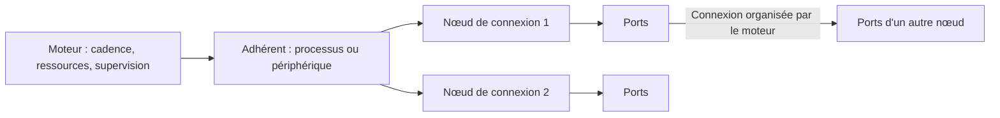

# Timox — adhérents, nœuds de connexion et supervision du moteur

**Statut :** formalisation des décisions de la conversation du 26 octobre 2026.
Les principes ci-dessous sont retenus pour le modèle cible. Les arbitrages
explicitement ouverts ne sont pas des comportements déjà décidés ou implémentés.
Cette spécification ne modifie ni le code ni le contrat API existant.

**Référence remplacée :**
[proposition à deux agrégats](2026-10-26-timox-object-model-design.md).
En particulier, l'identité commune des participants appartient désormais au
modèle moteur ; elle n'est plus réservée à un `VSSCClient` défini par la GUI.

## 1. Intention

Le système suit un modèle mutualiste : le moteur ne promet que le service
qu'il peut fournir avec les ressources disponibles et les participations en
cours. Il organise les échanges et supervise leurs conditions d'exécution.

Trois objets principaux structurent ce modèle : **adhérent**, **nœud de
connexion**, **moteur**. Les ports, connexions, capacités, mesures et décisions
restent des éléments nécessaires, rattachés à ces objets. Cela n'impose pas
trois classes C++, trois tables ou trois endpoints HTTP.

La supervision est centrale : décrire une topologie ne suffit pas. Le moteur
doit distinguer ce qui est demandé, ce qui fonctionne et ce qui ne tient plus
les conditions de participation, puis rendre ses décisions explicables.

## 2. Objets et relations

| Objet | Responsabilité | Informations principales |
|---|---|---|
| Adhérent | Identifier qui participe | Identité, nature processus/périphérique, capacités connues, nœuds associés |
| Nœud de connexion | Décrire comment l'adhérent participe | Adhérent propriétaire, accès technique, ports, configuration effective, état et mesures des échanges |
| Moteur | Fournir le cadre collectif | Horloge de référence, cadence, ressources, graphe de connexions, conditions de participation et supervision |

### Adhérent

Un adhérent est un **processus** ou un **périphérique** participant au moteur.
Une entité seulement découverte dans l'inventaire n'est pas automatiquement
participante. L'identité persiste dans le modèle après la fin d'une
participation, afin de conserver la configuration et la raison d'une éjection.
La politique de rétention reste à définir.

La nature de l'adhérent et son mode d'accès sont distincts : un processus peut
utiliser ASIO directement ou être représenté par un pont. Un périphérique
peut fournir plusieurs accès. Le nombre de pistes internes d'une application
n'est pas le nombre de ports qu'elle expose au moteur.

### Nœud de connexion

**Un adhérent peut avoir plusieurs nœuds.** Chaque nœud appartient à un seul
adhérent dans le cadre du moteur considéré. Un adhérent connu peut n'avoir
aucun nœud actif, notamment après déconnexion ou éjection.

Le nœud représente l'accès effectif : session via un pilote, pont WASAPI ou
autre adaptateur de transport. Un pilote installé est un moyen d'accès ; il
ne constitue pas, à lui seul, un nœud actif. Les ports audio du nœud portent
un sens explicite relativement au moteur, évitant l'ambiguïté entrée/sortie
entre application, périphérique et graphe.

Les connexions relient des ports de nœuds. Leur identité, gain et mute sont
conservés dans le graphe organisé par le moteur. Une connexion configurée
peut exister alors que son nœud ou son adhérent n'est pas actif.

### Moteur

Le moteur fixe la cadence commune, organise le graphe et gère les ressources
collectives. Il tient le registre des adhérents et des nœuds, les observations
et les décisions de supervision. Un contrôleur doit pouvoir comprendre et
commander ce modèle par son API sans reconstruire une identité commune à
partir de tableaux propres à chaque transport.

TimoxVSSC représente et commande ces objets. Ses propriétés de présentation
(position des nœuds à l'écran, sélection, disposition) ne définissent pas
l'identité métier des adhérents ou de leurs accès.

## 3. Adhésion ouverte, participation conditionnelle

L'adhésion n'est **pas** soumise à un examen préalable de puissance ou à une
capacité de traitement connue. Un DAW peut donc être représenté et participer
avec une capacité soutenable inconnue.

Cela ne signifie pas que toutes les demandes peuvent être exécutées : un
format non pris en charge ou une ressource indisponible doit être signalé.
La validation des commandes et les contrôles d'authentification existants
restent applicables ; l'adhésion ouverte concerne les capacités de traitement.

Le moteur ne transforme pas une demande en engagement implicite. L'API doit
distinguer les conditions demandées, celles réellement appliquées et celles
dont le respect est observé. Les engagements communs ne doivent pas être
dégradés silencieusement pour maintenir un participant défaillant.

### Cadence et échéances

La première condition de participation audio est de tenir la cadence du
moteur. À 48 000 Hz, cela représente 48 000 trames par seconde, chaque trame
contenant un échantillon par canal. Avec des blocs de 128 trames, la période
est de 128 / 48 000 secondes, soit environ 2,67 ms.

Le critère porte sur les échéances, pas seulement sur une moyenne de débit.
La fréquence des paquets réseau peut différer de celle des blocs du moteur,
à condition que l'accès fournisse ou consomme les trames aux échéances prévues.
La cadence audio ne définit pas à elle seule les contraintes temporelles MIDI.

**Aucun retard non compensé n'est acceptable dans le service rendu.** La
détection et la réaction de supervision ont elles-mêmes un délai technique
à mesurer ; cette règle n'affirme pas que le moteur peut effacer un incident
déjà survenu ou garantir des délais non démontrés par la plateforme.

### Compensation

Un autre adhérent peut compenser une faiblesse si la chaîne fournit toujours
le service convenu à temps. La compensation doit être explicite : adhérent
responsable, nœuds concernés, mécanisme, limites, ressources consommées et
latence éventuelle convenue. Elle utilise les mêmes objets de base.

Une mise en tampon peut absorber une variation d'arrivée avec une latence
définie à l'avance. Remplacer des données manquantes par du silence ne constitue
pas une restitution équivalente ni une preuve de compensation réussie.

Les incidents avant compensation restent visibles, même si les échéances
finales sont respectées. La supervision doit connaître la dépendance au
compensateur, sa réserve et les conséquences de sa disparition. On ne présume
pas que les compensateurs soient gratuits ou qu'une boucle de dépendances
fournisse une réserve réelle.

### Éjection

Quand un adhérent ne tient plus les conditions de participation et qu'aucune
compensation effective ne les préserve, le moteur met fin à la participation
défaillante. Cela signifie arrêter/déconnecter l'accès au moteur, **pas tuer
le processus, désinstaller un pilote ou effacer les routes sauvegardées**.

La supervision localise la défaillance : un nœud en difficulté ne prouve pas
que tous les nœuds du même adhérent sont incapables. La décision doit nommer
sa portée et les connexions affectées. Le choix entre retrait du seul nœud,
de nœuds dépendants ou de toute la participation de l'adhérent reste à définir
avant d'automatiser ces actions.

L'identité, la raison, les mesures justificatives et la différence entre
configuration souhaitée et état appliqué restent consultables après éjection.
La reconnexion automatique et les conditions de reprise ne sont pas décidées.

## 4. Capacités : déclaration, usage et observation

| Catégorie | Sens |
|---|---|
| Capacités déclarées ou découvertes | Formats, fréquences, ports exposés, transports natifs, rôles d'horloge, fonctions MIDI |
| Participation demandée et appliquée | E/S engagées, cadence, taille de bloc, latence et compensations utilisées |
| Capacité observée | Charge et configuration testées, marges, incidents, compensations et limites de l'observation |

Les capacités doivent exprimer les combinaisons compatibles : annoncer une
fréquence maximale et un nombre maximal de canaux ne garantit pas leur usage
simultané. Distinguer aussi le support natif du support fourni par un adaptateur.

Les E/S physiques décrivent un périphérique ; les ports d'un processus sont
logiques. Le nombre d'E/S exposées n'est pas une garantie d'E/S soutenables.
Un niveau qualifié décrit les E/S effectivement tenues sous une charge et
une configuration identifiées, sans incident non compensé pendant l'observation.

Pour un DAW, la capacité de traitement est typiquement **inconnue à l'avance** :
elle dépend du projet, des instruments, effets et autres charges de la machine.
Un projet simple et un projet lourd peuvent exposer exactement les mêmes ports.
« Inconnue » ne signifie ni nulle, ni illimitée, ni raison de refuser l'adhésion.

Fréquence × canaux mesure un volume d'échantillons ; cela ne mesure pas à lui
seul le coût du calcul. Les capacités ne sont pas réduites à un score universel.
Les compensations consomment des ressources : une participation plus coûteuse
réduit la réserve disponible, sans imposer automatiquement ses limites à tous.

## 5. Supervision : observer, expliquer, agir

La supervision est une responsabilité du moteur, pas un quatrième acteur
indépendant ni une simple collection de vumètres.

Pour chaque situation, elle doit permettre de répondre :

1. Qui participe et par quels nœuds/ports ?
2. Quelles conditions sont demandées et effectivement appliquées ?
3. Quelles échéances sont tenues, avec quelle marge et quelles compensations ?
4. Où se trouve la défaillance observée, et quelles autres participations en dépendent ?
5. Quelle décision est prise, sur quelle preuve, avec quel résultat ?

### Mesures et provenance

Une observation doit identifier sa source, son périmètre (moteur, adhérent,
nœud, port ou connexion), sa fenêtre de mesure, son unité, sa fraîcheur et sa
disponibilité. Les compteurs doivent distinguer les totaux depuis le démarrage
des variations sur une fenêtre et rendre les remises à zéro identifiables.

Mesures utiles : callbacks, échanges complets, trames échangées/attendues,
underruns, overruns, trames expirées/rejetées/silencées, remplissage des files,
durées de traitement, marges avant échéance et consommation des compensateurs.
Conserver à la fois les observations brutes et le résultat après compensation.

Ne pas additionner sans distinction plusieurs compteurs décrivant le même
incident, ni attribuer une mesure globale à un processus particulier. Une
attente de file ou une durée de callback n'est pas nécessairement du temps CPU.
Le CPU global d'un processus est un indice, pas une preuve qu'un thread audio
tient ses échéances. Le niveau sonore n'est pas une mesure de capacité : un
flux silencieux peut être échangé correctement et coûter du calcul.

Une mesure indisponible reste inconnue avec sa raison ; elle ne devient pas
zéro ni un état sain. Les règles de réaction à la perte de télémétrie restent
à préciser. Une absence de signal audible ne prouve pas une absence d'activité.

### Décisions explicables

Chaque décision de supervision doit pouvoir être reliée à la règle appliquée,
aux observations utilisées, aux objets concernés et à l'action effectuée.
L'API distingue décision, action en cours et résultat observé : demander une
déconnexion ne prouve pas que les ressources ont déjà été libérées.

Les actions doivent préserver la sûreté audio : arrêt de publication et
libération des ressources coordonnés avec les callbacks. Une décision de
supervision ne doit pas introduire d'attente bloquante, d'I/O de contrôle ou
de destruction prématurée de buffers dans le chemin temps réel.

## 6. Caractérisation courte, sans examen d'entrée

Le test court sert à caractériser une participation et ses dépendances. Il ne
conditionne pas l'adhésion et ne garantit pas les charges futures d'un DAW.

Il sollicite intensivement la chaîne réelle dans les limites testables du
candidat, à cadence moteur fixe : E/S simultanées, traitement réellement
activable, transport aller/retour et compensateurs prévus. Chaque faiblesse
est enregistrée, y compris lorsqu'elle est compensée. Un candidat opaque ne
peut pas être déclaré qualifié pour un traitement qu'on ne sait pas solliciter.

Les incidents provoqués pendant la recherche de limite ne doivent pas être
confondus avec une participation de production conforme. Le dispositif doit
isoler l'épreuve des engagements en cours et attribuer ses propres coûts au
test ; la façon de réaliser cette isolation reste à concevoir.

Le résultat conserve configuration, charge, durée, incidents, marges et limites
de représentativité. La durée de cinq secondes évoquée était une proposition,
pas une décision. Aucun seuil chiffré ni marge de réserve n'est fixé ici.
La surveillance continue reste nécessaire après l'épreuve et lors des
changements de projet, de charge, de route ou de transport.

## 7. Rattachement de l'existant

| Existant | Rattachement cible |
|---|---|
| Processus attaché au pilote TimoxVasio | Adhérent processus ; session ASIO portée par un nœud |
| Périphérique ASIO physique | Adhérent périphérique ; accès par le pilote porté par un nœud |
| Périphérique Windows avec endpoints capture/render | Adhérent périphérique ; accès/ports des nœuds référencent les endpoints |
| Copie WASAPI d'un processus | Adhérent processus représenté ; pont de capture porté par un nœud |
| Client PWAR Windows | Adhérent processus ; nœud ASIO actuel et observations du transport réseau |
| Audio natif | Accès porté par un nœud ; identité de l'entité correspondante à relier explicitement |
| Routes, gain, mute, associations stéréo | Graphe et configuration des connexions/ports |
| Horloge physique ou logicielle, rythme effectif | Cadre moteur et capacités du fournisseur d'horloge |
| Inventaire, diagnostics, performances | Observations reliées aux objets concernés |
| Profils applications et paramètres PWAR | Intentions/politiques de configuration, pas preuves de participation active |
| MIDI | Capacités et ports/échanges à préciser ; aucun support effectif déduit du seul modèle |

La capture d'un processus ne prouve ni qu'il utilise WASAPI nativement, ni
qu'il a ouvert TimoxVasio, ni que son signal original a été redirigé. Le pont
rend sa participation possible et observable sans modifier ces faits.

Les mesures déjà présentes dans l'API extraite constituent le point de départ :
activité des sessions ASIO, CPU du processus, durées par étape lorsqu'activées,
santé du callback physique et compteurs des transports. Leur couverture et
leur précision ne sont pas uniformes. Le travail consiste à les rattacher
correctement avant d'ajouter de nouvelles sondes.

## 8. Conséquences pour l'API et la configuration

L'API cible doit exposer le moteur, ses adhérents, leurs nœuds et les relations
de ports/connexions, ainsi que leurs capacités, observations et décisions.
Les noms de types sérialisés, endpoints et événements restent à définir.

**Souhaité / appliqué / observé** reste une distinction fondamentale, mais
décrit les objets et leurs relations au lieu de les remplacer. Une intention
persistée ne devient pas une session active ; une éjection ne supprime pas
automatiquement l'intention de connexion sauvegardée.

`AudioConfiguration` peut rester un document de persistance et un contrat de
mutation. Un snapshot composé tel que `/api/v1/state` peut rester utile. Cette
spec n'impose ni leur suppression ni une réécriture des services internes.

Les identités doivent permettre plusieurs nœuds pour un même adhérent et
distinguer une instance de processus d'une autre réutilisant le même PID.
Le choix concret des identifiants, la reconnexion et les liens entre identité
persistée et session runtime restent des décisions du contrat API.

La supervision reste fonctionnelle sans GUI. Les contrôleurs doivent observer
les mêmes décisions ; leur authentification et leur concurrence ne doivent
pas créer plusieurs autorités contradictoires sur l'état du moteur.

La séparation en dépôts ne change pas ces responsabilités. WASAPI reste
provisoirement un module du moteur ; un dépôt bibliothèque est toujours une
option ouverte. Les sources extraites résident dans TimoxVAudioEngine,
TimoxVSSC et Timox-Pwar, avec les anciennes copies conservées dans TimoxVasio.

## 9. Scénarios de conformité du futur modèle

Ces scénarios serviront de critères pour la conception du contrat et ses tests ;
ils ne décrivent pas des tests nouvellement implémentés.

1. Un DAW aux capacités soutenables inconnues peut participer ; ses ports
   exposés, engagés et éventuellement qualifiés restent distincts.
2. Un adhérent possède deux nœuds. Les observations et une défaillance sont
   attribuées au bon nœud ; la portée d'une action est explicite.
3. Une faiblesse PWAR est compensée à temps : le service final respecte les
   conditions, mais l'incident brut et la consommation du compensateur restent visibles.
4. Une échéance n'est plus tenue sans compensation : la décision de retrait,
   ses preuves et son résultat sont observables ; le processus n'est pas tué.
5. La télémétrie manque ou un compteur redémarre : l'API ne produit pas une
   fausse absence d'incidents ni un débit calculé sur des générations différentes.
6. Après éjection, les routes souhaitées restent consultables et leur absence
   d'application est visible ; aucune reprise automatique n'est supposée.
7. Un projet DAW change : une ancienne qualification n'est pas présentée comme
   garantie de capacité du nouveau projet ; les observations courantes prévalent.
8. Deux contrôleurs interrogent le moteur : ils obtiennent les mêmes identités
   et décisions, sans dépendre d'une table privée dans TimoxVSSC.

## 10. Arbitrages nécessaires avant automatisation/API finale

- Identifiants et durées de vie des adhérents/nœuds ; rattachement des endpoints
  et processus distants ; portée d'identité entre plusieurs moteurs.
- Formats de capacités, horloge et MIDI, combinaisons compatibles et
  représentation explicite de l'inconnu.
- Critères d'incident, source de preuve, fraîcheur requise et délai maximal de
  réaction. Distinguer un retard mesuré à une étape d'une échéance finale manquée,
  sans introduire une tolérance de service contraire au principe retenu.
- Portée de l'éjection et propagation aux dépendances, notamment si le nœud
  retiré fournit l'horloge commune ; état résultant du moteur et conditions de reprise.
- Déclaration, mesure et limites des compensateurs ; effet de leur disparition.
- Protocole, charge, durée et isolation du test court ; aucun examen d'entrée.
- Révisions souhaitée/appliquée, règles de concurrence, persistance des profils
  et paramètres d'intégration, et compatibilité avec les clients API existants.

La prochaine étape est la définition du contrat API à partir de cette base,
avec ces arbitrages visibles. Cette formalisation n'autorise ni essai audio,
ni modification de l'API existante, ni publication par elle-même.
