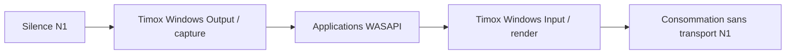

# Prototype natif Timox Windows Audio — N1

Ce projet produit un véritable binaire noyau `TimoxWindowsAudio.sys`, dérivé
du sous-ensemble PortCls/WaveRT de SysVAD. Il est distinct de `TimoxVasio.dll`.
Le build Release x64 passe avec W4/WX, InfVerif et ApiValidator Universal.
Il n'a pas été chargé : l'énumération et le fonctionnement WASAPI restent à
qualifier sur une machine de test. Le catalogue généré n'est pas signé.

Deux endpoints sont décrits, au format PCM signé 32 bits, stéréo, 48 kHz :

| Endpoint Windows | Sens | Comportement N1 |
|---|---|---|
| Timox Windows Input | application → render WaveRT | audio consommé puis abandonné |
| Timox Windows Output | capture WaveRT → application | silence initialisé explicitement |

Chaque endpoint expose un stream physique ; le partage entre applications
revient au moteur audio Windows. Aucun APO, offload, pin loopback, pilote
Bluetooth/USB ou générateur de sinus n'est inclus. Les buffers sont initialisés
et le remplissage du silence est borné à un tour de ring. Le timing et les
transitions WaveRT hérités du sample nécessitent encore qualification.
Le ring est limité à une seconde (384000 octets), avec des paquets alignés
sur les frames et une période de notification minimale de 1 ms. Le format
entrant doit déclarer un débit de 384000 octets/s et une extension contenue
dans la taille fournie. Ces règles partagées pilote/hôte sont exercées par
`NativeAudioGeometryTests`, en complément des tests du protocole N0.



L'identité PnP est `Root\TimoxWindowsAudio`, le service `TimoxWindowsAudio`
et les références KS sont `TimoxRenderWave`, `TimoxRenderTopology`,
`TimoxCaptureWave`, `TimoxCaptureTopology`. Les GUID de catégories KS restent
ceux de Windows ; ce ne sont pas des identités propriétaires à remplacer.
Le GUID du projet est propre à Timox. Aucun GUID de contrôle privé n'est encore
publié. La licence et le commit amont sont dans `THIRD_PARTY_NOTICES.md`.

## Reproduire le build

Préparer les dépendances épinglées avec les scripts décrits dans
[`../BUILDING.md`](../BUILDING.md), puis depuis la racine :

```powershell
git rev-parse --show-toplevel
git status --short
& 'C:/Program Files/Microsoft Visual Studio/18/Community/MSBuild/Current/Bin/amd64/MSBuild.exe' `
  native-windows-audio/driver/TimoxWindowsAudio.vcxproj `
  /p:Configuration=Release /p:Platform=x64 /p:SignMode=Off /m:1
```

Sortie : `build_native_windows_audio/x64/Release/TimoxWindowsAudio.sys`.
Ce build n'installe rien. La date INF est estampillée par WDK : reproductible
désigne ici la procédure et les dépendances, pas une identité binaire garantie.

Preuve locale du 22 octobre 2026 à 05:44:42 UTC : 58 368 octets, SHA-256
`ACBC01063A4BEEA82F4DD69BFE80206178280466C98214D843C57877FF2255E1`.
Le journal local est `build_native_audio_wdk/timox-driver-build.log`.
Cette empreinte décrit le build observé ; un rebuild peut la changer.

## Prochaine tranche N2

Relier les points `ReadBytes` (render) et `WriteBytes` (capture) au transport
privé N0, avec un contexte de génération attaché au moteur, des files bornées
préallouées et des statistiques de pertes. Le protocole portable ne constitue
pas encore une interface IOCTL. Définir et tester d'abord le contrôle sécurisé,
la durée de vie des buffers, la déconnexion et les transitions stop/reprise.
L'ACL audio publique de ce prototype ne doit pas servir à ouvrir le contrôle
privé : ce dernier devra autoriser exclusivement le service moteur prévu.

La conversion float/PCM32 et la compensation de dérive restent dans le moteur
utilisateur. Avant tout déploiement : revoir les chemins à IRQL élevé, les
annulations/PnP/power, puis tester en VM adaptée avec Driver Verifier, ouverture
WASAPI duplex, silence, pause/reprise, retrait et reprise après crash du moteur.
Tester aussi les requêtes KS avec PinId 0, 1, 2 et UINT_MAX, les tailles de
propriété tronquées et les échecs de mapping. Les handlers et prédicats bornent
désormais les indices ; cela ne constitue pas une validation dynamique de
sécurité. Les gardes de buffer vide évitent les modulos par zéro mais ne
remplacent pas la synchronisation du retrait du mapping avec les callbacks.
La signature et l'installation constituent un lot séparé ; aucune réussite
de build ne démontre leur disponibilité sur cette machine.
