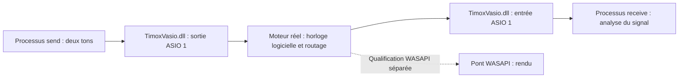

# Qualification par deux véritables clients ASIO

`AsioEngineSignalProbe` charge explicitement la DLL indiquée, obtient sa
`IClassFactory` et appelle l'interface `IASIO`. Il n'ouvre aucun mapping moteur,
ne simule aucune cadence et ne modifie ni registre ni configuration.



Le processus émetteur produit 997 et 1709 Hz, chacun à une amplitude de 0,0005.
La somme reste sous -60 dBFS crête. Le récepteur ignore deux secondes initiales,
puis analyse un nombre entier de secondes : amplitude de chaque composante,
énergie résiduelle, valeurs non finies, zéros et demandes de reset. Le niveau
attendu impose un routage à gain unitaire, sans mute. La phase est libre.
L'analyse exige chaque amplitude à ±2 % et un rapport signal/résidu supérieur à
50 dB. Une entrée silencieuse échoue. Le callback utilise une table préparée à
l'avance ; il ne réalise ni allocation, ni verrouillage, ni entrée/sortie.

## Exécution coordonnée

L'orchestrateur fourni automatise les deux clients, la route temporaire et sa
restauration. Il suppose que le moteur de qualification est déjà démarré avec
une horloge logicielle et sans autre client ASIO :

```powershell
pwsh -NoProfile -File tests/invoke-asio-engine-signal-probe.ps1 `
  -ApiPort 52526 `
  -DriverPath C:\chemin\TimoxVasio.dll `
  -ProbePath C:\chemin\AsioEngineSignalProbe.exe `
  -Seconds 5
```

Le script ne démarre ni n'arrête le moteur. Il archive sa configuration initiale,
les hashes des deux binaires, les états API et les résultats des sondes sous
`tests/results/asio-engine-<identifiant>/`. Il crée deux copies identiques de la
sonde, nommées `AsioSignal-send.exe` et `AsioSignal-receive.exe`, et vérifie leurs
hashes : la persistance des routes utilise le nom de l'application et serait
ambiguë entre deux instances du même nom. La restauration utilise une révision
optimiste : si une autre commande modifie la configuration, il échoue et laisse
un rapport `skipped-concurrent-change` au lieu d'écraser cette modification.
Le démarrage et la restauration du moteur installé restent à coordonner hors
du script.

Pour une qualification de signal coordonnée avec d'autres applications ASIO
encore ouvertes, ajouter explicitement `-AllowExistingClients`. Le comportement
par défaut reste strict : tout client préexistant interdit le test. Avec cette
option, le rapport archive les identités des clients observés et porte la mention
`shared client environment, not isolated performance evidence` lorsqu'ils sont
présents. Le script conserve les routes existantes et ne modifie ni leurs
profils, ni leurs processus. Ses contrôles de révision, sa route dédiée et sa
restauration conditionnelle restent actifs. Ce mode ne fournit pas une mesure
de performance isolée ; le moteur doit déjà avoir été préparé par
l'orchestrateur au format convenu avec les applications présentes.

Cette sonde est volontairement **hors CTest** : elle nécessite un moteur réel
et des routes temporaires. Elle ne doit pas être lancée automatiquement sur la
configuration audio de travail.

1. Vérifier la racine Git et son état. Construire la cible, puis enregistrer
   chemins absolus, dates et SHA-256 du moteur, de la DLL et de la sonde.
2. Arrêter de façon coordonnée le moteur habituel et ses relanceurs. Deux moteurs
   avec des ports API différents restent susceptibles d'accéder aux mêmes
   clients ASIO : le port ne fournit pas une isolation de transport.
3. Démarrer un moteur réel avec configuration temporaire, ou sauvegarder et
   restaurer explicitement sa configuration de travail. Choisir l'horloge
   `software`, 48 kHz et 256 frames, sans pilote physique.
4. Démarrer deux processus avec stdin/stdout redirigés :

   ```text
   AsioSignal-send.exe --dll C:\chemin\TimoxVasio.dll --role send --seconds 7
   AsioSignal-receive.exe --dll C:\chemin\TimoxVasio.dll --role receive --seconds 5
   ```

5. Attendre le JSON `event: ready` de chacun. Il fournit PID, fréquence et
   quantum. Les deux doivent correspondre au moteur. Les buffers ASIO sont
   créés, mais le flux n'a pas encore démarré.
6. Lire les endpoints réellement exposés par `/api/v1/state`. Configurer la route
   sortie 1 du PID émetteur vers entrée 1 du PID récepteur via l'API. Utiliser les
   IDs retournés par l'API, jamais un nom d'application ambigu entre deux
   instances. Vérifier l'acquittement et la route dans l'état moteur.
7. Écrire `start` suivi d'un saut de ligne sur stdin de l'émetteur puis du
   récepteur. Conserver moins d'une seconde entre les deux. L'émetteur dispose
   de deux secondes supplémentaires pour ne pas s'arrêter pendant l'analyse.
8. Attendre les JSON `event: result` et les codes de sortie zéro des deux
   processus. Vérifier également dans l'API que l'horloge effective est
   logicielle et conserver les métriques moteur. Archiver les résultats,
   paramètres de route et provenance des binaires ensemble.
9. Retirer les routes temporaires, arrêter le moteur de qualification, restaurer
   la configuration et relancer le fonctionnement habituel, y compris en cas
   d'échec. Ne terminer que les PID créés par l'orchestrateur.

Le délai du flux est borné à durée demandée + 12 secondes ; la barrière stdin
reste sous le contrôle de l'orchestrateur, qui doit imposer son propre timeout.
La sonde accepte de 1 à 1200 secondes ; le script accepte de 1 à 1198 secondes,
car il réserve deux secondes supplémentaires à l'émetteur. Une exécution de
dix minutes utilise `-Seconds 600`. Les tables préallouées ne grandissent pas
avec la durée du test.

## Portée de la preuve

### Trajet WASAPI réel

Le mode explicite suivant crée un pont de rendu et un pont de loopback du même
endpoint, puis deux routes indépendantes : sortie ASIO du sender → rendu WASAPI,
et capture loopback → entrée ASIO du receiver. Il n'y a aucune route du loopback
vers ce rendu, donc aucune boucle de retour. L'ID de l'endpoint doit être choisi
par l'orchestrateur, par exemple après résolution de la sortie multimédia par
défaut ; le script n'en choisit pas un arbitrairement.

```powershell
pwsh -NoProfile -File tests/invoke-asio-engine-signal-probe.ps1 `
  -ApiPort 52526 -DriverPath C:\chemin\TimoxVasio.dll `
  -ProbePath C:\chemin\AsioEngineSignalProbe.exe -Seconds 5 `
  -RouteMode WasapiLoopback -WasapiEndpointId '{0.0.0.00000000}.{identifiant-reel}'
```

Le script crée les bridges avant de découvrir leurs ports réels. Une seconde
transaction installe les routes. Même si cette seconde étape échoue, la première
configuration est restaurée si la révision et les identifiants du test prouvent
qu'elle appartient toujours à cette exécution. Les compteurs de frames rendues
et capturées doivent progresser, sans erreur de bridge, et sont archivés avec
les états complets. L'option `-AllowExistingClients` reste disponible avec les
limites précédemment décrites.

Dans ce mode, le récepteur analyse des fenêtres de 25 ms après les deux secondes
de préchauffe. Les projections complexes à 997 et 1709 Hz sont combinées en
puissance entre fenêtres : les phases ne doivent pas rester identiques pendant
tout le test. Une fenêtre est conforme si chaque amplitude dépasse 1e-7,
chaque composante représente au moins 15 % de la puissance totale, leur somme
au moins 70 %, et leur rapport d'amplitude reste entre 0,5 et 2. Au moins 90 %
des fenêtres complètes doivent être conformes, avec au moins vingt fenêtres.
La fraction finale de fenêtre est ignorée. Les valeurs non finies et les resets
font toujours échouer la sonde.

Ce contrôle établit la présence de deux composantes proches des fréquences
émises malgré la dérive et le volume Windows. Il ne mesure pas précisément leurs
fréquences et ne constitue **ni une mesure SNR, ni une qualification de latence
ou de stabilité sans glitch**. Les champs de corrélation longue `amplitude997`,
`amplitude1709` et `snrDb` valent `null` dans ce mode : ils ne sont pas interprétables
sur des horloges libres. `rms` et les deux `windowAmplitude` restent des mesures.
`qualificationScope: tone-presence-only`, `analysis: bridge-tone-presence`, `toneWindows` et
`matchedToneWindows` indiquent le critère réellement utilisé. Le mode par défaut
`AsioDirect` conserve ses seuils stricts d'amplitude et de SNR.

`AsioEngineSignalProbe --self-test-analysis` ne charge aucune DLL et n'émet aucun
son. Il vérifie vingt-quatre cas à 44,1/48/96 kHz : phases libres, dérive ±0,4 %,
atténuation de 40 dB, puis refus du silence, d'un ton à 1100 Hz, d'un bruit
déterministe, d'un seul des tons attendus et de NaN.

Le résultat bridge comprend aussi `toneDiagnostics`, sans changer le critère
de réussite. Les statistiques couvrent toutes les fenêtres complètes : nombre
de rejets, longueur et début de la plus longue suite de rejets, et compteurs de
motifs. Seules les seize premières fenêtres rejetées et la dernière gardent
leurs métadonnées détaillées ; `omittedRejectedWindows` compte les autres.
Le stockage est fixe, sans PCM conservé ni allocation ajoutée au callback.
L'impression JSON intervient après l'arrêt du callback.

| Bit de `reasonMask` | Critère non satisfait |
|---|---|
| 1 | Au moins une valeur non finie |
| 2 / 4 | Amplitude 997 / 1709 Hz insuffisante |
| 8 / 16 | Fraction d'énergie 997 / 1709 Hz insuffisante |
| 32 | Fraction d'énergie combinée insuffisante |
| 64 | Rapport d'amplitude des deux tons hors limites |

Plusieurs motifs peuvent concerner une même fenêtre ; leur somme peut donc
dépasser le nombre de rejets. Chaque détail contient RMS, crête, amplitudes,
fractions d'énergie, nombres de zéros exacts et d'échantillons dont la valeur
absolue atteint 0,999. `windowIndex` est indexé depuis zéro ; `startSeconds` est
relatif au début de l'analyse **après** la préchauffe, et utilise la durée réelle
de fenêtre arrondie au nombre entier de frames. Les fractions sont des
projections de fenêtres courtes, pas un partage spectral exact ni un SNR.

Ces indices permettent de comparer un affaiblissement des deux tons, une hausse
d'énergie extérieure aux tons ou des suites de silence. Ils n'identifient pas
avec certitude une perte, une contamination Windows, un saut de phase ou un
défaut de ratio. Les premières fenêtres conservées ne constituent pas un
échantillon représentatif de tous les rejets. L'autotest vérifie également la
troncature des métadonnées, les motifs et deux suites connues de silence
intermittent, tout en conservant la tolérance de présence initiale de 90 %.

### Stabilité observée des ponts

Ajouter `-RequireStableBridges` au mode `WasapiLoopback` pour exiger une preuve
distincte de la présence des tons. Ce mode demande `-Seconds` au moins égal à
10. Exemple d'endurance : `-Seconds 600 -RequireStableBridges` ; on peut fixer
explicitement `-MinimumStableSeconds 590`. Sans valeur explicite, la durée
minimum observée vaut `max(1, Seconds - 5)`.

Le script interroge l'API approximativement chaque seconde pendant que les
deux sondes sont vivantes et archive les états complets, leur temps monotone
écoulé et leur date UTC dans `stability-snapshots.jsonl`. La référence est prise
après au moins deux secondes, uniquement lorsque les deux ponts sont `running`,
sans erreur ni `primingTimedOut`. Les incidents de démarrage déjà comptés sont
conservés dans cette référence, pas effacés.

Après cette référence, chaque échantillon doit conserver les générations et
l'état `running`, sans erreur ni timeout. Les deltas doivent rester exactement
nuls pour `droppedCaptureFrames`, `rejectedFrames`, `renderSilencedInputFrames`,
`silencedFrames`, `timestampErrors`, `discontinuities` et
`renderSilencedDeviceFrames`. Une diminution de compteur, une donnée absente,
une reconnexion ou une requête d'état échouée fait échouer ce contrôle. Les
niveaux de remplissage et corrections ppm sont archivés sans seuil arbitraire.
Les compteurs natifs `renderedFrames` du pont de rendu et `capturedFrames` du
loopback doivent progresser entre **chaque paire d'états consécutifs**, pas
seulement depuis la référence initiale. Le type effectif de chaque pont est
vérifié. Un état figé, une régression ou un écart de sondage supérieur à 2,5
secondes échoue, même si l'état affiché reste `running`.

Le rapport sépare `signalPresencePassed` et `stabilityPassed`. L'option exige
les deux pour le succès global, ainsi que le nettoyage/restauration habituels.
Il donne `baselineElapsedSeconds`, `lastElapsedSeconds`, `observedSeconds`, le
nombre d'échantillons et leur écart maximal réel. La période s'arrête au dernier
état reçu pendant que les deux sondes tournent ; les deux secondes finales du
sender seul en sont exclues. **600 secondes demandées ne signifient donc pas
600 secondes de stabilité observée.** Une référence jamais disponible ou une
durée observée insuffisante échoue.
`observedSeconds` reste la durée entre premier et dernier états observés en cas
d'incident ; seule la valeur `stabilityPassed` détermine si cette période satisfait
les critères.

Ce contrôle porte sur les compteurs cumulatifs et les états exposés par le
moteur. Il n'est pas une preuve de latence, de qualité subjective, de performance
isolée, ni de détection de toute transition d'état survenant entre deux sondages.
Les tests hors ligne `pwsh -File tests/wasapi-stability.Tests.ps1` vérifient entre
autres les incréments de chaque compteur, leur remise à zéro, les reconnexions,
les états manquants et un incrément unitaire au-delà de la précision des doubles.

Un succès en mode `AsioDirect` démontre un trajet numérique entre deux véritables instances de la
DLL ASIO à travers le moteur. Il ne suffit pas à qualifier toutes les applications
ASIO du marché, la latence aller-retour, le comportement sous charge, ou WASAPI.

Le mode WASAPI peut être perturbé par les autres sons joués sur le même endpoint,
car le loopback observe le mélange Windows. Les seuils de présence ne doivent
pas être abaissés après un échec pour faire passer un enregistrement contaminé.

La sonde ne doit pas être présentée comme ayant réussi tant que les deux
processus n'ont pas été exécutés avec un moteur réel et les résultats archivés.
