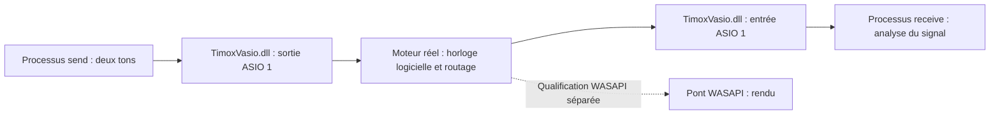

# Qualification par deux véritables clients ASIO

`AsioEngineSignalProbe` charge explicitement la DLL indiquée, obtient sa
`IClassFactory` et appelle l'interface `IASIO`. Il n'ouvre aucun mapping moteur,
ne simule aucune cadence et ne modifie ni registre ni configuration.



Le processus émetteur produit 997 et 1709 Hz, chacun à une amplitude de 0,0005.
La somme reste sous -60 dBFS crête. Le récepteur ignore deux secondes initiales,
puis analyse un nombre entier de secondes : amplitude de chaque composante,
énergie résiduelle, valeurs non finies, zéros et demandes de reset. Le niveau
attendu impose un routage à gain unitaire, sans mute. La phase est libre.
L'analyse exige chaque amplitude à ±2 % et un rapport signal/résidu supérieur à
50 dB. Une entrée silencieuse échoue. Le callback utilise une table préparée à
l'avance ; il ne réalise ni allocation, ni verrouillage, ni entrée/sortie.

## Exécution coordonnée

L'orchestrateur fourni automatise les deux clients, la route temporaire et sa
restauration. Il suppose que le moteur de qualification est déjà démarré avec
une horloge logicielle et sans autre client ASIO :

```powershell
pwsh -NoProfile -File tests/invoke-asio-engine-signal-probe.ps1 `
  -ApiPort 52526 `
  -DriverPath C:\chemin\TimoxVasio.dll `
  -ProbePath C:\chemin\AsioEngineSignalProbe.exe `
  -Seconds 5
```

Le script ne démarre ni n'arrête le moteur. Il archive sa configuration initiale,
les hashes des deux binaires, les états API et les résultats des sondes sous
`tests/results/asio-engine-<identifiant>/`. Il crée deux copies identiques de la
sonde, nommées `AsioSignal-send.exe` et `AsioSignal-receive.exe`, et vérifie leurs
hashes : la persistance des routes utilise le nom de l'application et serait
ambiguë entre deux instances du même nom. La restauration utilise une révision
optimiste : si une autre commande modifie la configuration, il échoue et laisse
un rapport `skipped-concurrent-change` au lieu d'écraser cette modification.
Le démarrage et la restauration du moteur installé restent à coordonner hors
du script.

Pour une qualification de signal coordonnée avec d'autres applications ASIO
encore ouvertes, ajouter explicitement `-AllowExistingClients`. Le comportement
par défaut reste strict : tout client préexistant interdit le test. Avec cette
option, le rapport archive les identités des clients observés et porte la mention
`shared client environment, not isolated performance evidence` lorsqu'ils sont
présents. Le script conserve les routes existantes et ne modifie ni leurs
profils, ni leurs processus. Ses contrôles de révision, sa route dédiée et sa
restauration conditionnelle restent actifs. Ce mode ne fournit pas une mesure
de performance isolée ; le moteur doit déjà avoir été préparé par
l'orchestrateur au format convenu avec les applications présentes.

Cette sonde est volontairement **hors CTest** : elle nécessite un moteur réel
et des routes temporaires. Elle ne doit pas être lancée automatiquement sur la
configuration audio de travail.

1. Vérifier la racine Git et son état. Construire la cible, puis enregistrer
   chemins absolus, dates et SHA-256 du moteur, de la DLL et de la sonde.
2. Arrêter de façon coordonnée le moteur habituel et ses relanceurs. Deux moteurs
   avec des ports API différents restent susceptibles d'accéder aux mêmes
   clients ASIO : le port ne fournit pas une isolation de transport.
3. Démarrer un moteur réel avec configuration temporaire, ou sauvegarder et
   restaurer explicitement sa configuration de travail. Choisir l'horloge
   `software`, 48 kHz et 256 frames, sans pilote physique.
4. Démarrer deux processus avec stdin/stdout redirigés :

   ```text
   AsioSignal-send.exe --dll C:\chemin\TimoxVasio.dll --role send --seconds 7
   AsioSignal-receive.exe --dll C:\chemin\TimoxVasio.dll --role receive --seconds 5
   ```

5. Attendre le JSON `event: ready` de chacun. Il fournit PID, fréquence et
   quantum. Les deux doivent correspondre au moteur. Les buffers ASIO sont
   créés, mais le flux n'a pas encore démarré.
6. Lire les endpoints réellement exposés par `/api/v1/state`. Configurer la route
   sortie 1 du PID émetteur vers entrée 1 du PID récepteur via l'API. Utiliser les
   IDs retournés par l'API, jamais un nom d'application ambigu entre deux
   instances. Vérifier l'acquittement et la route dans l'état moteur.
7. Écrire `start` suivi d'un saut de ligne sur stdin de l'émetteur puis du
   récepteur. Conserver moins d'une seconde entre les deux. L'émetteur dispose
   de deux secondes supplémentaires pour ne pas s'arrêter pendant l'analyse.
8. Attendre les JSON `event: result` et les codes de sortie zéro des deux
   processus. Vérifier également dans l'API que l'horloge effective est
   logicielle et conserver les métriques moteur. Archiver les résultats,
   paramètres de route et provenance des binaires ensemble.
9. Retirer les routes temporaires, arrêter le moteur de qualification, restaurer
   la configuration et relancer le fonctionnement habituel, y compris en cas
   d'échec. Ne terminer que les PID créés par l'orchestrateur.

Le délai du flux est borné à durée demandée + 12 secondes ; la barrière stdin
reste sous le contrôle de l'orchestrateur, qui doit imposer son propre timeout.

## Portée de la preuve

Un succès démontre un trajet numérique entre deux véritables instances de la
DLL ASIO à travers le moteur. Il ne suffit pas à qualifier toutes les applications
ASIO du marché, la latence aller-retour, le comportement sous charge, ou WASAPI.

Pour la suite WASAPI, dupliquer la sortie vers un pont de rendu puis capturer
l'endpoint par loopback. Conserver la mesure de fréquence/compensation de dérive
et employer une analyse adaptée à deux horloges libres : les seuils cohérents
de cette sonde app→app ne sont pas directement des seuils SRC. Ne pas boucler
la capture d'un endpoint vers le rendu du même endpoint.

La sonde ne doit pas être présentée comme ayant réussi tant que les deux
processus n'ont pas été exécutés avec un moteur réel et les résultats archivés.
